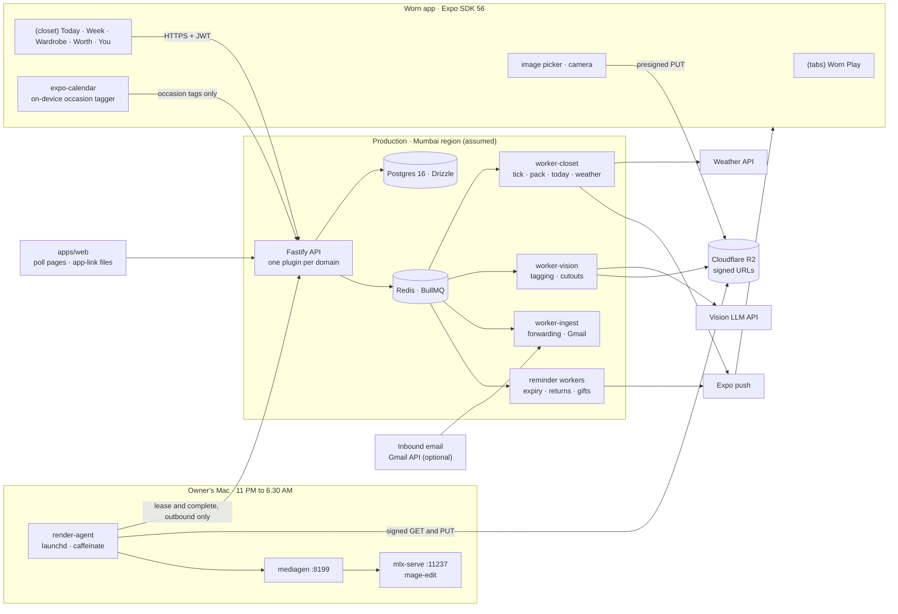
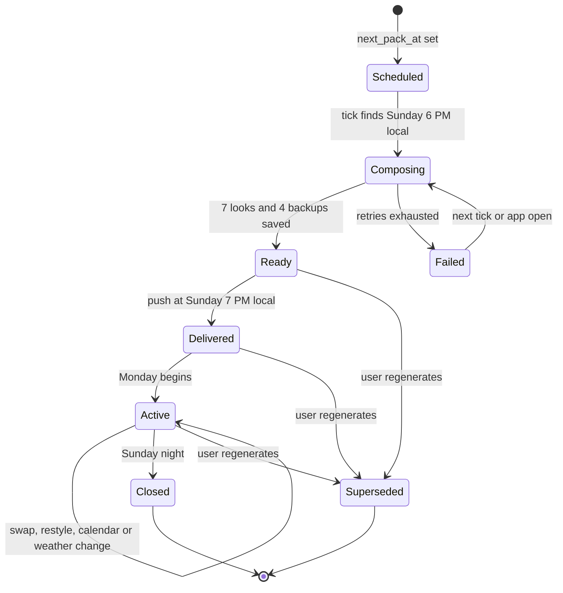
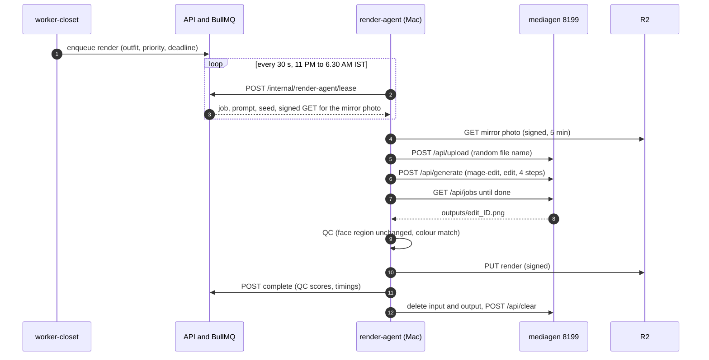
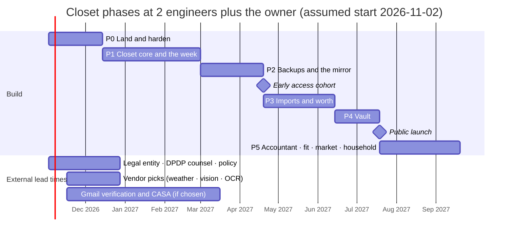

# WORN CLOSET — Implementation Plan

> The engineering plan for **Worn Closet**, the next chapter of Worn, as the `/closet` page describes it (`apps/web/src/app/closet/page.tsx` and `apps/web/src/components/closet/*` in this worktree).
> The product is a stylist and back office for clothes you already own. It plans Monday to Sunday from your closet, packs four backups, shows the pick on you, counts wears and cost per wear, keeps the money paperwork, and helps the pile leave.
> This doc covers what exists today, the target architecture, the data model, the API, the mobile app, jobs, integrations, the AI pipeline, render capacity, DPDP, phases with estimates, the definition of done every build task meets, tests, risks, the page-vs-plan table, why the phases come in this order, open questions and assumptions, and next steps.
> Status (2026-10-25): **code work has started.** Two pieces are under way in separate worktrees:
> - landing the universe tree onto `main`, together with this branch's commits, plus the §3.0 migration reset;
> - the week composer, written as pure modules in `packages/shared` to §3.3, §4.4 and §8.4–§8.7.
>
> Writing this plan changed no code and ran no builds, tests or generation jobs. Where the code and this plan disagree on a name, the code wins and the plan gets updated.

**How to read code references**

| Tag | Meaning |
|---|---|
| `[U]` | **The universe tree.** This is the uncommitted working tree in the main checkout `/Users/kandarp/startups/shopoholia`, on branch `feat/universe-p0-spine` at `ab43455` (2026-07-24) plus uncommitted changes. Almost all Closet code lives only here. **A path with no tag refers to `[U]`.** |
| `[main]` | The `main` branch at `1c75306`. |
| `[site]` | This worktree's uncommitted website work (`apps/web/src/components/closet/*`), which is the copy this plan has to make true. |

Path short forms:

| Short form | Full path |
|---|---|
| `api/` | `apps/api/src/` |
| `mob/` | `apps/mobile/` |
| `sh/` | `packages/shared/src/` |
| `db/` | `packages/db/src/` |
| `ww/` | `services/worker-wardrobe/src/` |

Line numbers are as read on 2026-10-25 and 2026-10-26, and will drift.

---

## At a glance

- **The code is mostly there, but none of it is committed, and the parts that matter most are stubs.**
  - Committed: none of the Closet code. About 36 tables, 17 screens and 6 new worker services sit uncommitted on a branch 23 commits behind `main`.
  - Stubbed or fake: the week planner repeats three pieces across all seven days. Weather and calendar are fake. The workers start and exit at once, and there is no scheduler.
  - Unsafe: erase leaves photos behind, and the consent log is deleted on erase.
- **Recommended order:**

  | Step | Phase | Ends (2 engineers, start 2026-11-02) |
  |---|---|---|
  | 1 | **P0** Land and harden | around 2026-12-14 |
  | 2 | **P1** Closet core and the week | around 2027-03-01 |
  | 3 | **P2** Backups and the mirror | early access around 2027-04-19 |
  | 4 | **P3** Imports and worth | around 2027-06-14 |
  | 5 | **P4** Vault | public launch around 2027-07-19 |
  | 6 | **P5** Accountant, fit, market, household, gifts | around 2027-09-20 |

  This reverses the old order (P0 spine → P1 gift-card/warranty → P2 wardrobe/outfits/waste → P3 accountant/returns → P4 gift/fit/disposition/concierge). The reasons are in §15.
- **Effort is 70–103 engineer-weeks.**
- **Render capacity on one Mac is far below "~1,000 users" if every look is rendered.**
  - Rendering every look (12 renders per user per week) caps out at about 100–150 weekly active users.
  - About 1,000 registered users fits only if all of these hold: around half are weekly active, renders are rationed, the busiest night is spread out, and the Mac is dedicated to rendering.
  - The cloud path should be ready by about 250 weekly active users (§9).
- **The page promises more than the code can deliver before launch.** 43 lines need rewording, two sample lines contradict each other, and Saturday's sample look has no shoes. The Accountant, Market, Fit and Household groups need a "coming later" label or have to wait for P5 (§14).
- **Production grade has a definition of done** (§11.6). Every task needs green checks; auth, ownership and zod on every route; an index behind every query; clean migrations; idempotent jobs with retries and a durable dead-letter; and virtualised lists with cached images and loading, empty and error states. Budgets are stated as targets. Today's code misses several of these. For example, one unauthenticated route grants trials to any user id, dead letters are kept only in memory, and closet lists nest a fixed-height list inside a scroll view.

---

## 0. Reality check (read first)

### 0.1 Where the code is

**All Closet code is uncommitted.**
- It sits in the main checkout on `feat/universe-p0-spine` (`ab43455`), 23 commits behind `main`.
- What is there:
  - 36 new tables;
  - a `(closet)` route group of 17 screens (9,798 lines);
  - 16 API libs that queue jobs;
  - six new worker services (expiry, gifts, ingest, nudge, returns and wardrobe), alongside Play's worker-orders and worker-render.
- None of it is on a remote. One wrong checkout, a bare `git stash` or a disk failure would lose it.
- Another session may be using that checkout: five mobile UI files changed there on 2026-10-23.

**`main` has moved on.**
- `main` added:
  - access-token renewal (`cbd31fd`: `mob/app/_layout.tsx`, `mob/src/api/client.ts` +232 lines, `mob/src/stores/session.ts`);
  - order pushes on `expo-notifications ~56.0.18`;
  - Sentry and PostHog;
  - migrations `0005_listing_price_links`, `0006_refresh_tokens` and `0007_lookbook_items`.
- This worktree's branch adds two more commits that aren't pushed: `f4a2156` (stable presigned URLs) and `54d6c4c` (mobile caches).
- Merging the universe tree will conflict in the app shell, the API client, the session store and push.

**The migrations have drifted.**
- There are 34 SQL files but only 29 journal entries (up to `0028_concierge_consent`).
- Snapshots exist only for `0000` and `0005`–`0012`.
- Five files are never applied: `0024_household_borrow_profiles`, `0024_tailor_marketplace`, `0025_rto_size_repair`, `0029_useful_returns_packages` and `0029_useful_u026_u030`.
- Numbers repeat, and they collide with `main`'s `0005`–`0007`.

**Nothing runs in production.**
- The workers never start:
  - `services/*/src/index.ts` only exports factories, so `node dist/index.js` loads and then exits.
  - There is no Dockerfile, Procfile or hosting config.
  - There is no scheduler: no cron, no repeat jobs, no `upsertJobScheduler`, no `setInterval`.
- Queued jobs are skipped:
  - `apps/api` has no `bullmq` dependency, only `src/types/bullmq.d.ts`.
  - Its 16 queue-producing libs call `await import("bullmq")` and return `"skipped"` when `REDIS_URL` is unset or the import fails.
- Seven queues have no consumer at all: `cal-event-outfit`, `cooling-off-release`, `emi-due`, `interview-kit`, `lent-overdue`, `price-drop` and `ingest-dead-letter`.
- `infra/docker-compose.yml` [main] runs Postgres 16 and Redis 7 for local use only.

**Release builds call localhost, on `main` too.**
- `mob/app.json` sets `extra.apiUrl: "http://localhost:3000"`, which takes precedence over `EXPO_PUBLIC_API_URL`.
- `eas.json` sets no environment variables for any profile.
- Unless something outside the repo overrides this, TestFlight and Play internal builds can't reach an API. The site's CTA says Play is in early access "through TestFlight and Play internal testing", so the owner should confirm those builds actually work.

The backend in `[U]` hasn't changed since 2026-08-27.

### 0.2 Claims vs code

| Claim | Where it's made | What the code shows |
|---|---|---|
| 96.81% test coverage | `docs/UNIVERSE_QA_REPORT.md` l822, l863 | The figure is `@worn/mobile` line coverage over a hand-picked `include` list (`mob/vitest.config.ts:17–38`). The list covers UI components, the Closet hooks and stores, the session store and 15 lib files, and no `app/` screen. The gate is 55% of lines (l48). Of the 120 mobile test files, three render screens, all of them Play's (`src/screens/checkout`, `reveal` and `order-tracking`). None renders a Closet screen. |
| CASA track under way | `CASA.md` l50-60 | 0 of 9 items are ticked. `scripts/check-casa-track.mjs` only checks, with regexes, that the docs and a few app source files contain certain text. |
| Children handled | `TRUST_DPDP_GDPR.md` D8 | The doc says "age gate TBD", and `closet_profiles.kind` defaults to `KID`. |
| Privacy policy ready | `PRIVACY_POLICY_DRAFT.md` | The legal entity is TBD, the contact is a placeholder `privacy@worn.app`, and the grievance contact is TBD (l93-94). |
| Gmail import works | `api/routes/ingestion.ts`, `services/worker-ingest/src/connectors/gmail.ts` | OAuth starts, but then it breaks: <br>• The callback (`ingestion.ts:385`) is unauthenticated and returns JSON 202 to a browser (l481). <br>• No first sync runs: the OAuth job (`worker-ingest/src/index.ts:627–648`) never schedules one. <br>• `GOOGLE_CLIENT_ID` falls back to `"MISSING_GOOGLE_CLIENT_ID"` (`ingestion.ts:112`, `worker-ingest/src/index.ts:432`) and `GOOGLE_CLIENT_SECRET` to `""` (l439). <br>• The app opens it with `openBrowserAsync`, which can't return to the app. |
| SMS import | `POST /ingestion/sms`, `mob/` | There is no native SMS module, so no messages ever come back. `READ_SMS` in `app.json` would get the app rejected on Google Play. |
| Week planner | `POST /outfits/week/generate` | It puts the same three pieces on all seven days. Its test only checks that seven outfits exist. |
| Daily outfit push | `api/lib/wardrobe-jobs.ts`, `ww/handler.ts` | It is scheduled only when someone opens `/outfits/today`. The worker stub picks the first three items and a fake 26 °C. Quiet hours are in UTC, so a 07:00 push lands around 12:30 IST. |
| Consent ledger and hard delete | `api/routes/vault.ts`, `api/lib/audit.ts` | Consent rows are deleted on erase and carry no notice version. `GrantConsentBodySchema` (`sh/schemas/consent.ts:24–29`) requires a `userId` that the route ignores; it uses the token's user (`vault.ts:262`). That is a contract to fix, not an ownership hole. The audit log lives in memory (5,000 rows). Erase leaves photos, renders, jobs and vendor copies behind. |

### 0.3 Promise-by-promise inventory

Status:
- **Real:** works as the page promises, apart from hardening.
- **Partial:** some of it works.
- **Stub:** the code path exists but returns mock or fake data.
- **Missing:** nothing exists yet.

| # | Promise (page section) | Status | Code today | Gap to close | Phase |
|---|---|---|---|---|---|
| 1 | The week, Mon–Sun, planned from your clothes every Sunday evening (Week) | Partial | `GET /outfits/week?weekStart` and `PATCH /outfits/week/:date` (`api/routes/outfits.ts`) are sound in structure. | The generator repeats three pieces across all seven days. Dates are UTC, so on a Sunday it returns the week that is ending. There is no Sunday job. | P1 |
| 2 | Planned around your calendar (Week) | Stub | `sh/cal-event-outfit.ts` matches keywords. `mob/src/lib/deviceCalendar.ts` and `calendarPermission.ts` are stubs that send fake events ("Onsite interview", "Office standup", "Cousin shaadi reception") to `POST /outfits/from-calendar`, which saves real outfits and queues pushes. | Read the device calendar and tag events on the device. Delete the fake events. | P0 (delete fakes), P1 |
| 3 | Planned around the weather (Week, Today) | Stub | `api/lib/weather.ts` returns a random 18–33 °C unless `WEATHER_API` is set. Bengaluru is hardcoded (12.97, 77.59) and there is no forecast, so users see "Weather 26°C, sunny (mock)". `weather-reroll.ts` swaps before noon on a ≥5 °C change, using server time. | A forecast provider, a city cell per user, local time | P1 |
| 4 | "Packed Sunday, 7:00 PM" (Week) | Missing | — | A scheduler, the pack job and the push | P1 |
| 5 | Four backups from four checks (Week, Backups) | Missing | — | Coverage, fit, hair and evening attributes, plus a backup composer | P2 |
| 6 | A "why" line for each day and the stylist's note (Week, Stylist) | Missing | — | Note templates driven by rule hits | P1 |
| 7 | "The outfit, the shoes, the bag and the earrings, all things you already own" (Stylist) | Partial | `api/lib/outfit-rank.ts` takes the top three items whatever their type and adds +5 for often-worn pieces. Slots exist in `api/lib/outfit-goes-with.ts` but only some helpers use them. `api/lib/outfit-accessories.ts` adds at most one accessory and never shoes. | A composer built on slots | P1 |
| 8 | "Tell it how today is and it restyles" (Stylist, Value) | Missing | — | `POST /outfits/today/restyle` | P2 |
| 9 | The pick on you, in the mirror (Stylist, Today "Avatar try-on") | Partial | Play's FASHN try-on (`api/routes/wardrobe.ts:1480`) runs synchronously with no limits. With no avatar it caches a missing path, and when a try-on fails it caches the garment photo as if it were the try-on. | Mirror-photo consent and photo, overnight mage-edit renders, and fixes for both bugs | P2 |
| 10 | Friend polls (Stylist, Today) | Partial | `api/routes/social-polls.ts` and `api/lib/social-poll-store.ts` keep polls in memory with a 72 h expiry, 2–3 options and unlimited votes. The share link `https://worn.app/p/outfit/{id}` has no page behind it. | Store polls in Postgres, allow one vote per voter, add a web vote page | P2 |
| 11 | Hang tag "Worn N× · ₹X a wear · Last worn" and cost per wear falling (Stylist, Value, Worth) | Partial | `POST /wear`, `POST /wear/photo` and `DELETE /wear/:id` (10-minute undo) are in `wardrobe.ts:1551–1745` and `postgres.ts:2696`, with an `item_metrics` table. | The update isn't atomic, and a back-dated wear overwrites a newer last-worn date. Cost per wear is empty when the price is 0, which is every manual and photo-dump item. | P1 |
| 12 | Forgotten pieces, worn again (Value) | Partial | The waste heuristics work. The outfit ranker gives often-worn pieces +5, which is the opposite. | A "forgotten" boost in the composer | P1 |
| 13 | A morning outfit using weather, calendar and laundry, in one notification (Today) | Partial | <br>• Generator: `generateOutfitForUser` (`outfits.ts` ~140–330). <br>• `GET /outfits/today?alt=n`: needs the `outfits` entitlement. <br>• `scheduleMorningOutfit` (`api/lib/wardrobe-jobs.ts`, jobId `outfit:{userId}:{date}`): only called from `outfits.ts:324`. <br>• `ww/handler.ts`: a stub that takes the first three items at 26 °C and saves an undated outfit, so the push can disagree with `/today`. <br>• Laundry rules: in memory (`api/lib/closet-ops-prefs.ts:15`). <br>• The deep link `worn://today?focus=outfit` works. | A Today job driven by the week plan, a push in local time, laundry rules that persist | P1 |
| 14 | One-tap imports from order emails, "matched to the right product", with brand, price, size and materials (Wardrobe, Hero) | Partial | <br>• Import paths: Gmail OAuth plus `GET /wardrobe/importable-purchases` and `POST /wardrobe/from-purchases`. <br>• Parsers: amazon, flipkart, myntra, swiggy, zomato and a generic one. <br>• `ParsedPurchaseItem` holds only `{title, category?, brand?, priceMinor, qty, imageKey?}`. <br>• The generic parser invents one item equal to the order total (`generic.ts:163-169`). <br>• Items are capped at 10. | Forwarding, fashion parsers that read size and colour, purchase candidates and dedupe. Nothing matches against a product catalog, so soften that claim. | P3 |
| 15 | Photo-dump triage, with AI tagging colour, category, season and feel (Wardrobe) | Stub | `POST /wardrobe/photo-dump` with triage and undo works. `POST /wardrobe/autotag` (`api/lib/wardrobe-vision.ts`, `sh/wardrobe-autotag.ts`) guesses from the file name, and its hosted mode sends only the storage key to a service that doesn't exist. Duplicate detection compares text only. | Vision tagging, cutouts, image-based dedupe | P1 |
| 16 | Lend and borrow tracked (Wardrobe) | Partial | The `lent_*` columns exist. The `lent-overdue` queue has no consumer, there's no "borrowed from" tracking, and `Alert.prompt` is iOS-only, so Android saves every borrower as "Friend". | Borrow tracking, reminders, a cross-platform input | P1 |
| 17 | Capsules, laundry rules, an automatic seasonal swap (Wardrobe) | Partial | Capsules, rotation and `POST /wardrobe/seasonal-swap` are real heuristics, but the swap only runs when asked. Capsule IDs live in `users.consent_flags`, where every save overwrites the whole object (a race). Laundry rules are in memory. | Persist the rules. Turn the swap into a nudge. | P1 (laundry), P3 (swap nudge) |
| 18 | Care-label OCR, dry-clean tickets, shoe and bag rotation (Wardrobe) | Partial | OCR (`api/lib/ocr/`, `POST /wardrobe/:id/care-ocr`, `/care-ocr/photo`) is a mock unless `OCR_PROVIDER_URL` is set; the Google Vision format is supported. Dry-clean works (the `dry-clean-pickup` consumer). `GET /wardrobe/rotation` (`api/lib/shoe-bag-rotation.ts`) is a working heuristic. | A real OCR provider, nudges through reminders | P3 |
| 19 | Concierge cataloguing, "coming soon" (Wardrobe) | Missing | Only a consent migration exists (`0028_concierge_consent`). | There is no plan for it. Remove it from the page. | — |
| 20 | Cost per wear, live, "on everything you own" (Worth) | Partial | Same as #11. | Only priced items can show it | P1 |
| 21 | Wear streaks paid in gold coins (Worth) | Partial | `GET /waste/rewear-streak` and a milestone push. No coins are paid. | Credit coins on the coin ledger | P3 |
| 22 | The waste tracker totals "every rupee" of unworn stock (Worth) | Real (heuristic) | `GET /waste/summary`, `/waste/dead`, replacement suggestions, dispose and a never-worn ₹ total all work. Cost-per-wear goals work. The CO₂ and water figures are constants. | Count unpriced items separately. Label CO₂ and water as estimates or drop them. | P3 |
| 23 | Rewear challenges with friends (Worth) | Partial | Challenges are held in memory (`waste.ts:30`) and have no friends. | Store them in Postgres, add invites | P3 |
| 24 | A gift-card vault with balances and expiry rescue (Vault) | Partial | <br>• Works: `money_accounts` (including `GIFT_CARD`) and the double-entry `money_ledger` (`db/schema/money.ts`, `queries/money.ts` `postLedgerEntry`), and `routes/credits.ts`. <br>• No column for the card code or PIN. <br>• `lib/expiry.ts` sends one push at 7 days but never fires. <br>• `lib/balance-check.ts` echoes back whatever balance the user entered. <br>• `sh/merchantDeepLink.ts` links to merchant homepages with affiliate tags (`tag=shopoholia-21`, `affid=yourshopoholia`). | Encrypted codes, reminders at 30, 7 and 1 days, and "last known balance" wording | P4 |
| 25 | "Warranty claims, filed", with deadlines and nudges (Vault) | Partial | A `warranties` table and a `warranty-expiry` consumer (in a worker that never runs). "Claim" only flips a state. | Reminders and a claim kit. "Filed" needs rewording. | P4 |
| 26 | A refund ledger with ETAs, and chasing that "flags the merchant" (Vault) | Partial | Returns work: 17 endpoints in `routes/returns.ts` and a state machine in `lib/returns/state-machine.ts`. The ETA is fixed at +10 or +5 days, "chase" is only a snooze or escalate flag, and pickup is a stub. | ETAs from each merchant's policy, and a nudge that shows the merchant's contact | P4 |
| 27 | A receipts vault, searchable and export-ready (Vault) | Stub | The OCR mock invents "Amazon/Croma/Mock Mart" receipts with no purchase date. Search runs in memory, and the export is a `data:` URI. | Real OCR, Postgres full-text search, an async export | P4 |
| 28 | A closet P&L, including what it's "worth today" (Accountant) | Partial | `routes/accountant.ts` has 14 endpoints, but "worth today" doesn't exist. | A stated estimation method, labelled as an estimate | P5 |
| 29 | A budget soft gate at checkout (Accountant) | Partial | `lib/budget-soft-gate.ts` (via `POST /prebuy/fit`) only runs at Play's own coin checkout (`checkout.tsx`). | Worn can't pause other apps' checkouts. Use a share-sheet check before buying instead. | P5 |
| 30 | "EMI don't miss" (Accountant) | Partial | `routes/emi.ts` and `POST /emi/from-sms` exist, but the `emi-due` queue has no consumer. | Reminders, and parsing of shared message text | P5 |
| 31 | A tax-ready export, including "resale gains" (Accountant) | Partial | The tax pack covers workwear only. | A chartered accountant's review. Drop "resale gains". | P5 |
| 32 | Sell, donate or barter with "live comps", "one listing to every channel" and pickup (Market) | Stub | The price is 55% of cost, clamped to 12–70%. Pickup goes to four stub partners held in memory, and payments are stubs (UPI `worn@staging`). | An honest price estimate and a listing kit. Soften the copy. | P5 |
| 33 | Swap circles with invite codes (Market) | Partial | A `swap_circles` table exists, but the invite page `/c/{code}` returns 404. | A web invite page, size matching | P5 |
| 34 | Gift recipients (Market) | Real | `recipients` and `recipient_profiles` exist, with a `gift-occasion` consumer. Festival dates are hardcoded for 2025–27. | Work out festival dates instead of hardcoding them | P5 |
| 35 | Measurement profiles per person, checked "at checkout" (Fit) | Partial | `measurement_profiles` exists but isn't linked to a person. | Link profiles to people. Add a size-chart check for shared links. | P5 |
| 36 | Tailoring tracked "like a package" (Fit) | Partial | `tailoring_orders` move through `PENDING/CONFIRMED/IN_STITCHING/SHIPPED/DELIVERED` **on timers** (1 h, 2 h, 24 h, 48 h), which fabricates progress. The app shows a debug view, "Tailoring orders (state machine)". | Drop the timers. Use the states the site shows, updated by the user or the tailor. | P5 |
| 37 | Fit preview showing drape, length and looseness (Fit) | Stub | A FASHN 2D preview | Replace it with a size-chart fit check, or soften the claim | P5 |
| 38 | A shared household vault (Privacy) | Partial | `households` exists in basic form. Household vault settings live in memory (`postgres.ts:675-678`), and `closet_profiles.kind` defaults to `KID`. | Adult accounts only, joining by invite | P5 |
| 39 | A dated, explicit consent entry for every source, revocable and "logged forever" (Privacy) | Partial | <br>• `consent_grants` has no index and no notice version. It is deleted on erase and mirrored into `users.consent_flags`. <br>• `requireConsent` (`api/lib/auth/consent.ts`) has no scopes for calendar, location, photos, household, analytics or children. <br>• `POST /vault/consent` (`vault.ts:247-279`) uses the token's user, but its body schema still requires a `userId` it ignores (`sh/schemas/consent.ts:24–29`). <br>• Revoking (`postgres.ts:1797`) only flips a flag, so tokens survive. Only `DELETE /ingestion/sources/:id` clears them (`postgres.ts:2104`). <br>• Google's revoke endpoint is never called. | `consent_records` v2, a scope per purpose, and the side effects of withdrawal | P0 |
| 40 | Export everything, read the access log, hard delete (Privacy) | Partial | <br>• **Export** (`vault.ts:303`): covers 38 collections but misses the `users` row and 13 tables, and returns photos only as storage keys. <br>• **Audit log** (`api/lib/audit.ts`): in memory with 5,000 rows, and the app never calls `GET /vault/audit`. <br>• **Delete** (`vault.ts:456-509` → `postgres.ts:1818`): leaves wardrobe, wear, try-on, fit and upload photos, purchase images, delivery proofs, renders, jobs, audit rows, analytics and FASHN's copies. Failed R2 deletes are only logged. | A complete export, a durable audit log, an erasure job | P0 |
| 41 | Retention (implied by the Privacy group) | Partial | `api/lib/retention.ts` keeps EMAIL 7 days, SMS 14 and RECEIPT 30. It skips documents in RECEIVED or ERROR status and only runs through `POST /admin/ingestion/retention/purge` (`admin.ts:208`). | A scheduled sweep that covers every status | P0 |
| 42 | Play in early access through TestFlight and Play internal testing (CTA) | Unverified | `eas.json` [main] has `testflight` (channel beta) and `play-internal` profiles, but `extra.apiUrl` points to localhost. | Fix which API URL wins. Set EAS env per profile. | P0 |
| 43 | Closet "finds the gift cards, warranties and resale money sleeping in your wardrobe" (home DropStage) | Partial | See #14, #24–26 and #32. | Depends on imports | P3/P4 |

### 0.4 Cross-cutting blockers (all in P0)

**1. Snapshot and merge.** The universe tree has to be committed to a branch and merged with `main` (§0.1) before anything else can start. This is under way in a separate worktree (§17).

**2. Migrations.** Reset them (§3.0).

**3. Workers and scheduler.**
- Add `bullmq` as a real dependency of `apps/api`.
- Add a worker runner and a Job Scheduler.
- In production, a failed enqueue must be an error, not `"skipped"`.

**4. Release API URL.** Release builds point to localhost.

**5. Time zones.** Dates and quiet hours are UTC. `users` has no time zone column, and `getTodayOutfit` (`postgres.ts:2628`) uses UTC.

**6. State held in memory.** All of these are lost on restart and wrong with two instances:
- OTPs, refresh tokens and household vault settings (`postgres.ts:675-678`);
- the audit log;
- polls and wear challenges;
- laundry rules;
- interview kits (`interview-kit.ts:213`);
- entitlements.

**7. Self-granted entitlements.**
- `POST /entitlements/sync` lets a user grant themselves `CLOSET_ENTITLEMENTS = ["accountant","outfits"]`, each with a 7-day trial.
- `POST /payments/upi/smoke` (`payments.ts:94–127`) has no auth and grants a trial to whatever `userId` the body names (`api/lib/payments/adapter.ts:122`). Its comment says it is open only outside production when `FEATURE_UPI_SMOKE=1`. In fact it refuses only in production without that flag, so it is open in every other environment.
- Entitlements have to be validated against RevenueCat instead, and the smoke route removed or limited to staging behind auth.

**8. OAuth.**
- State is an HMAC over `{userId, sourceId, kind}`. The secret falls back from `OAUTH_STATE_SECRET` to `JWT_ACCESS_SECRET` to `"dev-only-change-me"`.
- There is no nonce and no expiry.
- An unsigned legacy state is accepted whenever a JWT is present.
- Tokens use AES-256-GCM with an scrypt key, a static salt `"worn-oauth-token-v1"` and no key version.

**9. Schema hygiene.**
- 51 tables have 10 indexes between them, and none is on `user_id`.
- `ingestion_sources` has no `user_id`, and `ingestion_documents` stores its owner as `__userId` inside JSON.
- `merchant_purchases` has no unique order key.
- `users.consent_flags` is overloaded with prefs, `coolingOff`, capsule IDs, both `timezone` and `timeZone`, and `emailConnected`.

**10. Demo data on production paths.** All of these can reach real users today:
- about 110 demo references in the vault screen (2,834 lines, including `SAMPLE_MYNTRA_CREDIT`);
- the fake calendar events;
- the "(mock)" weather;
- the invented OCR receipts;
- mock storage that serves picsum.photos;
- a Gmail demo card that records FINANCIAL consent;
- a placeholder that tells users "Enable EXPO_PUBLIC_FEATURE_CLOSET=1".

**11. Mobile session.**
- Tokens live in memory rather than in `expo-secure-store`.
- `stores/closet.ts` isn't persisted, so onboarding repeats.
- The universe `client.ts` (3,577 lines, 219 call sites) has no 401 retry. `main` has token renewal.
- `expo-notifications` is missing from `[U]` but present on `main`.
- Missing everywhere: expo-calendar, expo-location, expo-media-library, expo-task-manager, expo-secure-store and expo-updates.

**12. Storage.**
- Some R2 keys aren't prefixed by user: `tryon/{model}__{garment}.jpg`, `tryon/fashn/{predictionId}.jpg` and `fit/preview/{tpl}.jpg`. That means one user's files can't be deleted by prefix.
- Signed URLs last 3,600 s.
- R2 relies on default server-side encryption (`r2.ts:62`).

**13. Undisclosed sub-processors.** FASHN, the vision tagger (`VISION_TAG_URL`) and `WEATHER_API` aren't listed anywhere.

---

## 1. Scope, decisions, constraints

### 1.1 What Closet is

Worn Play, the chapter in early access now, is a fantasy shopping arc that ends in AI renders. Worn Closet is the chapter about the real closet, India first:

- It catalogs what you own.
- It plans Monday to Sunday every Sunday at 7 PM and hands you the day's outfit at 7 AM.
- It packs four backups for mornings that go sideways, and previews the pick on you.
- It counts wears and cost per wear.
- It keeps gift cards, warranties, refunds and receipts.
- It helps unworn pieces leave.

### 1.2 Decisions already made (not reopened here)

**The week.**
- The plan is a fixed Mon–Sun week, delivered on Sunday evening.
- The four backups (bad hair day, bloated, not waxed, party/date) are weekly extras:
  - Worn suggests them automatically with the pack.
  - They are never part of the seven-day plan.
  - They are only worn when the user picks one.

**Renders.**
- Mirror renders run overnight on the owner's local GPU (an Apple silicon Mac running mediagen with mage-edit) until about 1,000 users.
- The site's mirror photos were made with `mediagen edit` (mage-edit), keeping face, hair and pose identical.
- Qwen multi-reference editing is broken in this install, and nothing here depends on it.

**India first.**
- Money in ₹, stored as paise.
- Gmail order emails.
- Tailoring: blouses, kurtas, sarees and alterations.

### 1.3 Guiding constraints

**One app, one backend.**
- `(closet)` sits beside `(tabs)` in the existing Expo Router app.
- It shares the Fastify + Drizzle API, Postgres, BullMQ, R2, Expo push, Sentry, PostHog and RevenueCat.
- Extend existing tables and route families instead of forking parallel ones.

**Honesty.**
- Every promise on the page is true at launch, or it gets reworded (§14).
- Production never shows mock data, because mock providers refuse to boot in production (§2.6).
- When the closet can't do something, the app says so. Examples: no backup is possible, or there is no forecast.

**Local time.**
- Every time and date a user sees is computed in their own time zone.
- The time zone lives in `users.timezone` and defaults to `Asia/Kolkata`.

**Idempotent jobs.**
- The database is the source of truth.
- Every job is keyed by user and by local date or ISO week, so running it twice changes nothing.

**Cutouts are the truth.** Renders are labelled previews.

**Deterministic planning.**
- The composer is rules plus scoring with a seeded tie-break.
- No LLM decides what you wear.
- LLMs tag photos. Later they may polish notes, inside guardrails.

**Privacy by design.** DPDP foundations land in P0. That happens before Closet handles email, photos of people's bodies or calendars for anyone outside the team.

**Match what exists.** Follow the patterns already in the repo:
- Play's double-entry ledgers;
- the `RenderProvider` interface;
- `tryon_previews`-style caching;
- `cost_micros`;
- money in `*_minor` columns;
- zod schemas in `packages/shared`;
- Zustand plus TanStack Query.

### 1.4 Out of scope for launch

- Concierge cataloguing
- Reading SMS
- Children's profiles
- Pausing checkout in other apps
- Live resale comps and listing on several channels at once
- 3D drape simulation
- The Google Calendar API
- Notes written by an LLM

---

## 2. Architecture

### 2.1 Topology



### 2.2 Mobile shell: `(closet)` beside `(tabs)`

**Root layout.** There is one root `app/_layout.tsx`: `main`'s version with token renewal. `(closet)` is a route group beside the Play `(tabs)` group.

**Guard.**
- The group sits behind `Stack.Protected guard={closetEnabled}`. `closetEnabled` comes from `GET /me/features`, a cohort flag the server controls and the app caches.
- `Stack.Protected` only hides routes in the client, so every Closet API route also checks `requireFeature("closet")` on the server.
- `EXPO_PUBLIC_FEATURE_CLOSET` stays only as a build-time kill switch. The placeholder that tells users to set it goes.

**Tabs.**
- Keep the JS `Tabs` with the custom `BottomNav` the universe code already uses. NativeTabs (`expo-router/unstable-native-tabs`) is still unstable and allows only five tabs on Android.
- Cut the bar from seven items to five: **Today, Week, Wardrobe, Worth, You**.
- In P4 a **Money** tab (Worth plus Vault, later Accountant) replaces Worth, so the bar stays at five.

**Session and state.**
- `SurfaceToggle` switches between Play and Closet and remembers the choice.
- Tokens are kept in `expo-secure-store`, and the API client is `main`'s, with 401 renewal.
- TanStack Query holds server state.
- Persisted Zustand holds UI state only.
- Onboarding progress is stored on the server.

### 2.3 Backend (`apps/api`)

**Plugins.** Fastify keeps one plugin per domain, as today. These are new or reworked:
- `closet-settings`
- `context` (calendar tags, location, weather)
- `renders`
- `render-agent` (internal only)
- `polls`, plus public routes
- `privacy`
- `ingestion` (reworked)

**Hooks.** Routes use `requireAuth`, `requireFeature("closet")`, `requireConsent(purpose)` and rate limits.

**Queues.**
- Add `bullmq` as a real dependency.
- Producers import queue names, payload schemas and jobId builders from a new `sh/queues.ts`, so the API and the workers can't drift apart.

**Composer.** The composer (§8.4–§8.7) is a set of pure TypeScript modules in `packages/shared`, now being written. The API runs it inline when a user asks for a new plan; workers run it on schedule.

### 2.4 Workers and deployables

Keep the `services/*` packages, but deploy them as a few processes. A small runner (`services/runner`, configured by `WORKERS=closet,vision,…`) imports the factories and actually starts them.

| Deployable | Queues | Notes | Phase |
|---|---|---|---|
| worker-closet (new; absorbs worker-wardrobe) | `closet-tick`, `week-pack`, `week-pack-push`, `today`, `today-push`, `weather-refresh`, `push-receipts` | Light CPU load. Dry-clean pickup moves to `reminders` (§6.8). | P1 |
| worker-vision (new) | `vision-tag`, `vision-cutout` | BiRefNet cutouts need 2–4 GB of RAM per process (to be measured in a spike). | P1 |
| worker-ingest (fixed) | `ingest-email`, `gmail-sync`, `gmail-watch-renew` | Concurrency 4 | P3 |
| worker-privacy (new) | `privacy-export`, `privacy-erase`, `retention-sweep` | | P0 |
| worker-reminders (merges worker-expiry, worker-returns, worker-gifts and worker-nudge) | `reminders` plus the existing consumers | Also removes the nudge code duplicated in `api/lib/nudge-jobs.ts` | P1 (lend), P4 |
| render-agent (owner's Mac) | `render`, through the internal lease API | Outbound connections only; the Mac accepts no inbound traffic | P2 |

### 2.5 Storage layout (R2)

**Layout.** Every user-owned object lives under `u/{userId}/`, so deletion works by prefix:

| Prefix | Contents |
|---|---|
| `items/{itemId}/{photoId}.jpg` | Item photos |
| `cutouts/{itemId}.png` | Cutouts |
| `likeness/{photoId}.jpg` | Mirror photos |
| `renders/{renderId}.jpg` | Renders |
| `receipts/{receiptId}.jpg` | Receipts |
| `mail/{docId}.eml.enc` | Raw order emails, encrypted |
| `exports/{requestId}.zip` | Export bundles |

Shared, non-personal objects go under `pub/`.

**URL lifetimes.**
- Mirror photos and renders: 15 minutes.
- Other images keep the current 1-hour URLs, which `f4a2156` keeps stable for image caching.
- The render agent's URLs: 5 minutes.

**Lifecycle backstops.** These run in addition to the sweep job:
- `u/*/mail/` expires after 7 days.
- `u/*/exports/` expires after 7 days.

### 2.6 Environments and mocks

**Environments.**
- dev uses docker-compose, with Postgres 16 and Redis 7 [main].
- staging and production are separate.
- Each has its own database, Redis, R2 bucket, secrets and Expo channel.

**Mocks.**
- Mock providers (weather, OCR, vision, storage, payments) only load when `NODE_ENV !== "production"`.
- At boot, `assertNoMocksInProduction()` stops the process if any provider resolves to a mock.
- The app therefore never shows a "(mock)" label, because production has nothing to label.

### 2.7 Hosting (assumed; open question Q1)

**Region.** An India region (Mumbai), for latency and so personal data stays in India by default.

**Containers.**
- Use always-on managed containers for the API and the workers.
- Platforms that scale to zero don't suit BullMQ workers.

**Postgres.**
- Managed Postgres 16 with point-in-time recovery.
- Backups are kept for 30 days, so an erasure finishes reaching backups within 30 days. The privacy policy says so.

**Redis.**
- Choose Redis priced per instance, not per command, because BullMQ is command-heavy.
- Set `maxmemory-policy noeviction`, which BullMQ requires.

**Keys.** A KMS wraps the per-user data keys (§3.2, `data_keys`).

**Web.** `apps/web` stays on its current host.

---

## 3. Data model (Postgres / Drizzle)

Conventions:
- Every user-owned table has `user_id NOT NULL`, indexed, with a foreign key.
- Money is `*_minor bigint` plus `currency char(3)`.
- Instants are `timestamptz`.
- Local calendar days are `date`, computed in `users.timezone`.
- Enums are Postgres enums, mirrored as zod enums in shared.

### 3.0 Migration reset (P0, before any new table)

1. **Snapshot and merge.** Commit `[U]` to a branch and merge `main` into it, together with this branch's commits. This step and the rest of the reset are under way in a separate worktree (§17).
2. **Regenerate the universe migrations.**
   - Universe tables exist only in dev databases (assumption A1), so regenerate them instead of repairing them.
   - Drop the universe SQL files that come after `main`'s `0007_lookbook_items`.
   - Generate a short ordered set with fresh snapshots: `0008_closet_core`, `0009_closet_ingestion`, `0010_closet_money` and `0011_closet_trust`.
   - Review the five never-applied files. Fold in what they meant to do, or drop it.
3. **CI checks.**
   - Fail if the number of SQL files differs from the number of journal entries.
   - Run `drizzle-kit check`.
   - Keep migrating from an empty database; CI on `main` already does this.

### 3.1 Changes to existing tables

**`users` [main]**
- Add `timezone text not null default 'Asia/Kolkata'`.
- Add `adult_declared_at timestamptz`, for the 18+ declaration.
- Add `locale text default 'en-IN'`.
- Settings move out of `consent_flags` into `closet_settings`. `consent_flags` stays readable until it's removed, but nothing writes to it.

**`wardrobe_items`** keeps its current columns: `user_id`, `source`, `category`, `colors[]`, `brand`, `cost_minor`, `image_keys[]`, `garment_image_key`, `purchase_item_id`, laundry and closet status, `tags[]`, `care_rules`, `dry_clean_*`, `lent_*` and `profile_id`. These columns are added:

| Column | Type | Why |
|---|---|---|
| `title` | text | A display name ("Sage ruched mini") |
| `slot` | enum `item_slot` | Lets the composer filter by slot (§3.3) |
| `set_id` | uuid null | Ties co-ord sets together, and a saree to its blouse |
| `size_label`, `size_system` | text, enum (IN, UK, US, EU, ALPHA, WAIST_IN, FREE) | For imports and fit |
| `materials` | text[] | For care and weather |
| `formality` | smallint 1–5 | For filtering |
| `warmth_min_c`, `warmth_max_c` | smallint | For the weather filter |
| `attributes` | jsonb not null default `'{}'` | The full `ItemAttributesSchema` (§3.3) |
| `attributes_version`, `attributes_source`, `attributes_confirmed` | int, enum (MODEL, USER, IMPORT), jsonb | Which fields the user has confirmed |
| `cutout_key`, `cutout_status` | text, enum | |
| `image_phash` | bigint | Duplicate detection |
| `price_source` | enum (USER, IMPORT, NONE) | Cost per wear only counts real prices |
| `purchased_on` | date | |
| `currency` | char(3) default `'INR'` | |
| `deleted_at` | timestamptz | A 30-day restore window, then a purge of the row and its photos |

Two more changes:
- Add a foreign key from `purchase_item_id` to the purchase line-items table.
- The `source` enum (MANUAL, RECEIPT, EMAIL, SMS) gains `PHOTO`, `FORWARD` and `SHARE`. Nothing writes new `SMS` rows.

**`outfits`**
- Drop `unique (user_id, planned_for) where planned_for is not null` (`wardrobe.ts:66`), because backups and restyles share a day with the plan.
- Add these columns:

  | Column | Type | Notes |
  |---|---|---|
  | `week_plan_id` | uuid FK | |
  | `kind` | enum (DAY, BACKUP, RESTYLE, MANUAL) | |
  | `backup_check` | enum (NOT_WAXED, BLOATED, BAD_HAIR, PARTY_DATE) null | |
  | `restyle_reason` | text null | |
  | `for_day` | date null | |
  | `fits_days` | date[] | |
  | `slots` | jsonb | Maps slot to item id |
  | `note` | text | |
  | `note_reasons` | jsonb | Rule ids plus their parameters |
  | `status` | enum (PROPOSED, ACCEPTED, WORN, SKIPPED, SUPERSEDED, UNAVAILABLE) | |
  | `composer_version` | text | |
  | `score` | real | |

- Keep `item_ids uuid[]`, now derived from `slots`, and add a GIN index so "which outfits use this item?" is fast.
- New partial unique indexes:
  - `(week_plan_id, planned_for) where kind = 'DAY' and status <> 'SUPERSEDED'`
  - `(week_plan_id, backup_check) where kind = 'BACKUP' and status <> 'SUPERSEDED'`
- The `occasion` enum (CASUAL, WORK, FORMAL, PARTY, SPORT, TRAVEL) gains `FESTIVE`. Finer occasions live in the calendar tags.

**`wear_log`**
- Add `unique (wardrobe_item_id, worn_on)`.
- Add `source` enum (TODAY_CONFIRM, MANUAL, PHOTO, OUTFIT).
- `worn_on` is a local date.
- Recompute `item_metrics` in the same transaction, from `count(*)` and `max(worn_on)`. That way a back-dated wear can't overwrite a newer last-worn date.

**`item_metrics`**
- Set `cost_per_wear_minor = cost_minor / greatest(wear_count, 1)` only when `price_source <> 'NONE'`.
- Otherwise it is null, and the app shows "Add price".

**`ingestion_sources`**
- Add `user_id uuid not null` with an FK and an index.
- Add `kind` enum (GMAIL_OAUTH, FORWARDING) and `status`.
- Add `gmail_history_id numeric(20)`, compared as a number. Line 384 currently compares it as a string.
- Add `watch_expires_at`, `token_key_version smallint` and `forward_address text unique`.

**`ingestion_documents`**
- Add `user_id` and `source_id`.
- Add `external_id`: the Gmail message id, or a hash of `Message-ID`. Make `(source_id, external_id)` unique.
- Add `raw_key` (encrypted, in R2), `purge_after timestamptz`, `parse_status`, `merchant` and `dkim_verified boolean`.
- Stop storing the owner as `__userId` inside JSON.

**`merchant_purchases`**
- Add `order_ref`, `ordered_at` and `source_document_id`.
- Make `(user_id, merchant, order_ref)` unique.

**`money_accounts`** (GIFT_CARD and the other kinds)
- Add `code_ct bytea` and `pin_ct bytea`, encrypted with the user's data key.
- Add `code_last4`, `merchant` and `expires_on date`.
- Add `balance_as_of timestamptz` and `balance_source` enum (USER, IMPORT).

**`warranties`**
- Add FKs `purchase_id` and `receipt_id`.
- Add `ends_on date` and `claim_kit_at timestamptz`.

**`return_requests`**
- Add `eta_source` enum (MERCHANT_POLICY, USER, DEFAULT).
- Add `refund_received_at`.

**`tailoring_orders`**
- States become `DROPPED_OFF, CUTTING, STITCHING, READY, PICKED_UP, CANCELLED`.
- Only the user changes them for now (the tailor later). The timer-driven transitions are removed.

**`closet_profiles`**
- The default becomes `SELF`, not `KID`.
- Creating `KID` profiles is blocked (§10).

**`consent_grants`**
- Replaced by `consent_records`.
- Existing rows migrate as GRANT records with `notice_version = 'pre-v1'`.

**`push_events` [main]**
- Add `category` and `local_date`.
- For daily categories, make `(user_id, category, local_date)` unique. This enforces the cap and makes sends idempotent.

### 3.2 New tables

**`week_plans`**

| Column | Type | Notes |
|---|---|---|
| `id` | uuid pk | |
| `user_id` | uuid | |
| `iso_week` | text | For example `'2026-W45'` |
| `week_start` | date | The local Monday |
| `tz` | text | |
| `version` | int | |
| `status` | enum | SCHEDULED, COMPOSING, READY, DELIVERED, ACTIVE, CLOSED, SUPERSEDED or FAILED |
| `composer_version` | text | |
| `seed` | bigint | |
| `inputs_hash` | text | |
| `context` | jsonb | The calendar tags and forecast used for each day |
| `composed_at`, `delivered_at` | timestamptz | |
| `error` | text | |

Indexes:
- unique `(user_id, iso_week, version)`;
- partial unique `(user_id, iso_week) where status not in ('SUPERSEDED','FAILED')`;
- `(user_id, week_start desc)`.

**`closet_schedules`**
- Columns:
  - `user_id` pk;
  - `next_pack_at` timestamptz;
  - `next_today_at` timestamptz;
  - `pack_local_time` time, default `19:00`;
  - `today_local_time` time, default `07:00`;
  - `paused` bool.
- `next_pack_at` is one hour before the pack push, and `next_today_at` is 30 minutes before the Today push.
- Partial indexes on both `next_*` columns, `where not paused`.

**`closet_settings`**
- Columns:
  - `user_id` pk;
  - `quiet_start` and `quiet_end` (local times);
  - `laundry_rules` jsonb;
  - `work_pattern` jsonb (office and WFH days);
  - `city` and `geo_cell` (geohash-4);
  - `checks_enabled` jsonb (each of the four checks can be turned off);
  - `hair_edits_ok` bool, default false;
  - `lock_screen_detail` enum (FULL, MINIMAL);
  - `onboarding_step`;
  - `capsules` jsonb.
- This replaces the in-memory `closet-ops-prefs` and the overloaded `consent_flags`.

**`calendar_day_tags`**
- Primary key `(user_id, day)`. Columns: `tags` jsonb, a list of `{startLocal, endLocal, kind, formality, outdoor, allDay}`, and `received_at`.
- Kept 14 days.
- Event titles, attendees and locations are never stored.

**`weather_forecasts`**
- Primary key `(cell, kind, valid_date)`, where `kind` is DAILY or HOURLY.
- Columns: `payload` jsonb, `provider`, `fetched_at`.
- This isn't personal data.

**`likeness_photos`**
- A sibling of Play's `avatars`, so Play is untouched.
- Columns: `id`, `user_id`, `key`, `version`, `status` (ACTIVE or DELETED), `consent_record_id`, `quality` jsonb, `created_at`, `deleted_at`.

**`outfit_renders`**

| Column | Type | Notes |
|---|---|---|
| `id` | uuid | |
| `user_id` | uuid | |
| `outfit_id` | uuid | |
| `likeness_photo_id` | uuid | |
| `cache_key` | text unique | |
| `status` | enum | QUEUED, LEASED, DONE, REJECTED_QC, FAILED or EXPIRED |
| `priority` | smallint | |
| `deadline_at` | timestamptz | |
| `attempts` | int | |
| `lease_agent`, `lease_expires_at` | | |
| `provider` | enum | MAC_MAGE_EDIT or CLOUD_* |
| `model`, `prompt_version`, `seed` | | |
| `output_key` | text | |
| `qc` | jsonb | |
| `gpu_ms` | int | |
| `cost_micros` | bigint | |
| `created_at`, `done_at` | timestamptz | |

Indexes:
- `(status, priority, deadline_at) where status = 'QUEUED'`;
- `(outfit_id)`.

**`consent_records`** (append-only)
- Columns:
  - `id` and `user_id` (nullable);
  - `subject_ref`: an HMAC of the user id under a retention key, so the record survives erasure under a pseudonym;
  - `purpose`, `action` (GRANT or WITHDRAW);
  - `notice_version` and `notice_sha256`;
  - `locale`, `surface` (APP or WEB), `app_version`;
  - `created_at`.
- Indexed on `(user_id, purpose, created_at desc)`.
- A trigger rejects UPDATE and DELETE. Erasure clears `user_id` only through a `SECURITY DEFINER` function.
- Purposes:
  - `EMAIL_FORWARDING`, `EMAIL_GMAIL`
  - `CALENDAR_TAGS`, `LOCATION_CITY`
  - `PHOTOS_WARDROBE`, `LIKENESS_PREVIEWS`
  - `POLL_SHARING`, `HOUSEHOLD_SHARING`
  - `ANALYTICS`, `PUSH_MARKETING`

**`audit_log`** (partitioned by month)
- Columns: `id`, `user_id` (nullable), `subject_ref`, `actor` (USER, SYSTEM, ADMIN or AGENT), `action`, `resource`, `resource_id`, `at`, `ip_trunc`, `meta` jsonb.
- Kept 1 year, as the DPDP Rules require; old partitions are dropped.
- This replaces the in-memory `api/lib/audit.ts`.

**`data_keys`**
- Columns: `user_id` pk, `wrapped_dek`, `kek_id`, `version`, `created_at`, `destroyed_at`.
- Destroying a user's key makes their encrypted fields unreadable everywhere, backups included. Those fields are OAuth tokens, gift-card codes and PINs, raw emails and export bundles. This is crypto-shredding.

**`privacy_requests`**
- Columns: `id`, `user_id`, `kind` (EXPORT or ERASE), `status`, `steps` jsonb, `result_key`, `expires_at`, `requested_at`, `completed_at`, `error`.

**`purchase_candidates`**
- Columns:
  - `id`, `user_id`, `source_document_id`;
  - `merchant`, `order_ref`;
  - `line` jsonb: `{title, brand, size, colour, qty, priceMinor, imageUrl, productUrl}`;
  - `confidence`;
  - `status` (PENDING, ACCEPTED, REJECTED or DUPLICATE);
  - `wardrobe_item_id`, `created_at`.
- Indexed on `(user_id, status)`.

**`reminders`**
- Columns:
  - `id`, `user_id`;
  - `kind`: one of GIFT_CARD_EXPIRY, WARRANTY_END, RETURN_WINDOW, REFUND_OVERDUE, EMI_DUE, LENT_OVERDUE, DRY_CLEAN_PICKUP, TAILOR_PICKUP, OCCASION, SEASON_SWAP;
  - `subject_type`, `subject_id`;
  - `fire_at`;
  - `status` (SCHEDULED, SENT, CANCELLED or SNOOZED);
  - `job_id`.
- Indexes:
  - unique `(kind, subject_id, fire_at)`;
  - partial `(fire_at) where status = 'SCHEDULED'`.
- This one table replaces the queues that have no consumer.

**`polls` and `poll_votes`**
- `polls`: `id`, `user_id`, `outfit_ids uuid[]` (2 or 3), `token_hash`, `expires_at`, `closed_at`, `created_at`.
- `poll_votes`: `poll_id`, `option`, `voter_hash`, `voter_user_id` (nullable), `created_at`. `(poll_id, voter_hash)` is unique.

**`wear_challenges` and `challenge_members`** (P3)
- `wear_challenges`: `id`, `owner_id`, `kind`, `starts_on`, `ends_on`, `rules` jsonb.
- `challenge_members`: `challenge_id`, `user_id`, `joined_at`, `progress` jsonb.

### 3.3 Item attributes (`sh/schemas/closet-item.ts`)

The composer and the four checks run on these. Fields that queries filter on (`slot`, `formality` and the warmth range) are also real columns. Every model-inferred field carries a confidence. **The body-related fields (`coverage`, `fit`, `hair`) only feed a backup check when the user has confirmed them, or when the confidence is at least 0.8.** Otherwise triage asks one quick question.

```ts
export const ItemSlot = z.enum([
  "TOP", "BOTTOM", "DRESS", "COORD_TOP", "COORD_BOTTOM", "JUMPSUIT",
  "SAREE", "BLOUSE", "KURTA", "DUPATTA", "LAYER", "ACTIVE_TOP", "ACTIVE_BOTTOM",
  "FOOTWEAR", "BAG", "EARRINGS", "NECKLACE", "BANGLES", "WATCH", "HAIR_ACCESSORY", "OTHER",
]);
const Zone = z.enum(["covered", "partly", "bare"]);

export const ItemAttributesSchema = z.object({
  v: z.literal(1),
  slot: ItemSlot,
  subtype: z.string().max(40),                       // "mini dress", "wide-leg trousers", "anarkali"
  colours: z.array(z.object({ name: z.string(), hex: z.string(), share: z.number() })).min(1).max(4),
  pattern: z.enum(["solid", "stripe", "check", "floral", "print", "embroidered", "other"]),
  materials: z.array(z.string()).max(3),
  warmth: z.object({ minC: z.number().int(), maxC: z.number().int() }),
  rainOk: z.boolean(),
  formality: z.number().int().min(1).max(5),          // 1 lounge … 5 black tie / wedding
  occasions: z.array(z.string()).max(6),
  feel: z.array(z.enum(["relaxed", "polished", "playful", "minimal", "festive", "sporty"])).max(3),
  coverage: z.object({ shoulders: Zone, underarms: Zone, midriff: Zone, back: Zone,
                       legs: z.enum(["above_knee", "knee", "midi", "ankle", "floor", "trousers"]) }).partial(),
  sleeve: z.enum(["strapless", "one_shoulder", "sleeveless", "cap", "short", "elbow", "three_quarter", "long"]).optional(),
  neckline: z.enum(["strapless", "off_shoulder", "one_shoulder", "halter", "scoop", "v", "crew", "collar", "high", "other"]).optional(),
  silhouette: z.enum(["bodycon", "fitted", "a_line", "straight", "relaxed", "oversized", "flowy"]).optional(),
  fit: z.object({ waist: z.enum(["bodycon", "fitted", "ruched", "defined", "relaxed", "unstructured"]),
                  hip: z.enum(["bodycon", "fitted", "relaxed", "unstructured"]) }).partial(),
  hair: z.object({ upFriendly: z.boolean(), styledDown: z.boolean() }).partial(),
  eveningOk: z.boolean(),
  footwear: z.object({ heelCm: z.number(), walkability: z.number().int().min(1).max(5) }).optional(),
  confidence: z.record(z.string(), z.number().min(0).max(1)),
});
```

### 3.4 Indexes and constraints

- **`user_id` indexes.** Every user-owned table gets an index on `user_id`; today 51 tables have 10 indexes and none is on `user_id`. A CI check lists any user-owned table that lacks one.
- **Lookup indexes.** A GIN index on `outfits.item_ids`, plus the partial indexes listed above.
- **Foreign keys.** Add the missing ones: `wardrobe_items.purchase_item_id`, the `ingestion_*` owners and `money_accounts` to purchases.
- **Erasure coverage.** A generated list of user-owned tables drives both the erasure job and the export, so a new table can't be forgotten (§12, P0).

### 3.5 Retention

| Data | Kept | Mechanism |
|---|---|---|
| Raw order emails (forwarded or fetched) | 7 days after parsing, whatever the status | `retention-sweep` plus the R2 lifecycle rule |
| Parsed purchases and accepted candidates | Until the user deletes them or erases the account | — |
| Rejected candidates | 30 days | sweep |
| Calendar day tags | 14 days | sweep |
| Location | The latest city and geohash-4 only | Overwritten |
| Wardrobe photos and cutouts | Until the item is deleted, plus a 30-day restore window | Purge job |
| Mirror photos | Until deleted or consent is withdrawn | Deleted at once, with their renders |
| Renders | 21 days unless saved | sweep |
| Restyle reasons (`outfits.restyle_reason`) | 30 days | sweep |
| Render-agent files on the Mac | Deleted after each job | Agent, plus a nightly sweep |
| Audit log | 1 year | Dropping partitions |
| Consent records | Life of the account, then kept under a pseudonym (period for counsel to confirm) | — |
| Export bundles | 7 days | R2 lifecycle |
| Database backups | 30 days | Provider |
| Sentry and PostHog | 90 days, with no PII | Vendor settings |

---

## 4. Backend API (Fastify, REST, zod in `packages/shared`)

### 4.0 Conventions

**Paths.** Existing route families keep their paths, and new ones follow the same style.

**Schemas.** Request and response bodies are zod schemas in `sh/schemas/closet-*.ts`. The API, the workers and the app share them.

**Guards.** Closet routes use `requireAuth`, `requireFeature("closet")` and, where data is tied to a purpose, `requireConsent(purpose)`.

**Formats.**
- Dates are local `YYYY-MM-DD`.
- Instants are ISO 8601 in UTC.
- Money is `{ amountMinor, currency }`.

**Behaviour.**
- Lists use cursors.
- Slow work returns `202` with a resource to poll.

The **E/C/N** column marks each route as existing, changed or new.

### 4.1 Features and settings

| Method | Path | Request → response | E/C/N | Phase |
|---|---|---|---|---|
| GET | `/me/features` | → `FeaturesSchema {closet, cohort, entitlements[]}` | N | P0 |
| GET | `/closet/settings` | → `ClosetSettingsSchema` | N | P1 |
| PATCH | `/closet/settings` | `ClosetSettingsPatchSchema` (pack and Today times, quiet hours, time zone, which checks are on, hair edits, lock-screen detail) → `ClosetSettingsSchema`. Recomputes `closet_schedules`. | N | P1 |
| POST | `/closet/onboarding/step` | `{step}` → `{step}` | N | P1 |

### 4.2 Wardrobe and capture

| Method | Path | Request → response | E/C/N | Phase |
|---|---|---|---|---|
| POST | `/wardrobe/upload` | `UploadRequestSchema {count ≤ 30, mime}` → presigned PUTs under `u/{userId}/items/` | C | P1 |
| POST | `/wardrobe/photo-dump` | `{uploadKeys[]}` → `{batchId}`; queues a `vision-tag` job per photo | C | P1 |
| GET | `/wardrobe/photo-dump/:batchId` | → `PhotoDumpBatchSchema`: for each photo, its status, the proposed item, attributes with confidence, and any `duplicateOf` | N | P1 |
| POST | `/wardrobe/photo-dump/:batchId/commit` | `{accept: [{photoId, overrides}], reject: [photoId]}` → items | C | P1 |
| GET | `/wardrobe` | `?cursor&slot&status&q` → a page of `WardrobeItemSchema` | C | P1 |
| POST, PATCH, DELETE | `/wardrobe`, `/wardrobe/:id` | Adds attributes, price and `price_source`. DELETE becomes a soft delete. | C | P1 |
| POST | `/wardrobe/:id/confirm` | `{fields}` → item, with those fields marked confirmed | N | P1 |
| POST | `/wardrobe/:id/retag` | → 202 | N | P1 |
| POST | `/wardrobe/:id/lend`, `/wardrobe/:id/return` | `{to, dueOn}` | C | P1 |
| POST | `/wardrobe/borrowed` | `{from, dueOn, photo}` → item flagged as borrowed | N | P1 |
| GET | `/wardrobe/:id/goes-with` | No change | E | — |
| POST | `/wardrobe/autotag` | **Remove**; replaced by `vision-tag` | — | P1 |

### 4.3 Wear and worth

| Method | Path | Request → response | E/C/N | Phase |
|---|---|---|---|---|
| POST | `/wear` | `WearCreateSchema {itemIds[] or outfitId, wornOn}` → wear rows; idempotent | C | P1 |
| DELETE | `/wear/:id` | 10-minute undo | E | — |
| POST | `/outfits/:id/worn` | `{wornOn}` → logs every item and marks the outfit WORN | N | P1 |
| GET | `/worth/summary` | → `WorthSummarySchema {priced, unpricedCount, neverWorn: {count, paidMinor, unpricedCount}, forgotten[]}`. Wraps `/waste/summary`. | N | P1 |
| GET | `/waste/*` | No change | E | — |
| GET | `/waste/rewear-streak` | Adds the coins credited | C | P3 |
| POST, GET | `/challenges`, `/challenges/:id/join` | Stored in Postgres, with invites | N | P3 |

### 4.4 Week and today

| Method | Path | Request → response | E/C/N | Phase |
|---|---|---|---|---|
| GET | `/outfits/week?weekStart=` | → `WeekPlanSchema`. `weekStart` is the local Monday. On Sunday after the pack is composed, it returns next week. | C | P1 |
| POST | `/outfits/week/generate` | `{weekStart, mode: REGENERATE or REST_OF_WEEK, lockDays?: date[]}` → `WeekPlanSchema`. Runs inline within a 3 s budget, otherwise returns 202. Supersedes the current version. | C | P1 |
| PATCH | `/outfits/week/:date` | `DayPatchSchema`: either `{swap: {slot, itemId}}`, `{replaceWith: outfitId}` or `{lock: boolean}` → `DayPlanSchema` | C | P1 |
| POST | `/outfits/week/workwear` | Kept; becomes a composer mode | E | — |
| GET | `/outfits/today` | → `TodaySchema {date, outfit, note, context: {weather, events}, backupsForToday[], render?}`. Whether this sits behind an entitlement is a product decision (Q7). | C | P1 |
| POST | `/outfits/today/select` | No change | E | — |
| POST | `/outfits/today/restyle` | `RestyleRequestSchema {reason: BAD_HAIR, BLOATED, NOT_WAXED, PARTY_DATE, PLANS_CHANGED, TOO_HOT, TOO_COLD or RAIN, occasion?}` → `RestyleResultSchema {outfit, source: BACKUP, COMPOSED or NONE, note, why?}`. p95 under 1 s, and it never renders synchronously. | N | P2 |
| POST | `/outfits/from-calendar` | **Remove**; replaced by `/context/calendar` | — | P1 |

The week schemas (`sh/schemas/closet-week.ts`):

```ts
export const BackupCheck = z.enum(["NOT_WAXED", "BLOATED", "BAD_HAIR", "PARTY_DATE"]);

export const DayPlanSchema = z.object({
  date: LocalDate,                                   // "2026-11-09"
  context: z.object({ label: z.string(),             // "Lunch at 1 · 31°"
                      tempMaxC: z.number().nullable(), events: z.array(CalendarTag) }),
  outfit: OutfitSchema,                              // slots → items, note, noteReasons, status
  locked: z.boolean(),
});

export const BackupSchema = z.object({
  check: BackupCheck,
  status: z.enum(["READY", "UNAVAILABLE"]),
  forDay: LocalDate.nullable(),                      // the day whose look triggered the check
  fitsDays: z.array(LocalDate),                      // every day it can stand in for
  outfit: OutfitSchema.nullable(),
  why: z.string(),                                   // "Monday's strapless mini shows shoulders, underarms and legs."
  missing: z.string().nullable(),                    // when UNAVAILABLE: what the closet lacks
});

export const WeekPlanSchema = z.object({
  plan: z.object({ id: z.string().uuid(), isoWeek: z.string(), status: WeekStatus, version: z.number().int() }),
  days: z.array(DayPlanSchema).length(7),
  backups: z.array(BackupSchema).length(4),
  renders: z.record(z.string().uuid(), RenderRefSchema),   // outfitId → preview status / URL
});
```

### 4.5 Context: calendar, location, weather

| Method | Path | Request → response | Consent | Phase |
|---|---|---|---|---|
| PUT | `/context/calendar` | `CalendarTagsPutSchema {days: [{date, tags: CalendarTag[]}]}`. The schema has no free-text field, so event titles can't be sent. | `CALENDAR_TAGS` | P1 |
| DELETE | `/context/calendar` | Drops every tag (used when consent is withdrawn) | — | P1 |
| PUT | `/context/location` | `{city, geoCell}`. The geohash-4 is computed on the phone, and raw coordinates are never sent. | `LOCATION_CITY` | P1 |
| GET | `/context/weather?from&to` | → `WeatherDaySchema[]`, with provider attribution | — | P1 |

### 4.6 Mirror photo and renders

| Method | Path | Request → response | Consent | Phase |
|---|---|---|---|---|
| POST | `/likeness/photos` | `{uploadKey}` → `LikenessPhotoSchema`. Checks the photo is full-length, shows one person, and shows the face. | `LIKENESS_PREVIEWS` | P2 |
| GET, DELETE | `/likeness/photos`, `/likeness/photos/:id` | Deleting a photo deletes its renders. | — | P2 |
| POST | `/outfits/:id/render` | `{priority?}` → 202 `{renderId, eta}`, within a weekly quota | `LIKENESS_PREVIEWS` | P2 |
| GET | `/renders/:id` | → `{status, url?, urlExpiresAt, label: "Preview"}` | — | P2 |
| POST | `/renders/:id/report` | `{reason}`. Google Play's policy on AI-generated content requires a way to flag offensive output. | — | P2 |

### 4.7 Render agent (internal)

**Auth.**
- An agent token scoped to `/internal/render-agent/*` that can be rotated.
- An IP allowlist is optional.

**How it works.**
- These routes wrap BullMQ's manual job processing: a `Worker` with no processor, driven by `getNextJob(token)`, `extendLock`, `moveToCompleted` and `moveToFailed`.
- The Mac never accepts inbound connections.

| Method | Path | Request → response |
|---|---|---|
| POST | `/internal/render-agent/lease` | `{agentId, models: ["mage-edit"], max: 1}` → `{job: {renderId, prompt, seed, steps, inputUrl, outputUrl}}` or `{job: null}`. `inputUrl` is a 5-minute signed GET and `outputUrl` a 5-minute signed PUT. |
| POST | `/internal/render-agent/:jobId/heartbeat` | `{progress}` → extends the lock |
| POST | `/internal/render-agent/:jobId/complete` | `{qc: {faceSsim, colourDeltaE, nsfw}, gpuMs}` |
| POST | `/internal/render-agent/:jobId/fail` | `{reason, retryable}` |
| POST | `/internal/render-agent/heartbeat` | `{agentId, version, ownerBusy, windowOpen}` |

### 4.8 Polls

| Method | Path | Request → response | Phase |
|---|---|---|---|
| POST | `/polls` | `{outfitIds (2–3), expiresInHours ≤ 72}` → `{pollId, shareUrl}`. Needs `POLL_SHARING`, because it shares pictures of your clothes, and of you if a preview is used. | P2 |
| GET | `/polls/:id` | → results | P2 |
| DELETE | `/polls/:id` | Closes the poll and removes its images from the share | P2 |
| GET | `/public/polls/:token` | No auth → options with 10-minute image URLs | P2 |
| POST | `/public/polls/:token/vote` | `{option, voterHash}`. One vote per voter hash, rate-limited by IP, with Turnstile on the web page. | P2 |

`apps/web` adds a `/p/[token]` page. It is `noindex` and expires with the poll.

### 4.9 Consent and privacy

| Method | Path | Request → response | Phase |
|---|---|---|---|
| GET | `/consents` | → each purpose's current state and notice version | P0 |
| POST | `/consents` | `{purpose, action, noticeVersion}` → the record. A WITHDRAW runs its side effects: revoke Gmail at Google, stop the watch, delete calendar tags, delete mirror photos and renders, close polls. Replaces `POST /vault/consent`. | P0 |
| GET | `/privacy/notice?purpose&version&locale` | → the notice text | P0 |
| GET | `/privacy/access-log?cursor` | → this user's audit entries | P0 |
| POST, GET | `/privacy/export`, `/privacy/export/:id` | → 202 `{requestId}`; then `{status, url}` with a 24-hour URL | P0 |
| POST, GET | `/privacy/erase`, `/privacy/erase/:id` | Needs an OTP from the last 5 minutes → 202 `{requestId}`; then status | P0 |
| POST | `/privacy/grievance` | `{category, message}` → a ticket | P0 |
| PATCH | `/me/nominee` | `{name, contact}` (DPDP s.14) | P1 |

### 4.10 Ingestion

| Method | Path | Request → response | Phase |
|---|---|---|---|
| GET | `/ingestion/forwarding` | → `{address, status, pendingConfirmationCode?}` | P3 |
| POST | `/ingestion/gmail/start` | → `{authUrl}`. The state is a random nonce stored on the server, single use, valid 10 minutes. Needs `EMAIL_GMAIL`. | P3 |
| GET | `/ingestion/gmail/callback` | Unauthenticated, but validates the nonce. Stores the tokens, queues the first sync, then redirects with 302 to `worn://closet/connect?status=ok`. | P3 |
| DELETE | `/ingestion/sources/:id` | Revokes the token at Google, stops the watch and deletes the tokens | P3 |
| POST | `/webhooks/inbound-email` | HMAC-signed by the inbound mail worker. Stores the encrypted MIME and queues `ingest-email`. | P3 |
| POST | `/webhooks/gmail` | Pub/Sub push. Verifies Google's signed JWT and its audience. | P3 |
| GET | `/ingestion/candidates?status` | → a page of candidates | P3 |
| POST | `/ingestion/candidates/:id/accept`, `/ingestion/candidates/:id/reject` | `{overrides?}` → the item | P3 |
| POST | `/ingestion/share` | `{kind: URL, TEXT or IMAGE, value}` → candidates | P3 |
| POST | `/ingestion/sms` | **Remove**; replaced by `/ingestion/share` with kind TEXT | P3 |

### 4.11 Vault (P4)

| Method | Path | Request → response |
|---|---|---|
| GET, POST, PATCH, DELETE | `/vault/gift-cards`, `/vault/gift-cards/:id` | `GiftCardCreateSchema {merchant, code?, pin?, balanceMinor, balanceAsOf, expiresOn}`. Codes are stored encrypted, and responses only include the last four characters. |
| POST | `/vault/gift-cards/:id/reveal` | Needs the device's biometric check (expo-local-authentication) plus a 60-second step-up token from the server → `{code, pin}`. Audited. |
| POST | `/vault/gift-cards/:id/spend` | `{amountMinor}` → an entry in the existing double-entry `money_ledger` |
| GET, POST | `/vault/warranties`, `/vault/warranties/:id/claim-kit` | → a claim kit: receipt, dates, serial number and the merchant's contact |
| (17 endpoints) | `/returns/*` | Kept. Adds `POST /returns/:id/refund-received`, and ETAs come from a merchant policy table. |
| GET | `/receipts?q=` | Postgres full-text search |
| POST | `/receipts` | `{uploadKey}` → an OCR job |
| POST | `/receipts/export` | → 202, then a zip behind a 24-hour URL |

### 4.12 P5 families

The paths already exist in `[U]`. Harden them rather than rebuild:

| Family | Work |
|---|---|
| Accountant (`routes/accountant.ts`, 14 endpoints) | Add `GET /accountant/estimated-worth`. |
| Budgets | Add `POST /prebuy/check`, called from the share sheet. |
| EMI (`routes/emi.ts`) | Add reminders. |
| Market | A price estimate and a listing kit. |
| Swap circles | Add the `/c/[code]` web page. |
| Recipients | No change listed. |
| Measurement profiles | Link to a person, and add `POST /fit/size-check {productUrl or sizeChart}`. |
| Tailoring orders | States updated by the user. |
| Households | Invited adults only. |

### 4.13 Shared files

| File | Contents |
|---|---|
| `sh/schemas/closet-item.ts` | `ItemAttributesSchema`, `WardrobeItemSchema`, slots and enums |
| `sh/schemas/closet-week.ts` | `WeekPlanSchema`, `DayPlanSchema`, `BackupSchema`, `TodaySchema`, the restyle schemas |
| `sh/schemas/closet-context.ts` | `CalendarTag`, location, weather |
| `sh/schemas/closet-render.ts` | Mirror photo, render, agent lease |
| `sh/schemas/closet-poll.ts` | Polls |
| `sh/schemas/closet-privacy.ts` | Purposes, consent records, export and erase |
| `sh/schemas/closet-ingest.ts` | Candidates, forwarding, share |
| `sh/schemas/closet-vault.ts` | Gift cards, warranties, receipts |
| `sh/queues.ts` | Queue names, job payload schemas and jobId builders, such as `packJobId(userId, isoWeek)` |
| `sh/closet-notes.ts` | Stylist-note templates, tested against the site's lines (§8.5) |
| `sh/calendar-tagger.ts` | A pure tagger that runs on the phone; replaces `sh/cal-event-outfit.ts` |

---

## 5. Mobile app (`apps/mobile`)

### 5.1 Route tree

The URL never shows the `(closet)` group, so existing links such as `worn://today?focus=outfit` keep working.

```
app/
  _layout.tsx                  main's root: token renewal, Sentry, push; Stack.Protected guard={closetEnabled}
  (tabs)/…                     Worn Play, unchanged
  (closet)/
    _layout.tsx                Tabs + the existing BottomNav, cut to five items
    today.tsx                  Today
    week/_layout.tsx           Stack
    week/index.tsx             Week: seven days and the top drawer
    week/[date].tsx            One day: swap a piece, lock, regenerate the rest of the week
    wardrobe/_layout.tsx       Stack
    wardrobe/index.tsx         Grid by slot, filters, search
    wardrobe/add.tsx           Camera or photo dump
    wardrobe/triage/[batchId].tsx
    wardrobe/[id].tsx          Item: attributes, price, wears, laundry, lend
    worth.tsx                  Worth (becomes money/ in P4)
    you/_layout.tsx            Stack
    you/index.tsx              Settings hub and the Play/Closet switch
    you/mirror.tsx             Mirror photo: consent, upload, delete
    you/sources.tsx            Calendar, location, email (P3)
    you/privacy.tsx            Consents, notice, access log, export, erase, grievance, nominee
    you/plan.tsx               Paywall, only if Q7 makes anything paid
    onboarding/[step].tsx      Nine steps (§5.7), modal
    closet/connect.tsx         Redirect target for the Gmail callback (§4.10) → you/sources
    money/…                    P4: Worth, gift cards, warranties, returns, receipts; Accountant in P5
```

The 17 screens in `[U]` map onto the tree like this:

| `[U]` screen | Goes to | Phase |
|---|---|---|
| `today` (1,416 lines) | Today. Rewritten on `TodaySchema`. | P1 |
| `wardrobe` (1,095 lines) | Wardrobe tab, split into the stack above | P1 |
| `metrics` | Worth | P1 |
| `consent`, `privacy` | You → Privacy | P0 |
| `onboarding` | `onboarding/[step]`, with progress stored on the server | P1 |
| `paywall` | You → Plan, only if Q7 says paid | P1 |
| `connect-email` | You → Sources. The wizard's address `forward@inbox.shopoholia.app` becomes the per-user address (§7.1). | P3 |
| `vault` (2,834 lines, about 110 demo references), `returns` | Money tab. The demo data is deleted in P0, whatever happens to the screen. | P4 |
| `accountant` | Money tab | P5 |
| `fit`, `household`, `family-share`, `swap`, `disposition`, `recipients` | Hidden behind per-feature flags from `GET /me/features` until P5. The tailoring debug view ("Tailoring orders (state machine)") goes. | P5 |

Week is a new screen.

### 5.2 Screens

**Today**
- Header: the date, the forecast with provider attribution, and the day's tags ("Lunch at 1").
- The look:
  - The pieces as cutouts: outfit, shoes, bag, earrings and anything else in the look.
  - The stylist note (§8.5).
  - A mirror preview when one exists. It is labelled "Preview" and has "Report this preview".
- Actions:
  - **Wear it**: logs the wear.
  - **Restyle**: a reason sheet with Bad hair, Bloated, Not waxed, Party or date, Plans changed, Too hot, Too cold and Rain.
  - **Swap a piece**.
  - **Ask friends**: a poll.
- Today's backups (`backupsForToday`).
- A hang tag on each piece: "Worn N× · ₹X a wear · Last worn". It shows "Add price" when there is no real price.
- When the closet is too small, an honest empty state says how many pieces to add (§6.3).

**Week**
- The header says when the week was packed ("Packed Sunday, 7:00 PM") and has a Regenerate control: the whole week, or the rest of the week.
- Seven day cards, Monday to Sunday. Each has the label, the cutouts, the why-line, a lock toggle and a preview status.
- **The top drawer** holds the four backups. Each shows:
  - the check's name and the line that triggered it;
  - the days it fits;
  - when it is unavailable, what the closet lacks. It never shows a shopping link.

**Wardrobe**
- A grid grouped by slot.
- Filters: in the closet, in the wash, lent, borrowed, at the tailor.
- Search.
- **Add**: the camera, or a photo dump of up to 30 photos. Triage confirms each piece and asks one quick question when a body-related field has low confidence.
- **Item detail**:
  - attributes, each editable and confirmable;
  - price and cost per wear;
  - wear history;
  - laundry state;
  - lend and borrow;
  - care label (P3);
  - goes-with.
- **Imports** (P3): an inbox of purchase candidates to accept or reject.

**Worth**
- Cost per wear for priced pieces, with a count of unpriced ones.
- The never-worn total: what you paid, plus the number of unpriced pieces.
- Forgotten pieces.
- Streak coins and challenges (P3).
- In P4 this becomes **Money**: Worth plus the vault. Accountant joins in P5.

**You**
- **Mirror photo.**
- **Settings**:
  - pack time and Today time;
  - quiet hours and time zone;
  - which checks are on, and whether hair edits are allowed;
  - lock-screen detail;
  - laundry rules;
  - work pattern;
  - city.
- **Sources**: calendar, location and email.
- **Privacy.**
- **Plan.**
- The Play/Closet switch.

### 5.3 State and networking

**Session.**
- Use `main`'s session store and API client, with 401 renewal (`cbd31fd`).
- Tokens move into `expo-secure-store`.

**Large files.**
- The universe `client.ts` (3,577 lines, 219 call sites) and `useCloset.ts` (2,155 lines, 141 hooks) are merged onto `main`'s client.
- They are split per domain as each part is touched, not in one big refactor.

**State.**
- TanStack Query holds server state, with one query key per resource.
- Today and the current week are persisted, so the morning look shows without a network.
- Persisted Zustand holds UI state only.
- Onboarding progress lives on the server, so it never repeats.

**Images.**
- `expo-image` with a `cacheKey` per image or render id.
- Mirror previews use 15-minute URLs (§2.5), so caching by URL would miss every time.

### 5.4 Notifications

**Setup.**
- Channels: `week-pack`, `today`, `reminders`, `social` and `account`. On Android 13+ they are created before the token is requested.
- Remote push doesn't work in Expo Go on Android, so every push test runs on a dev build.

**Actions** on the Today push:
- **Wear it**: opens Today with a confirm sheet.
- **Restyle**: opens the reason sheet.

**Routing.**
- Deep links: `worn://today`, `worn://week`, `worn://week/{date}`, `worn://you/privacy`.
- `useLastNotificationResponse` routes a cold start.

**Delivery.**
- A `push-receipts` job polls Expo's receipts and drops `DeviceNotRegistered` tokens.

**Lock screen.**
- `closet_settings.lock_screen_detail` decides whether item names appear (Q15).
- A check name ("Not waxed") never appears on the lock screen. The pack push says "Next week is packed, with four backups." It gives the real count when a check is off or can't be filled ("with one backup"), and leaves the count out when there are none, as in P1.

### 5.5 Permissions

**Notifications.** Asked after the first plan is shown, so the value comes first.

**Calendar** (optional, `CALENDAR_TAGS`):
- iOS 17 needs full access to read events (`NSCalendarsFullAccessUsageDescription`).
- Android needs `READ_CALENDAR` only. `WRITE_CALENDAR` goes in `android.blockedPermissions`.
- Manual day tags are the fallback and need no permission.

**Location** (`LOCATION_CITY`):
- A city picker by default.
- "Use my location" is optional: one reading at `Accuracy.Low`, turned into a geohash-4 cell on the phone.

**Photos and camera** (`PHOTOS_WARDROBE`):
- `expo-image-picker`: `allowsMultipleSelection`, `selectionLimit: 30`, `orderedSelection`, quality 0.8.
- Before upload, `expo-image-manipulator` downscales to a 2,048 px long edge and re-encodes, which drops EXIF (to verify).
- Handle iOS limited library access.
- Config plugin: `microphonePermission: false`.
- Check the built Android manifest for `READ_MEDIA_IMAGES`; the system photo picker shouldn't need it.

**SMS.** No `READ_SMS`. It comes out of `app.json` in P0.

### 5.6 Background work and app links

**Background work.**
- `expo-background-task` runs at no exact time and at most every 15 minutes, so it is best-effort only.
- It refreshes calendar tags (the tagger runs, then `PUT /context/calendar`). The app also refreshes them on open.
- The server never depends on it. Every scheduled push comes from the server.

**App links.**
- `apps/web` serves `/.well-known/apple-app-site-association` and `/.well-known/assetlinks.json` for the production domain (assumed `worn.app`, A22).
- The app sets `ios.associatedDomains` and Android `intentFilters` with `autoVerify`, for `/closet/*` only.
- Poll pages (`/p/*`) stay on the web, because voters usually don't have the app.

### 5.7 Onboarding (nine steps, stored in `closet_settings.onboarding_step`)

1. **The 18+ declaration** (`users.adult_declared_at`) and the Closet notice.
2. **City**: the picker, or optional location.
3. **Work pattern** (office and work-from-home days) and the Today time.
4. **Calendar** (optional), or manual day tags.
5. **Add clothes**: camera or photo dump.
6. **Triage.**
7. **Laundry rules**: defaults the user can change.
8. **The first plan**, composed inline. A user who joins mid-week gets the rest of this week (§6.3).
9. **Notifications**, then the mirror-photo offer (optional, `LIKENESS_PREVIEWS`).

Each consent step shows its notice in English or Hindi, as the user chooses (§10).

### 5.8 Build and release

**API URL.**
- Remove `extra.apiUrl` from `app.json`, or derive it in `app.config.ts` from `EXPO_PUBLIC_API_URL`.
- Set EAS env for each profile: development, preview, testflight, play-internal and production.
- A P0 test fails if `localhost` appears in a release bundle (§12).

**Builds.**
- Dev builds are required for calendar and Android push.
- Add `expo-updates` with a channel per profile, so JS fixes can ship to testers.

**Platform.**
- iOS minimum is 16.4.
- Hermes v1 has a reanimated memory regression that SDK 57 fixes. Watch memory on long Week and Wardrobe sessions, and plan the SDK 57 upgrade after P1 if it shows.

---

## 6. Jobs and notifications

### 6.1 Queues

All queue names, payloads and jobId builders live in `sh/queues.ts`.

**Job ids.**
- BullMQ 5 rejects custom job ids that contain `:`, except a legacy three-part form that a later major version may drop. The builders therefore join with `.`.
- Verify this against the pinned `bullmq@5.81.3` in the P0 queue tests.
- `removeOnComplete: {age}` keeps ids long enough to dedupe a whole week.

**Redis.** Runs with `maxmemory-policy noeviction`.

| Queue | Producer | Consumer | jobId | Phase |
|---|---|---|---|---|
| `closet-tick` | Job Scheduler, every 5 min | worker-closet | (scheduler) | P1 |
| `week-pack` | tick | worker-closet | `pack.{userId}.{isoWeek}` | P1 |
| `week-pack-push` | `week-pack`, delayed to 19:00 local | worker-closet | `packpush.{userId}.{isoWeek}` | P1 |
| `today` | tick | worker-closet | `today.{userId}.{localDate}` | P1 |
| `today-push` | `today`, delayed to the Today time | worker-closet | `todaypush.{userId}.{localDate}` | P1 |
| `weather-refresh` | tick, per cell | worker-closet | `wx.{cell}.{kind}.{localDate}` | P1 |
| `push-receipts` | Job Scheduler, every 15 min | worker-closet | (scheduler) | P1 |
| `vision-tag` | photo dump, import accept | worker-vision | `tag.{photoId}` | P1 |
| `vision-cutout` | `vision-tag` | worker-vision | `cutout.{itemId}.{photoId}` | P1 |
| `reminders` | API and workers | worker-reminders | `rem.{reminderId}.{fireAtEpoch}` | P1 (lend), P4 |
| `render` | `week-pack`, swaps, API | render-agent, through the lease API | `render.{cacheKey}` | P2 |
| `ingest-email` | `/webhooks/inbound-email` | worker-ingest | `mail.{documentId}` | P3 |
| `gmail-sync` | Pub/Sub webhook, first connect | worker-ingest | `gsync.{sourceId}.{historyId}` | P3 |
| `gmail-watch-renew` | Job Scheduler, daily | worker-ingest | `gwatch.{sourceId}.{localDate}` | P3 |
| `privacy-export` | API | worker-privacy | `export.{requestId}` | P0 |
| `privacy-erase` | API, consent withdrawal | worker-privacy | `erase.{requestId}` | P0 |
| `retention-sweep` | Job Scheduler, 03:00 `Asia/Kolkata` | worker-privacy | (scheduler) | P0 |

### 6.2 The tick

Every 5 minutes, `closet-tick` claims the users who are due:

```sql
SELECT user_id FROM closet_schedules
WHERE NOT paused AND next_pack_at <= now()
ORDER BY next_pack_at
FOR UPDATE SKIP LOCKED
LIMIT 500;
```

The tick repeats this claim in batches of 500 until no due row is left, so a Sunday with thousands of users due is claimed in a single run.

**Per user, in one transaction.**
- Enqueue `week-pack` with its jobId.
- Advance `next_pack_at` to next Sunday 18:00 in `users.timezone`.
- The same query on `next_today_at` enqueues `today` and advances it to 30 minutes before tomorrow's Today time.
- Because the jobIds dedupe, a double tick or an overlapping run changes nothing.

**Other work on the tick.**
- Cheap status moves: DELIVERED → ACTIVE on Monday, ACTIVE → CLOSED after Sunday.
- Enqueue weather for any cell whose local refresh time has passed.

**Why a tick.** Postgres stays the source of truth. Time zone changes, pauses and new users are plain row updates, not thousands of per-user schedulers in Redis.

**Time.** One time-zone library across the API and the workers. Local times are never computed with plain `Date` arithmetic.

### 6.3 Sunday pack

**17:30 local.** Weather refreshes for the user's cell (once per cell, not per user).

**18:00 local: `week-pack`.**
- Loads the closet, settings, laundry state, calendar tags for Monday to Sunday, and forecasts.
- Runs `composeWeek` and `composeBackups` (§8.4, §8.6).
- Saves:
  - the `week_plans` row (READY, with `inputs_hash` and `seed`);
  - seven DAY outfits;
  - four BACKUP outfits.
- Enqueues renders (§6.7) and schedules `week-pack-push`.

**19:00 local: the push.**
- "Next week is packed", plus Monday's look. The plan moves to DELIVERED.
- The push and the app show cutouts straight away. Mirror previews arrive overnight, each just before its day.

**When composing fails.**
- Retries with backoff, then FAILED.
- The app says "We couldn't pack your week" and offers a retry.
- The next tick or app open tries again.

**Mid-week joiners.** The first plan covers today to Sunday (mode REST_OF_WEEK). The next Sunday pack is the first full week.

**Closet too small.**
- A full week needs about 12 base pieces and 2 pairs of footwear (assumption A19).
- Below that, Worn plans the days it can, marks the rest UNAVAILABLE, and says how many pieces to add.

### 6.4 Today

**06:30 local: `today` validates the day's look** against:
- the latest forecast;
- calendar tags;
- laundry, lent and tailor status.

**If a hard constraint breaks** (rain at 60% or more on a look that isn't rain-safe, a piece in the wash, a new formal event):
- Recompose today only, keeping the rest of the week as it is.
- Change and tell: the push says what changed and why, and offers **Undo**.
- A backup is never applied automatically. Backups are the user's choice.

**07:00 local (or the user's Today time): `today-push`** sends the look and its note.
- If the preview isn't ready, the push uses cutouts.
- Target: 95% sent by 07:05.

### 6.5 Weather

**Per cell, not per user:**
- Sunday 17:30: the 7-day daily forecast.
- Daily at 05:45: today and tomorrow.
- At 06:00: today's hourly forecast, for rain timing.

**Storage.** Rows go into `weather_forecasts`, and the app shows the provider's attribution.

**No forecast.** When there is none, the composer drops the weather constraints and the label drops the temperature. The app says "No forecast for your city today" rather than guessing.

### 6.6 Wear confirmation

**Ways to confirm.**
- The **Wear it** push action or the Today card.
- The day detail, for any earlier day (`POST /outfits/:id/worn`).
- An evening check-in at 21:00, off by default.

**Unconfirmed days.**
- They don't count as wears, so cost per wear stays honest.
- The laundry projection still assumes the look was worn, so availability stays safe.

### 6.7 Render scheduling

**Priorities.**

| Priority | What |
|---|---|
| 0 | Today's look after a change |
| 1 | Tomorrow's look |
| 2 | Backups whose `forDay` is tomorrow |
| 3 | Everything else |

**Timing.**
- Every render has a deadline of 06:30 local on its day of use.
- Jobs are delayed until 23:00 the night before their day, so each night renders only what the next morning needs.
- With the Full policy, Sunday and Monday nights carry the backups (§9).

**Quota.** A weekly quota per user (§9), enforced when renders are enqueued.

**Outside the window.** A restyle in the morning returns cutouts, or the backup's preview if it was rendered overnight. Nothing renders while the user waits.

### 6.8 Reminders

**Scheduling.**
- Creating a row in `reminders` enqueues a delayed job (`delay = fire_at − now`).
- At fire time the job rechecks the row, and skips it if it was cancelled or snoozed.

**Reconcile.** A daily run at 03:30 local re-enqueues missing jobs and cancels orphaned ones, so losing Redis loses no reminder.

**Coverage.** This replaces the seven queues that have no consumer (§0.1). Lend-overdue and dry-clean pickup move first (P1), shoe and bag rotation follows in P3 (#18), and the vault kinds in P4.

### 6.9 Privacy jobs

**Export.**
- Uses the generated list of user-owned tables (§3.4) and the `u/{userId}/` prefix.
- Builds a zip under `u/{userId}/exports/` behind a 24-hour URL. The bundle expires after 7 days.

**Erase.** Each step is recorded in `privacy_requests.steps`, and the job retries until every step is done. An alert fires after 24 hours. The steps:
1. Revoke Gmail at Google and stop the watch.
2. Cancel the user's jobs.
3. Delete the R2 prefix.
4. Delete the rows.
5. Destroy the data key.
6. Pseudonymise consent and audit rows.
7. Ask vendors to delete their copies.
8. Tell the render agent to purge any local files.

**Retention sweep.** Runs at 03:00 IST and applies §3.5 to every status.

### 6.10 Notification catalogue

**Caps.** Daily categories are capped through `push_events (user_id, category, local_date)`.

**Quiet hours.**
- Default 22:00–07:00 local.
- A Today time the user picks inside quiet hours (say 06:30) overrides them for that push only.

| Category | Channel | Default | When | Cap |
|---|---|---|---|---|
| Week packed | `week-pack` | On | Sunday 19:00 local | 1 a week |
| Today's look, and any change to it | `today` | On | 07:00 local, or the user's time | 1 a day |
| Wear check-in | `today` | Off | 21:00 local | 1 a day |
| Lend overdue, dry-clean pickup; P3: shoe and bag rotation; P4: gift card, warranty, return, refund; P5: EMI | `reminders` | On | 10:00 local | 2 a day |
| Poll results | `social` | On | Bundled | 3 a day |
| Privacy request done, security | `account` | Always on | At once | None |
| Marketing | `account` | Off (`PUSH_MARKETING`) | — | 1 a week |

Previews aren't announced; they simply appear on the look.

### 6.11 Week plan states



A regenerate writes a new `version` and supersedes the old row. Outfits from the superseded version keep their wear history.

### 6.12 Alerts

| Alert | Fires when |
|---|---|
| Tick lag | The oldest due schedule row is more than 10 minutes late |
| Pack failures | More than 1% of due users fail in an hour |
| Today pushes | Fewer than 95% are sent by 07:15 local |
| Render agent | No heartbeat by 23:15, or more than 5% of a night's renders miss their deadline |
| Erasure | A request is older than 24 hours |
| Push receipts | More than 5% are errors |

### 6.13 A day in the life (IST)

| When | What happens |
|---|---|
| Sun 17:30 | The forecast refreshes for the cell |
| Sun 18:00 | The week is composed (READY) |
| Sun 19:00 | "Next week is packed" (DELIVERED) |
| Sun 23:00 – Mon 06:30 | The Mac renders Monday's look, plus Monday's backups under the Full policy |
| Mon 03:00 | Retention sweep, then the reminder reconcile at 03:30 |
| Mon 05:45, 06:00 | Daily, then hourly weather |
| Mon 06:30 | Today is validated (ACTIVE) |
| Mon 07:00 | The Today push |
| Mon 08:10 | Restyle, bad hair → the BAD_HAIR backup, with its preview if one was rendered |
| Mon 08:40 | Wear it → wears logged, cost per wear updated |

### 6.14 The site's example as data

| Day | Site label | Context the composer gets |
|---|---|---|
| Mon | "Lunch at 1 · 31°" | A timed LUNCH tag at 13:00. The forecast high is 31 °C, which the label shows because it is 30 or more. |
| Tue | "Offsite, all day" | An all-day OFFSITE tag that keeps its 09:00–18:00, so the composer counts nine hours for `LONG_DAY` |
| Wed | "Work from home · gym at 7" | An all-day WFH tag from the work pattern, and GYM at 19:00. There are no timed MEETING tags, or the label would read "Work from home · meeting at 10". |
| Thu | "Dinner at 8" | DINNER at 20:00. The red one-shoulder mini was last worn in June (`FORGOTTEN`). |
| Fri | "Office, then drinks" | A timed OFFICE tag (for example 09:30–18:00), then DRINKS at 19:00. An untimed OFFICE tag would read "Office · drinks at 7". |
| Sat | "Brunch, then a long walk" | BRUNCH at 11:00 and an outdoor WALK 13:00–16:00. The high is warm but under 30 °C (for example 29), so the label shows no temperature. The composer's heat rule for `HEAT_AND_BAG` therefore has to fire below 30 °C. |
| Sun | "Slow day" | No tags |

The highs from Tuesday to Sunday sit between 16 and 29 °C, because `dayLabel` adds the temperature at 30 °C or more and at 15 °C or less.

**Work pattern.** Office days get a timed OFFICE tag with the user's usual hours. Home days get an all-day WFH tag.

**Tag kinds.** `CalendarTagKind` in `sh/schemas/closet-context.ts` has 17 kinds: OFFICE, WFH, OFFSITE, MEETING, INTERVIEW, BRUNCH, LUNCH, DINNER, DRINKS, DATE, PARTY, WEDDING, FESTIVE, GYM, WALK, TRAVEL and OTHER. A `CalendarTag` is strict: `{startLocal, endLocal, kind, formality, outdoor, allDay}`. Titles, attendees and places therefore can't be sent. Where this plan and the code differ, the code wins.

**Tagging on the phone.** The tagger maps titles such as "Shaadi", "Sangeet", "Mehendi", "Standup", "Offsite" and "Dinner w/ R". A meeting link (Meet, Zoom or Teams) makes an event a MEETING. A calendar event of 8 hours or more becomes all-day and keeps its times. The work pattern's OFFICE tag stays timed, whatever its length. Titles never leave the phone.

---

## 7. Integrations

### 7.1 Email: forwarding first

**The address.** Each user gets `u-{random}@in.<domain>`, with at least 10 random characters and never the user id.

**The inbound mail service** (assumed: Cloudflare Email Workers, since R2 is already Cloudflare; A23). For each message it:
- verifies DKIM, SPF and DMARC;
- drops mail that isn't from a merchant domain on the allowlist, without storing it (only the sender domain and a hash are logged);
- encrypts the MIME with the user's data key and stores it at `u/{userId}/mail/{docId}.eml.enc`;
- calls the HMAC-signed `/webhooks/inbound-email`.

**Gmail forwarding setup.**
- Filters can only be made in desktop Gmail.
- Gmail confirms a forwarding address by sending a code to it. The inbound worker captures that code and the app shows it (`pendingConfirmationCode`), so the user pastes it into Gmail themselves.
- A spike confirms the whole flow (§17).

**Other ways in.**
- Users can forward single emails without a filter.
- Outlook and Yahoo forwarding rules are assumed to work the same way.

### 7.2 Gmail API (optional; Q2)

**What it takes.**
- `gmail.readonly` is a restricted scope. It needs Google verification and a CASA assessment, repeated every year.
- Before verification: a 100-user cap and a warning screen.
- In "Testing" status, refresh tokens expire after 7 days.
- A Limited Use disclosure is required in the app and the privacy policy.

**Fixes before any user sees it** (§0.2, §0.4 #8):
- **State and redirect:**
  - a server-side nonce (single use, 10 minutes) plus PKCE;
  - `openAuthSessionAsync` instead of `openBrowserAsync`;
  - the callback 302s back to the app.
- **Sync:**
  - a first sync right after connecting;
  - a query narrowed to merchant senders (`from:(…) newer_than:180d`), so other mail is never downloaded;
  - numeric `historyId` comparison;
  - when history returns 404, a full resync that dedupes on `(source_id, external_id)`;
  - `users.watch` with Pub/Sub, renewed daily because a watch lasts 7 days.
- **Disconnect:** revoke at `https://oauth2.googleapis.com/revoke` on disconnect or withdrawal.
- **Secrets:**
  - tokens encrypted with the user's data key, with a key version;
  - production refuses to boot with an empty `GOOGLE_CLIENT_ID` or `GOOGLE_CLIENT_SECRET`.

### 7.3 Order-email parsers

**Which merchants.**
- Candidates: Myntra, Ajio, Amazon.in, Flipkart, Nykaa Fashion, Tata CLiQ, Meesho, H&M, Zara, Uniqlo, Westside, Snitch, Bewakoof, The Souled Store, FabIndia, Biba, W, Libas, Lifestyle, Max, Pantaloons, Shoppers Stop, Bata, Puma, Nike and Adidas.
- Pick the first 10 from the early-access cohort's inboxes. Count senders only, with consent (Q11).

**What each parser returns.**
- For each line: title, brand, size, colour, quantity, price, image URL and product URL.
- For the order: reference and date.
- Returns and cancellations update the candidates.

**Quality.**
- A golden set of at least 30 real, redacted emails per merchant, from the team and the cohort with consent.
- Targets: precision of at least 98% and recall of at least 90% (P3 exit).
- No synthetic item: the generic parser returns nothing rather than inventing a line equal to the order total (`generic.ts:163-169`).
- Swiggy and Zomato never create wardrobe candidates.

**Dedupe.** On `(user_id, merchant, order_ref)` plus the line, and on the product image's pHash against existing pieces.

**Accepting a candidate** creates a piece with `price_source = IMPORT` and queues `vision-tag` on the product image.

### 7.4 Share sheet (P3)

- Users can share a product link, text or an image from another app into Worn (`/ingestion/share`).
- This needs an iOS share extension and an Android intent filter through a config plugin. Check SDK 56 support before choosing one.
- It also covers SMS: a user can share an order or EMI message by hand.

### 7.5 SMS

Dropped:
- Google Play allows `READ_SMS` only for default handlers and a short list of exceptions.
- `POST /ingestion/sms` goes; the share sheet replaces it.

### 7.6 Calendar

- `expo-calendar` reads the next 14 days on the phone. The new API, with the old Async functions in `expo-calendar/legacy`. It needs a dev build.
- `sh/calendar-tagger.ts` runs on the phone, and only tags are sent (`PUT /context/calendar`).
- The fake-event stubs (`deviceCalendar.ts`, `calendarPermission.ts`) are deleted in P0.
- Manual day tags are the fallback.
- The Google Calendar API is out of scope.

### 7.7 Weather

**Choosing a provider.** Check commercial terms, caching, attribution, India coverage and an hourly rain probability. Candidates to check: Open-Meteo's commercial plan, Tomorrow.io, OpenWeather One Call 3.0 and Google's Weather API.

**Usage.**
- Requests are per geohash-4 cell, so no personal data goes to the provider.
- Production never shows "(mock)" (§2.6).

### 7.8 Location, photos, push and payments

- **Location.** City and geohash-4 only (§5.5).
- **Photos.** Presigned PUTs under `u/{userId}/items/`.
- **Push.** Expo's push service, with FCM v1 and APNs credentials in EAS. If `main` stores one token per user, add a token per device in P1.
- **RevenueCat.**
  - Entitlements come from RevenueCat's webhooks and REST API.
  - `POST /entitlements/sync` stops granting anything on its own say-so (§0.4 #7).

### 7.9 Vision and OCR vendors

**Vision LLM (tagging).**
- **Contract and data:**
  - a DPA;
  - no training on our data;
  - retention of 30 days or less, ideally none;
  - a stated region, which goes in the notice. A transfer is fine unless the country is on a s.16 negative list.
- **Output:** JSON that validates against `ItemAttributesSchema`.
- **Performance:** under 10 s per image.
- **Choosing:** a spike runs two or three vendors on the same 100 items (§17).
- **What the notice must say:** wardrobe photos often show the person wearing the piece. The `PHOTOS_WARDROBE` notice says photos go to this vendor, and flat-lay or hanger shots are suggested.

**Cutouts.**
- BiRefNet (MIT), on CPU in worker-vision.
- U²-Net or rembg is a lighter fallback.
- RMBG-2.0 (CC BY-NC) and InsightFace are non-commercial, so they are not used.

**OCR** (care labels P3, receipts P4).
- Google Cloud Vision's format is already supported. An India-region provider is preferred.
- It needs a DPA.
- The mock that invents receipts can't load in production.

### 7.10 Sub-processor register

The register is published with the privacy policy in P0 and updated whenever a vendor is added.

| Vendor | Purpose | Personal data | Phase |
|---|---|---|---|
| Hosting provider (Q1) | API, workers, Postgres, Redis | Everything | P0 |
| Cloudflare R2 | Object storage | Photos, renders, encrypted emails and exports. Check which region options apply. | P0 |
| Expo push service | Push delivery | Push tokens, notification text (kept minimal) | P1 |
| Sentry, PostHog | Errors, analytics | No PII; PostHog only with `ANALYTICS` consent | P0 |
| RevenueCat | Subscriptions | App user id, purchases | P1 |
| Vision LLM vendor | Tagging | Wardrobe photos | P1 |
| Weather provider | Forecasts | None (cells only) | P1 |
| Inbound mail service | Forwarding | Order emails | P3 |
| Google (Gmail API, Pub/Sub) | Gmail import, if Q2 | Order emails, tokens | P3 |
| OCR vendor | Care labels, receipts | Label and receipt images | P3 |
| Cloud render provider (later) | Overflow renders | Mirror photos | When §9 triggers it |

**Not vendors, but disclosed.**
- The owner's Mac processes mirror photos and renders as a Worn-controlled computer (§10).
- FASHN stays in Play only, and Closet never calls it. It still has to be listed for Play.

---

## 8. AI pipeline

Four steps turn a photo into a morning look. Only the composer decides what to wear. Tagging and cutouts describe the clothes, and the mirror preview only illustrates the result.

| Step | Runs on | Output | Phase |
|---|---|---|---|
| Tagging | A vision LLM vendor, called from worker-vision | `ItemAttributesSchema` for each piece | P1 |
| Cutouts | BiRefNet on CPU, in worker-vision | A transparent PNG for each piece | P1 |
| Composer | Pure TypeScript in `packages/shared`, run by the API and worker-closet | The week, four backups, restyles, and every line of copy | P1 (week), P2 (backups, restyle) |
| Mirror preview | mage-edit on the owner's Mac, through the render agent | An optional picture of a look on the user | P2 |

### 8.1 Tagging

**Input.** One photo per piece, downscaled on the phone (§5.5), or the product image of an accepted import (§7.3).

**Output.**
- JSON that must parse as `ItemAttributesSchema` (§3.3). If it doesn't, the job retries once with the validation errors in the prompt. A second failure leaves the piece in triage without attributes, for the user to fill in.
- It is stored with `attributes_version` and `attributes_source = MODEL`. `POST /wardrobe/:id/retag` runs it again.
- A retag never overwrites a field the user confirmed (`attributesConfirmed`).

**Confidence.**
- Every field carries a confidence. The body fields (coverage, fit, hair) count for a backup check only when the user confirmed them or their confidence is at least 0.8 (`BODY_FIELD_MIN_CONFIDENCE`).
- Otherwise triage asks one quick question about the piece, such as "Does it sit close at the waist?". It never asks more than one per piece.
- A body field that doesn't count can't trip a check or qualify a piece as a backup, so no backup line rests on a guess.

**Accuracy targets** (P1 exit; targets, not measurements):

| Field | Precision |
|---|---|
| Slot | 95% or more |
| Main colour | 90% or more |
| Coverage and fit | 85% or more |

They are measured on a golden set of 300–500 labelled pieces, Indian and Western wear, from the team and the alpha cohort (with consent).

**Cost.** Each call records `cost_micros`, following the existing convention.

### 8.2 Duplicates

- Each photo gets a 64-bit perceptual hash (`image_phash`).
- A Hamming distance of 8 or less from one of the user's pieces marks the photo as a likely duplicate (`duplicateOf`) in triage. The user decides.
- Imports run the same check against existing pieces (§7.3).

### 8.3 Cutouts

- BiRefNet (MIT licence) runs on CPU in worker-vision. A spike measures the time and memory per image (§2.4 budgets 2–4 GB per process).
- If a cutout takes more than about 20 s on CPU, move cutouts to a GPU instance or to a vendor with a DPA.
- Output: a 1,024 px PNG at `u/{userId}/cutouts/{itemId}.png`, tracked by `cutoutStatus`.
- When a cutout fails, the app shows the cropped photo instead.
- **Cutouts are the truth.** Today, the Week cards and the push all show cutouts of the user's own pieces. A preview (§8.9) is an extra.

### 8.4 The week composer (`composeWeek`)

The composer is being written now, as pure modules in `packages/shared` (§17). It implements the contract in §3.3 and §4.4. This section describes how it behaves. Where the code names something differently, the code wins.

**Files.**

| File | Contents |
|---|---|
| `sh/schemas/closet-item.ts` | `ItemAttributesSchema` (§3.3), `WardrobeItemSchema`, `BODY_FIELD_MIN_CONFIDENCE` |
| `sh/schemas/closet-context.ts` | `CalendarTag`, `WeatherDaySchema`, `ClosetDayContextSchema` |
| `sh/schemas/closet-week.ts` | The §4.4 schemas, `NoteReasonSchema` and the restyle schemas |
| `sh/closet-notes.ts` | Day labels, why-lines, stylist notes and backup lines (§8.5) |
| The composer modules (`sh/closet-composer/`, in progress) | `composeWeek`, `composeBackups` and `restyle` |

**Pure.** No I/O, no clock and no `Math.random`. Everything arrives as input, and the same input always gives the same output.

**Callers.**
- The API, inline, for `POST /outfits/week/generate` (3 s budget) and `PATCH /outfits/week/:date`.
- worker-closet, for the Sunday pack (§6.3) and the 06:30 check (§6.4).

**Inputs.**
- `weekStart` (the local Monday) and the mode: `REGENERATE`, or `REST_OF_WEEK` with today's date.
- Seven `ClosetDayContext`s. Each has the date, the forecast (or none) and the calendar tags, including the office or work-from-home tag from the work pattern.
- The closet: `WardrobeItem`s with their attributes, laundry, lent and tailor state, and wear metrics.
- Settings: laundry rules and which checks are on.
- The locked days and their looks.
- A seed, stored on `week_plans.seed`.

**Outputs.** Seven `DayPlan`s and four `Backup`s, shaped as in §4.4, plus `inputsHash` and `composerVersion`. The API adds the plan's id, status and version, and the render refs.

**Look templates.** A look is one of these:
- TOP + BOTTOM, with an optional LAYER;
- DRESS, with an optional LAYER;
- JUMPSUIT;
- COORD_TOP + COORD_BOTTOM from the same set (`setId`);
- SAREE + BLOUSE;
- KURTA + BOTTOM, with an optional DUPATTA;
- ACTIVE_TOP + ACTIVE_BOTTOM, or a set with a sporty feel.

Every look needs FOOTWEAR. Accessories join when the user owns them and they suit the day: earrings when the neckline is bare or the day runs into the evening, a bag for a day out, and a hair accessory when the look is built for hair up.

**Hard constraints.** The composer never proposes a look that breaks one of these:
- **Availability.** Not deleted or stored, not lent, not at the tailor or the dry cleaner, and clean on the day according to the laundry projection.
- **Warmth.** The day's high falls within each base piece's warmth range, give or take 2 °C. A LAYER is added when the low is below a piece's `minC`.
- **Rain.** When `rainChance` is 0.6 or more, the footwear and any floor-length piece must be `rainOk`.
- **Formality.** Within one step of the formality of every event that day.
- **Gym.** Active pieces or a sporty set, with sporty footwear.
- **Long walks** (two hours or more). Footwear with a walkability of 4 or more.
- **Repeats.** A base piece is never planned on consecutive days, and at most twice a week if laundry allows. Footwear and accessories can repeat.

**Soft scores.** These rank the looks that pass:
- colour harmony and warmth (sage and tan);
- forgotten pieces, last worn 60 or more days ago;
- a pull towards priced pieces that are rarely worn, which lowers their cost per wear;
- variety across the week;
- the user's past swaps, locks and skips (§8.8);
- fit with the occasion;
- comfort in the forecast.

The weights are versioned with `composerVersion`.

**Search.**
- Build the candidate looks for each day.
- Fill the tightest day first, the one with the fewest candidates.
- Use a beam of width 20 and up to 200 backtracking steps.
- A day with no candidate is marked UNAVAILABLE and says so (`DAY_UNAVAILABLE`).
- Ties break on a hash of the seed and the item ids (for example FNV-1a).

**Determinism and speed.**
- `inputsHash` is a sha256 of the inputs as canonical JSON. A regenerate changes only the seed.
- Target: under 300 ms for a 300-piece closet (A21), with a benchmark in CI.

**Edits.**
- A swap to an available piece is always applied. A swap to an unavailable piece is rejected. A weather or formality mismatch shows as a warning and doesn't block the swap.
- Backups are recomputed after every swap, because they depend on what the plan shows.
- `REGENERATE` and `REST_OF_WEEK` keep locked days as they are.

### 8.5 Notes and labels (`sh/closet-notes.ts`)

**No model writes text.** The composer emits `noteReasons`: rule ids with parameters (`NoteReasonSchema`). `closet-notes.ts` turns them into words with plain string templates. Every word therefore traces back to data, and the same reasons always give the same words.

| Text | Shown as | Built by |
|---|---|---|
| Day label, "Lunch at 1 · 31°" | `DayPlan.context.label` | `dayLabel(events, tempMaxC)` |
| Why-line, "Light and bare-shouldered for a hot lunch." | Each Week card (`outfit.note`) | `renderDayLine`, from the day rules |
| Stylist note | Today (`TodaySchema.note`) and restyle answers | `renderNote`, from the note rules |
| Backup lines | `Backup.why` and `Backup.missing` | `backupWhy`, `BACKUP_WHY_NONE` and `backupMissing` |
| Restyle answers that change nothing | `RestyleResult.note` | `RESTYLE_PASSES` and `RESTYLE_NONE` |

**Label rules,** as `dayLabel` reads today:
- No events: "Slow day".
- One all-day event: "{Event}, all day".
- One timed event: "{Event} at {h}".
- A timed event, then another: "{A}, then {b}". A walk of two hours or more reads "a long walk".
- An all-day or untimed event, then a timed one: "{A} · {b} at {h}".
- The temperature (" · 31°") is added only at 30 °C and above or 15 °C and below, when it changes what to wear.

**Order.** The composer lists reasons in a fixed priority order. The first day rule becomes the why-line, and every note rule present joins the stylist note, in order.

**Site parity.** The site's copy is the acceptance test. Given the fixture in §6.14 and §12, the composer has to produce these lines exactly. The rule ids are as `closet-notes.ts` has them on 2026-10-25.

| Line on the site | Rules |
|---|---|
| Mon: "Light and bare-shouldered for a hot lunch." | `HOT_BARE {event}` |
| Tue: "Polished in the room, easy for nine hours." | `LONG_DAY {hours: 9}` |
| Wed: "Calls on camera, then straight out the door." | `WFH_THEN_GYM` |
| Thu: "Out for the first time since June." | `FORGOTTEN {month}`, for a piece last worn 60 or more days ago |
| Fri: "Desk to drinks without going home." | `DESK_TO_DRINKS` |
| Sat: "Cool for the heat, and a bag for the day." | `HEAT_AND_BAG` |
| Sun: "Nothing to think about." | `SLOW_DAY` |
| "Sage and tan, same warmth. Gold hoops because the neckline's bare." | `PAIR_SAME_WARMTH` + `EARRINGS_BARE_NECK` |
| "Hair goes up in the claw clip, so the neckline does the talking. Black knit, nothing fussy." | `HAIR_UP` + `PLAIN_CORE` |
| "Nothing at the waist today. Cream linen falls from the shoulder, and the wedges keep it dressed." | `NOTHING_AT_WAIST` + `FALLS_FROM_SHOULDER` |
| "Floor-length linen and a crisp tee. It reads as a choice, not a cover-up." | `COVERS_LEGS` + `A_CHOICE` |
| "Black satin after six. Gold drops, the clutch, and the same wedges, so it's dinner, not a gala." | `AFTER_SIX` + `EVENING_FINISH` |
| The four backup trigger lines (§8.6) | `backupWhy`, one shape per check |

**When a line can't be produced honestly.** If a site line only comes out by special-casing the fixture, change the site's example, not the composer.

**Later.** LLM-written notes are out of scope for launch (§1.4). If they come, a model may only reword the reasons the composer chose. It never adds a claim.

### 8.6 Backups (`composeBackups`)

Each check reads what the planned looks show and where they sit close, using only the body fields that count (§8.1).

| Check | Trips when a planned look… | The backup has to… |
|---|---|---|
| NOT_WAXED | bares the shoulders or underarms, or shows the legs (above the knee or at the knee) | cover those zones, with legs at ankle or floor length or in trousers, keeping the footwear and earrings where it can |
| BLOATED | sits close at the waist (bodycon, fitted or ruched) or the hip (bodycon or fitted), or has a bodycon silhouette | be relaxed or unstructured at the waist and hip in every piece, keeping the footwear |
| BAD_HAIR | has a piece marked `styledDown` | use only pieces marked `upFriendly`, plus a hair accessory if the user owns one |
| PARTY_DATE | isn't `eveningOk`. This check is always considered. | be `eveningOk` and one step more formal than the look it replaces (at most 4), preferring the same footwear |

**Fields.**
- `forDay` is the first day whose look trips the check, or null.
- `fitsDays` lists every day whose hard constraints the backup also passes.
- `why` explains the trigger (`backupWhy`), or says that nothing in the plan trips the check (`BACKUP_WHY_NONE`, for example "Nothing in the plan needs hair down.").

**When the closet can't answer.** The backup is UNAVAILABLE, and `missing` says what's lacking in terms of clothes ("Nothing that covers the underarms and legs fits this week."). It never links to a shop.

**Checks that are off.** The array always holds four entries. A check the user turned off is UNAVAILABLE with `missing: null`, and the app hides it.

**Parity.** The four site trigger lines must match exactly (§8.5). The backup looks are checked by structure: each must pass its check's rule and the hard constraints of the days it fits.

**Privacy.** Check names and restyle reasons never go to analytics or error reports (§10.2).

### 8.7 Restyle (`restyle`)

| Reason | What happens | Source | Note |
|---|---|---|---|
| BAD_HAIR, BLOATED, NOT_WAXED, PARTY_DATE | This week's READY backup for that check, if it fits today. Otherwise a new look for today under the check's rule. | BACKUP or COMPOSED | The backup's note, or the check's own note lines (for example `HAIR_UP`) |
| PLANS_CHANGED | A new look for the `occasion` given | COMPOSED | `REPLANNED`, which names the plans |
| TOO_HOT, TOO_COLD | A new look with the warmth target moved by 4 °C | COMPOSED | `LIGHTER` or `WARMER` |
| RAIN | A new look from `rainOk` pieces | COMPOSED | `RAIN_READY` |

- **Already fine.** If today's look already passes, the answer says so and changes nothing (`RESTYLE_PASSES`, for example "Today's look already works with hair up.").
- **Nothing works.** The source is NONE, with an honest note (`RESTYLE_NONE`, for example "Nothing in the closet is made for rain.").
- **Speed.** p95 under 1 s at the API.
- **Pictures.** A BACKUP answer shows the preview rendered overnight, if there is one. A COMPOSED answer shows cutouts. Nothing renders while the user waits (§6.7).
- **Storage.** The new look is saved as a RESTYLE outfit, and its `restyle_reason` is cleared after 30 days (§3.5).

### 8.8 Feedback and evaluation

**Signals.** Swaps (which slot, from what, to what), locks, skips, confirmed wears, regenerations and poll votes.

**Learning.** Once a week, the signals adjust that user's soft-score weights within fixed bounds, so one odd week can't swing the plan.

**Targets** (not measurements):
- Fewer than 30% of planned looks are swapped by a user's fourth week.
- No hard-constraint violations, ever (P1 exit).

**Offline evaluation, in CI.**
- The site-parity fixture (§12).
- 20 synthetic closets: a small closet, a saree-heavy closet, an office-heavy closet, a monsoon week, a wedding week and others.
- Each run checks for constraint violations, variety and determinism.

### 8.9 Mirror previews

A preview shows a planned look on the user, made from one mirror photo they choose. It is optional (A14), labelled "Preview", and can be reported.

**The mirror photo.**
- It is uploaded with `LIKENESS_PREVIEWS` consent (§4.6).
- The checks in §4.6 (one person, face visible, full length) run on the Mac on the first night, with Apple's Vision framework, as a likeness-check job on the `render` queue.
- Until then the photo is accepted provisionally. If a check fails, the photo is deleted and the user is told why.

**The prompt.** It is built from attributes, never from free text:

> Change the outfit to a sage green ruched strapless mini dress, tan espadrille wedges, gold hoop earrings. Keep the face, hair, pose, body and background identical.

Each render stores its `prompt_version`.

**Fidelity.**
- mage-edit takes text, not a picture of the garment, so a preview approximates the user's piece rather than showing it.
- A spike tests a diptych input (the mirror photo beside the pieces' cutouts) to see whether the model follows the reference. Qwen's multi-reference mode is broken, so it isn't an option.
- This is why cutouts stay the truth everywhere, and the preview is labelled as one.

**Quality checks,** on the Mac before upload:
- **Face unchanged.** SSIM over the face region (found with `VNDetectFaceRectanglesRequest`) between the input and the output, above a threshold the spike sets.
- **Colour.** CIEDE2000 ΔE between each garment's main colour in the render and in its cutout, below a threshold.
- **Safety.** A licensed NSFW classifier, run on the device.
- A failure marks the render REJECTED_QC, and the app shows cutouts.
- People look at renders only for users who opt in to quality sampling.

**Hair.** Previews never edit hair by default (`hair_edits_ok` is false, A15). The BAD_HAIR backup's preview therefore shows the hair as photographed (Q12).

**Cache.** `cache_key` is a sha256 of the photo id and version, the sorted item ids with their image versions, `prompt_version`, the model and the seed. The same look on the same photo renders once.

**Quota and reports.**
- Each user has a weekly quota (§9).
- "Report this preview" (`POST /renders/:id/report`) hides the render at once and queues it for review. Google Play's AI-generated content policy requires a way to report.

**How a render runs:**



Step 12 deletes the input and the output on the Mac and clears mediagen's queue, so no photo stays in its `state.json` or `outputs/`.

### 8.10 The render agent

**Process.**
- A small program under launchd with `KeepAlive`. It holds `caffeinate -i` while the window is open.
- It asks for work every 30 s from 23:00 to 06:30 IST (§4.7), and gives way to the owner's own mediagen jobs.
- It sends a heartbeat every 60 s. No heartbeat by 23:15 raises an alert (§6.12), and the app falls back to cutouts.

**Hygiene.**
- The agent's token lives in the macOS Keychain.
- mediagen listens on 127.0.0.1 only.
- Inputs are uploaded under random file names and deleted after each job with `/api/clear`. A nightly sweep also clears `state.json` and `outputs/` (§3.5).
- FileVault is on. The work folder is excluded from Time Machine (`tmutil addexclusion`) and from Spotlight (`.metadata_never_index`).
- Optionally, the agent runs as its own macOS user.
- A UPS, because a power cut loses the rest of the night.

**Boundaries.** The agent accepts no inbound connections, keeps no copies, and sends pictures only to R2, through signed URLs.

---

## 9. Render capacity

### 9.1 Renders a night

One Mac renders in the window from 23:00 to 06:30 IST, which is 27,000 s:

**C_night = 27,000 × q / t**

- q = 0.85, the usable share of the window (A6).
- t = seconds per render, all in: about 40 s for the edit (A5), plus the download, upload, QC and cleanup.

| t (seconds per render) | Renders a night | Renders a week |
|---|---|---|
| 50 | 459 | 3,213 |
| 60 | 382 | 2,677 |
| 75 | 306 | 2,142 |

### 9.2 Users per Mac

**WAU_max = min(C_week / r_week, C_night / r_peak)**

- r_week = renders per weekly active user (WAU) per week.
- r_peak = renders per WAU on the busiest night.

| Policy | Renders per WAU per week | Limit from the week | Limit from the busiest night |
|---|---|---|---|
| Full | 12: seven looks, four backups and one re-render after a swap. Sunday and Monday nights carry 3 each, the other nights 1. | 180–270 | about 100–150 |
| Rationed (default) | 5: Monday's look, plus up to 4 the user asks for ("Preview this") | 430–640 | about 300–460 |
| Minimal | 3, on request only | 714–1,071 | — |

**What it means.**
- Rendering everything caps one Mac at about 100–150 WAU, because Sunday night is the bottleneck.
- "~1,000 users" holds only if all of these do:
  - about half of them are weekly active (A7), so about 500 WAU;
  - rationing is on, so 500 × 5 = 2,500 renders a week;
  - Monday's previews are split between Saturday and Sunday nights, which needs the Saturday pre-compose (§9.3);
  - t is 60 s or less, for 2,677 renders a week;
  - the Mac is dedicated to rendering at night.
- Even then the Mac runs at more than 90% of its week. All of these are estimates, good to about ±30%.

### 9.3 Levers, cheapest first

1. Rationing, the default.
2. Pre-composing on Saturday at 18:00 and re-checking on Sunday, so Monday's previews can render on Saturday night. The Sunday 19:00 push doesn't change. This is the one exception to the night-before rule in §6.7.
3. Cache reuse (§8.9).
4. A lower output resolution, if quality holds.
5. A second Apple-silicon Mac.
6. A daytime window, only with the owner's agreement.
7. Overflow to the cloud (§9.5).

### 9.4 When to start the cloud path

Any one of these starts it:
- The 8-week WAU forecast passes 70% of the current policy's limit.
- Two or more nights in a week miss more than 5% of their deadlines.
- mage-edit's licence isn't cleared for commercial use (Q3). A licensed path is then needed before public launch, whatever the numbers.
- The Mac is unavailable on more than 2 nights a month.

If none of these happens, start building it anyway at about 250 WAU, so it's ready before the rationed limit (about 300–460) is reached.

### 9.5 Cloud options

| Option | Notes |
|---|---|
| EC2 Mac instances (Apple silicon) | Run the same agent unchanged. Each Dedicated Host is billed for at least 24 hours, so they suit steady load, not one-night bursts. |
| Rented Mac hosting | Monthly, same agent |
| The model on rented GPUs | Only if the licence allows it and CUDA weights exist |
| FASHN or another try-on API | Through the existing `RenderProvider` interface, with a DPA, an entry in the sub-processor register and an updated notice |

**Overflow.** A job that no agent has leased by 02:00 IST goes to the cloud provider, so its 06:30 deadline still holds.

**Cost,** at an assumed ₹4 per cloud render (A20):
- rationed: 1,000 WAU × 5 renders × 4.35 weeks × ₹4 = ₹87,000 a month;
- full: ₹2,08,800 a month, at 12 renders.

Replace the ₹4 with a quote before deciding.

---

## 10. DPDP and other legal duties

This is a plan for counsel to review, not legal advice. Section numbers and dates are as understood on 2026-10-25 (A18).

### 10.1 What the law asks, and where the plan meets it

**The law.**
- The Digital Personal Data Protection Act 2023 (DPDP) and the DPDP Rules 2025, notified in November 2025.
- Most duties apply about 18 months after notification, around May 2027 (§10.6). Early access (about 2027-04-19) comes just before that, and public launch (about 2027-07-19) just after.
- Until then, section 43A of the IT Act and the SPDI Rules 2011 still apply: a privacy policy, a named grievance officer, consent for sensitive data and reasonable security practices. Building to DPDP from P0 covers both (§1.3).

| Duty | Section | How Worn meets it | Where | Phase |
|---|---|---|---|---|
| A notice with each consent request: what data, what for, how to withdraw, how to complain | s.5 | One notice per purpose, versioned, with its hash stored on the consent record | §3.2, §4.9 | P0 |
| The notice in English or a language of the Eighth Schedule | s.5(3) | English and Hindi at launch | §5.7 | P0 |
| Consent that is free, specific, informed and unambiguous, given by a clear action | s.6(1) | A separate switch per purpose, nothing pre-ticked. Closet works without email, calendar, location or a mirror photo. | §3.2, §5.7 | P0 |
| Withdrawal as easy as giving consent | s.6(4) | The same screen, one tap, with its side effects run at once | §4.9 | P0 |
| Proof of notice and consent | s.6(10) | Append-only `consent_records` with the notice version and hash | §3.2 | P0 |
| Processors only under contract | s.8(2) | A DPA with every sub-processor, listed in the register | §7.10 | P0 onward |
| Accuracy when data drives a decision | s.8(3) | Users confirm tags. Body fields count only when confirmed or at confidence 0.8 or more. | §8.1 | P1 |
| Reasonable security safeguards | s.8(5), Rules | Encryption, access control, a 1-year log, backups | §10.3 | P0 |
| Breach notice to the Board and to each affected user | s.8(6), Rules | A runbook: users told without delay, the Board within 72 hours | §10.3 | P0 |
| Erasure when consent is withdrawn or the purpose ends, including at processors | s.8(7) | The erasure job, the retention sweep and vendor deletion requests | §3.5, §6.9 | P0 |
| A published contact for privacy questions | s.8(9) | In the app (You → Privacy) and on the site. Needs the legal entity (Q8). | §5.1 | P0 |
| Grievance redressal | s.8(10), s.13 | `POST /privacy/grievance`, answered within a month. That meets the SPDI Rules now and the DPDP Rules' 90-day limit later. | §4.9 | P0 |
| Children | s.9 | Adults only: an 18+ declaration, `KID` profiles blocked, no tracking or targeted ads (A8, Q9). Counsel to confirm a declaration is enough for an adults-only service. | §3.1, §5.7 | P0 |
| Significant data fiduciary | s.10 | Not expected at this scale. Review if the government notifies a class that includes Worn. | — | — |
| Access, correction, erasure and a nominee | s.11, s.12, s.14 | Export, the access log, editing, erase, `PATCH /me/nominee` | §4.9 | P0, P1 (nominee) |
| Transfers outside India | s.16 | Hosting in India by default (A3). Vendors outside India are named in the notice. Check the government's restricted list before adding a vendor. | §2.7, §7.10 | P0 |
| Logs kept at least a year | Rules | `audit_log` partitions kept for 1 year | §3.2, §3.5 | P0 |
| Erasure after long inactivity | Rules, Third Schedule | Applies only to the large e-commerce, gaming and social media platforms it lists. Counsel to confirm Worn isn't one. | — | — |

**Penalties.** The Data Protection Board sets the amount, up to these limits:

| Breach | Up to |
|---|---|
| Security safeguards (s.8(5)) | ₹250 crore |
| Breach notice (s.8(6)) | ₹200 crore |
| Children (s.9) | ₹200 crore |
| Significant data fiduciary duties (s.10) | ₹150 crore |
| A user's own duties (s.15) | ₹10,000 |
| Anything else in the Act or Rules | ₹50 crore |

### 10.2 Purpose by purpose

| Purpose | What Worn gets | What it's for | Without it | Withdrawing it |
|---|---|---|---|---|
| The Closet notice (onboarding step 1) | The account, the pieces you add, wears, plans, settings | The service itself | No Closet | Erases the Closet account (§6.9) |
| `PHOTOS_WARDROBE` | Photos of clothes, which may show people or rooms | Tagging and cutouts | Pieces are added by hand or by import, without photos | Deletes photos and cutouts. The pieces stay as text. |
| `EMAIL_FORWARDING` | Order emails the user forwards | Imports | No email imports | Closes the address and deletes raw mail |
| `EMAIL_GMAIL` | Read-only access to merchant emails | Imports | Forwarding still works | Revokes at Google, stops the watch, deletes the tokens |
| `CALENDAR_TAGS` | Event kinds and times worked out on the phone. Never titles, people or places. | Planning around the day | Manual day tags | Deletes the tags |
| `LOCATION_CITY` | The city and a coarse cell (geohash-4) | The forecast | The user picks a city | Deletes the location |
| `LIKENESS_PREVIEWS` | One mirror photo and its previews | Mirror previews | Cutouts only | Deletes the photo and every preview at once, and purges the Mac |
| `POLL_SHARING` | Pictures of looks, and previews if chosen, shown to anyone with the link | Polls | No polls | Closes the polls and removes their images |
| `HOUSEHOLD_SHARING` (P5) | Pieces and sizes shared with invited adults | Household | Nothing is shared | Leaves the household |
| `ANALYTICS` | Product events, with no PII | Improving the app | No analytics | PostHog stops |
| `PUSH_MARKETING` | — | Marketing pushes | None | They stop |

**The core service.** Counsel to confirm whether accepting the Closet notice is consent under s.6 or a legitimate use under s.7(a). Either way it is recorded like a purpose.

**Body-related data.** The four checks and the restyle reasons say something about the user's body on a given day ("not waxed", "bloated"). DPDP has no special category for this, but Worn treats it as the most sensitive data it holds:
- Each check can be turned off, and the notice explains them in plain words.
- Check names and restyle reasons never go into analytics, error reports or push text.
- `restyle_reason` is cleared after 30 days (§3.5).
- Body fields describe clothes. They come from photos of clothes and the user's answers, never from photos of the user.

**Likeness.**
- The mirror photo must show the account holder. The upload screen says so, and any preview can be reported.
- Previews stay private unless the user puts one in a poll.
- The face check compares pixels between the input and the output. No face template is made or stored.
- Renders run on a computer Worn controls (§8.10). Counsel to confirm that the owner's Mac, set up that way, is acceptable (Q4).

### 10.3 Security

- **Encryption.** TLS everywhere and provider encryption at rest. On top of that, envelope encryption for OAuth tokens, gift-card codes and PINs, raw emails and export bundles, with per-user data keys wrapped by the KMS (`data_keys`, §3.2). Destroying a key crypto-shreds those fields, backups included.
- **Secrets.** No fallbacks in production: the API refuses to boot without `OAUTH_STATE_SECRET` and the other keys (§0.4 #8). Keys carry a version so they can be rotated.
- **Access.** Least privilege. Admin access goes through audited tools (`actor = ADMIN`). No production data on laptops. The Mac only sees one job's inputs at a time (§8.10).
- **Logs.** `audit_log` is kept for a year, and users can read their own entries (`/privacy/access-log`).
- **Backups.** 30-day point-in-time recovery, with one restore drill before early access.
- **Testing.** Dependency scanning in CI. An external penetration test before public launch; CASA covers the Gmail parts if Q2 says yes.
- **Breach runbook.** Detect, contain, assess, notify (users without delay, the Board within 72 hours), then review. Rehearse it once before early access.

### 10.4 Documents to produce

| Document | Owner | Needed by |
|---|---|---|
| A notice per purpose, in English and Hindi | Owner and counsel | Early access |
| The privacy policy, replacing the placeholders in `PRIVACY_POLICY_DRAFT.md` (entity, contact, grievance officer) | Owner and counsel | Early access |
| Terms of use, including 18+ | Owner and counsel | Early access |
| DPAs and the sub-processor register (§7.10) | Owner | Before each vendor goes live |
| A data map, generated from the list of user-owned tables (§3.4) | Engineering | P0 |
| The retention schedule (§3.5) | Engineering and counsel | P0 |
| The breach runbook | Engineering | Early access |
| A security policy that covers the Mac (§8.10) | Owner | P2 |
| Google's Limited Use disclosure and the CASA evidence | Engineering | P3, if Q2 says yes |
| The Play data safety form and App Store privacy labels | Engineering | Every release |
| Labels for AI-generated pictures, in the app and on the site (§14.4) | Owner | Early access |

**AI-generated pictures.** Previews say "Preview" and can be reported, as Google Play's AI-generated content policy requires. India's proposed IT Rules amendments on synthetically generated content (MeitY, October 2025) may add labelling duties. Counsel to confirm whether they apply to Worn and what a label must say.

### 10.5 Tax

- Section 2(14) of the Income-tax Act 1961 leaves personal effects, including clothes held for personal use, out of "capital asset". Selling your own clothes is therefore not a capital gain, and "resale gains" in a tax export would mislead (rewrite 28 in §14.2).
- Jewellery is excluded from personal effects, so gold earrings are capital assets. Worn computes no tax on them.
- The Income-tax Act 2025 replaces the 1961 Act from 1 April 2026. A chartered accountant has to confirm the equivalent provisions, and anything the Accountant group says about "tax time", before P5 ships (Q8).

### 10.6 Dates

| When | What |
|---|---|
| November 2025 | The DPDP Rules are notified. The Act's provisions on the Data Protection Board apply at once. |
| 1 April 2026 | The Income-tax Act 2025 applies |
| November 2026 | The rules on consent managers apply. Worn doesn't plan to use one. |
| About 2027-04-19 | Closet early access. Section 43A of the IT Act and the SPDI Rules still apply. |
| About May 2027 | Most DPDP duties apply: notice, consent, security, breach, erasure, children, rights |
| About 2027-07-19 | Public launch, under DPDP in full |

The DPDP dates follow the Rules' 12- and 18-month phasing from notification (A18).

---

## 11. Phases

### 11.1 Scope

**P0 Land and harden (6 weeks).** Nothing reaches users. P0 is done when the universe code runs safely in staging.
- **Land:** the snapshot and merge, and the migration reset (§3.0). Both are under way (§17).
- **Run:** `bullmq` as a real dependency, the worker runner, the Job Scheduler, failed enqueues as errors, containers, hosting (Q1) and staging.
- **Release:** the API URL fix, EAS env per profile and the localhost test (§5.8).
- **Secure:** entitlements checked with RevenueCat, OAuth state with a nonce and expiry, versioned keys, R2 keys under the user's prefix, short URLs for likeness (§0.4 #7, #8, #12).
- **Durable:** everything held in memory moves to Postgres or Redis (§0.4 #6).
- **Time:** `users.timezone`, local dates and local quiet hours (§0.4 #5).
- **Clean:** demo data and fake events off production paths, and mock providers refuse to boot (§0.4 #10, §2.6).
- **Mobile:** tokens in secure-store, `main`'s token renewal, a persisted Closet store (§0.4 #11).
- **Privacy:** `consent_records` v2, `audit_log`, `data_keys`, export, erasure, the retention sweep, grievances, notices and the 18+ declaration (§3.2, §4.9, §6.9).
- **Schema:** `user_id` indexes and the missing foreign keys (§3.4).

**P1 Closet core and the week (11 weeks).** Done when a closet added by photo gets a sound week every Sunday and a look every morning.
- **Capture:** camera, photo dump, manual add, downscaling and duplicates (§8.2).
- **Tagging** and triage with confirmations; cutouts (§8.1, §8.3).
- **Wear and cost per wear,** fixed: atomic updates, back-dated wears, prices on manual pieces (#11, #20).
- **Laundry rules** that persist, lend and borrow, dry-clean pickup reminders.
- **The week:** the composer and notes (§8.4, §8.5), the week and Today API (§4.4), the tick, the Sunday pack, Today and their pushes (§6).
- **Context:** weather by city cell, the calendar tagger on the phone, the city (§7.6, §7.7).
- **Screens:** Week, Today, Closet, the item page, triage and onboarding (§5).
- **Internal alpha:** the team and friends, about 10 people.

**P2 Backups and the mirror (7 weeks).** Done when early access opens.
- **Backups:** body attributes, the four checks and `composeBackups`; restyle and its sheet (§8.6, §8.7).
- **The mirror:** the photo with consent, the render agent on the Mac, the render queue, QC, quotas, reports and previews in the app (§8.9, §8.10).
- **Polls** in Postgres, the web vote page and app links (§4.8, §5.6).
- **The cloud path:** the `RenderProvider` path built and tested, but switched off (§9.5).
- **Early access:** a cohort sized to one Mac under rationing, about 150–250 weekly active users (§9).

**P3 Imports and worth (8 weeks).**
- **Imports:** forwarding and the inbound mail worker, parsers for the first 10 merchants (Q11), candidates, the share sheet, and Gmail if Q2 says yes (§7.1–§7.4).
- **Worth:** cost per wear from real prices; the waste tracker counts unpriced pieces separately; CO₂ and water are labelled as estimates; streak coins go on the coin ledger; challenges get invites; the seasonal swap becomes a nudge; care-label OCR uses a real provider, and the shoe and bag rotation nudge goes through reminders (#17, #18, #21–#23).

**P4 Vault (5 weeks).** Done at public launch.
- **Gift cards:** encrypted codes, reveal behind biometrics, spending on the ledger, reminders at 30, 7 and 1 days.
- **The rest of the vault:** warranties with a claim kit; returns with ETAs from merchant policy and a nudge with the merchant's contact; receipts with real OCR, search and export (§4.11).
- **Public launch,** once the gate in §11.5 is met.

**P5 Accountant, fit, market, household, gifts (9 weeks).**
- **Accountant:** an estimated worth, labelled as one; the budget check from the share sheet, which also shows owned pieces with the same slot and main colour; EMI reminders from shared messages; the tax export after a CA's review (§10.5).
- **Fit:** measurement profiles per person, the size-chart check, tailoring orders with real stages.
- **Market:** a price estimate, a listing kit and donation options; the swap-circle invite page and size matching.
- **Household** for invited adults, and gifts with festival dates worked out rather than hardcoded.

### 11.2 Effort

In engineer-weeks. The ranges include tests and review, but not the owner's time on product, copy, legal work and vendors.

| Phase | Work, in engineer-weeks | Total |
|---|---|---|
| P0 | Snapshot, merge and migrations 2–3 · infra, runner and CI 2–3 · release build, secure store and client 1–1.5 · security, and in-memory state made durable 2–3 · time zones 0.5–1 · DPDP 2.5–3.5 | 10–15 |
| P1 | Capture 1–2 · tagging 3–4 · cutouts 1.5–2 · wear and cost per wear 1 · composer and notes 4–6 · scheduler, jobs and push 2–3 · weather, calendar and location 2–3 · screens and onboarding 2.5–4 | 17–25 |
| P2 | Checks and restyle 3–4 · likeness 1–1.5 · agent, queue and QC 3–4.5 · previews in the app 1–1.5 · polls, web page and links 2–3 · cloud interface 1–1.5 | 11–16 |
| P3 | Forwarding 2.5–3.5 · Gmail 2–3 · parsers 3–4.5 · candidates 1.5–2 · share sheet 1.5–2 · worth, coins and challenges 2–3 · care-label OCR 0.5–1 | 13–19 |
| P4 | Gift cards 2–3 · warranties 1–1.5 · returns 1.5–2 · receipts 1.5–2 · reminders 1–1.5 | 7–10 |
| P5 | Accountant 2.5–4 · fit 3–4.5 · market 2.5–3.5 · household 2–3 · gifts 1–1.5 · EMI from shared messages 1–1.5 | 12–18 |
| **All** | | **70–103** |

If Q2 drops Gmail, P3 loses 2–3 engineer-weeks.

### 11.3 Timeline



**Reading it.**
- Two engineers from 2026-11-02 (A2). The bars hold 12, 22, 14, 16, 10 and 18 engineer-weeks, 92 in all, a little above the estimate's midpoint of 86.5.
- At the low end of the estimate (70) everything lands about 11 weeks sooner. At the high end (103) it lands about 6 weeks later.
- Phase ends: P0 2026-12-14, P1 2027-03-01, P2 2027-04-19 (early access), P3 2027-06-14, P4 2027-07-19 (public launch), P5 2027-09-20.
- No holidays are allowed for. Diwali (8 November) falls in P0, and Christmas and New Year in P1.
- With one engineer, every date roughly doubles.
- The external work runs alongside: the entity and counsel by the end of December, the vendor picks by the end of December, and Gmail verification (if chosen) by mid-March, ahead of P3.

### 11.4 Exit criteria

| Phase | Done when |
|---|---|
| P0 | `[U]` and this branch's commits are on `main`. Migrations run from empty, and the journal check passes. Workers run on the scheduler in staging. Release builds reach staging, and the localhost test passes. Production boots with no mocks. Export and erasure pass the coverage test (§12). Entitlements can't be self-granted. The fake calendar events are gone. |
| P1 | The alpha gets three Sunday packs in a row. 99% of due users are packed by 18:10, and 95% of Today pushes are sent by 07:05. The parity fixture and the 20 synthetic closets show no hard-constraint violations, and the site's lines match exactly (§8.5). Tagging meets its targets on the golden set (§8.1). Back-dated wears leave cost per wear correct. |
| P2 | All four backups and every restyle reason work on the fixture, with restyle p95 under 1 s. Two weeks of overnight renders finish 95% by their deadlines. The QC thresholds are set from the spike. Reporting a preview hides it. Polls allow one vote per voter. The early-access gate (§11.5) passes. |
| P3 | Forwarding works for the first 10 merchants, and fashion orders become candidates, with size and price when the email has them. The generic parser never invents an item. Worth numbers come only from real prices. |
| P4 | Vault reminders fire at 30, 7 and 1 days in local time. Codes are encrypted, and every reveal is audited. Return ETAs come from merchant policy. The public launch gate (§11.5) passes. |
| P5 | Each group's "coming later" tag comes off only when that group ships. |

### 11.5 Launch gates

**Early access (end of P2).**
- The page is trimmed. Every line is true or tagged "coming later" (§14), and the contradictions are fixed (§14.3).
- The notices, privacy policy, terms and grievance contact are published (Q8). The breach runbook has been rehearsed.
- The Mac is set up as in §8.10, and Q4 is answered.
- The cohort fits one Mac under rationing (§9).

**Public launch (end of P4).**
- Every line on the page is true as written (§14).
- Counsel has signed off the notices, the policy and the privacy processes.
- mage-edit's licence is cleared for commercial use, or previews run on a licensed path (Q3, §9.4).
- The WAU forecast is below 70% of render capacity, or the cloud path is live (§9.4).
- The stores are ready: the Play data safety form, App Store privacy labels, reporting for AI content, and age ratings that match the 18+ policy.
- The alerts in §6.12 page someone, and a backup has been restored in a drill.
- A full erasure has been tested end to end, including vendor deletion and the Mac purge.
- The penetration test is done, and its findings are fixed.

### 11.6 Definition of done

A build task counts as done only when it meets every row here, on top of its phase's exit criteria (§11.4). The Today column is what the code shows now.

| Area | Done means | Today |
|---|---|---|
| **Checks** | CI is green for each package the task touches: lint, typecheck and tests, `db:migrate` against Postgres 16, and the repository tests. A new package or worker joins CI's filters in the same change. CI gets a Redis 7 service so the queue tests run against real Redis. | `main`'s CI (`.github/workflows/ci.yml`) has the Postgres service, applies the migrations and runs the repository tests, but has no Redis. `[U]`'s CI covers five of the six new workers (not worker-nudge) and checks for schema drift, but has no database, so its repository tests skip. The landing keeps both halves. |
| **Routes** | `requireAuth` and the guards in §4.0. Rows are read and written only for `request.user.sub`, never for a `userId` from the path, query or body, and a test shows that another user's id gets 404. A zod `schema` covers params, query, body and each response. A public route says why it is public, and either checks a signature or has a tighter rate limit. | The zod type provider is wired in (`api/index.ts:34–35`), and a text search finds a `schema` on all 296 routes in `api/routes`. Of the 18 routes with no auth hook, 17 are public by design: sign-in and token refresh, webhooks, the public feed and listing, polls, referrals and the OAuth callback. The 18th is `POST /payments/upi/smoke` (§0.4 #7). `GrantConsentBodySchema` still requires a `userId` that its route ignores (§0.2). |
| **Queries** | Each new query is served by an index, checked with `EXPLAIN` on staging-sized data. The index ships in the task's own migration (§3.4). | 51 tables have 10 indexes between them, and none is on `user_id` (§0.4 #9). |
| **Migrations** | They apply cleanly from empty and on top of the last release. The file count equals the journal, and `drizzle-kit check` passes (§3.0). | 34 SQL files, 29 journal entries (§0.1) |
| **Jobs** | A deterministic jobId from `sh/queues.ts` (§6.1), and a handler that changes nothing if it runs twice. `attempts` with exponential backoff. Final failures go to a durable dead-letter (a Postgres table, or a queue that keeps its failed jobs), with an alert (§6.12). | Only the ingest path retries: `attempts: 3` with exponential backoff (`api/lib/ingest-queue.ts:64–67, 99–102`; `services/worker-ingest/src/index.ts:757–758`), keeping only the last 100 failures (`removeOnFail: 100`). Dead letters live in an in-memory array (`services/worker-ingest/src/dead-letter.ts:14`). Copying them to the `ingest-dead-letter` queue swallows errors (l39–50), and that queue has no consumer (§0.1). |
| **Mobile** | A list that grows (the closet, triage, wear history) is its screen's own virtualised scroller, with stable keys and memoised rows. Images are cached on disk on both platforms (`expo-image`, §5.3), sized to their cell, with a fallback on error. Each screen has loading, empty and error states, and the error state offers a retry. | `mob/src/components/ClosetVirtualList.tsx` renders up to 50 items in full. Above 50 it nests a `FlatList` 720 px tall (6 rows of 120) inside the screen's `ScrollView` (l39–58; `mob/src/lib/listVirtualization.ts:15–21`). `mob/src/components/CachedClosetImage.tsx` is a React Native `Image` with `cache: 'force-cache'`, which only iOS honours (`mob/src/lib/cachedImage.ts`). Neither FlashList nor expo-image is installed. `f4a2156`, not yet on `main`, keeps presigned URLs stable for the hour, so repeat loads can hit a cache. |
| **Budgets** | The task meets the targets below in staging, or its PR records why not. | Nothing on the Closet paths has been measured. |
| **Running app** | Passing checks is not enough. Every flow the task touches has been used on the running app: the API and workers against real Postgres and Redis, and the app in the iOS simulator (plus an Android emulator for a mobile change), the way a user would. That means the normal path, one error path, and the same action done twice. The PR lists the flows tried and what was seen. A task that can't be run yet records why and stays not done. | No Closet flow has been run end to end. No test renders a Closet screen (§0.2). |

**Budgets.** These are targets, not measurements. Each figure comes from a requirement elsewhere in this plan. Where nothing justifies a figure yet, the first staging or device measurement sets it.

| What | Target | Why this figure |
|---|---|---|
| Restyle (`POST /outfits/today/restyle`) | p95 under 1 s | The user waits on the sheet, and the answer uses cutouts, with nothing rendered (§8.7) |
| Regenerate the week (`POST /outfits/week/generate`) | Under 3 s | The composer runs inline in the API (§8.4) |
| Other API classes: reads, writes and enqueue-only (202) routes | A p95 per class, set from the P0 staging baseline and recorded here | None has been measured, so any figure now would be invented |
| `composeWeek` | Under 300 ms for a 300-piece closet | A21, with a benchmark in CI (§8.4) |
| Sunday pack | 99% of due users READY by 18:10 local; 10,000 due users packed within 10 minutes | The push goes at 19:00, and the tick-lag alert fires at 10 minutes (§6.12, §11.4, §12.1). That is about 17 packs a second, which sets worker-closet's concurrency once one pack has been timed. |
| Today push | 95% sent by 07:05 local | §6.4 and §11.4 |
| A render | 60 s or less, all in; 95% finished by 06:30 on their day | About 1,000 users on one Mac needs t ≤ 60 s (§9.2). The deadline is the one in §6.7. |
| Vision tagging and cutouts | Set from the spikes (§17) | Not measured yet |
| Scrolling | Frames within 16.7 ms while scrolling a 300-piece closet on the low-end Android (§12.4) | One frame at 60 Hz |
| Screen render | Today and Week show from the persisted cache, with no spinner, when a plan is cached (§5.3). Time to content is set from the first device baseline. | Any time figure now would be invented |

**Measuring.** The API logs `responseTime` for every request, because Fastify's logger is on outside tests (`api/index.ts:31`). Sentry traces sample 20% of transactions in `main`'s API and app (`tracesSampleRate: 0.2`). Job times come from BullMQ's `processedOn` and `finishedOn`, and push times from `push_events`.

### 11.7 Later

Not planned in any phase:
- Notes polished by an LLM, within guardrails (§8.5).
- The Google Calendar API, so calendars sync without the phone.
- Notices in more languages.
- Cloud rendering at scale, when the triggers in §9.4 fire.
- Concierge cataloguing, live resale comps, listing on several channels at once, and 3D drape (§1.4). Each needs its own plan before the page mentions it again.
- Reading SMS. Never, because of Google Play's SMS policy (§7.5).

---

## 12. Tests

Every task also meets the definition of done (§11.6), including its running-app row: tests and type checks never stand in for using the flow on the running app.

### 12.1 Across the codebase

- **Unit.** Vitest in `packages/shared` for the composer, the notes, the calendar tagger, queue payloads and the jobId builders.
- **API.** Integration tests against real Postgres 16 and Redis 7, with one suite per route family. `main`'s CI already runs a Postgres 16 service, applies the migrations and runs the repository tests. Add a Redis 7 service so the queue tests run too. `infra/docker-compose.yml` runs both for local runs.
- **Contracts.** The API and the app import the same zod schemas, so a contract change fails the type check on both sides.
- **Mobile.** Screen tests for Today, Week, the item page, triage and onboarding, in the existing pattern (`mob/src/screens/*.test.tsx`: vitest, jsdom and the `react-native` mock in `vitest.setup.ts`). No test renders a Closet screen today (§0.2). End-to-end flows on simulators with Maestro: onboarding → first plan → Today → restyle → Wear it.
- **Time.** A fake clock drives the tick and the jobs through a whole week in `Asia/Kolkata` and in one zone with daylight saving, including the switch weekend and a user who changes time zone.
- **Load.** In staging, 10,000 users due in one tick are all packed within 10 minutes.
- **Coverage.** Measured on the product paths (routes, jobs and screens), not on a hand-picked list of files (§0.2).

### 12.2 By phase

| Phase | Tests |
|---|---|
| P0 | The number of migration files equals the journal entries. `drizzle-kit check`. Erasure and export cover every user-owned table. No `localhost` in a release bundle. Production refuses to boot with a mock. An OAuth state can't be replayed or used after 10 minutes. Entitlements can't be self-granted. `bullmq@5.81.3` rejects a jobId with `:`, and no builder emits one. Consent rows reject UPDATE and DELETE. Quiet hours hold in IST. |
| P1 | Property tests: random closets never break a hard constraint, the same inputs give the same plan, and a regenerate changes only with the seed. The parity fixture (§12.3). A benchmark: 300 pieces in under 300 ms. The tagging golden set. Atomic and back-dated wears. Running any job twice changes nothing. Push caps and quiet hours. |
| P2 | Each check trips on its fixture look, and its backup passes the check and every day it claims to fit. Every restyle reason, including "already fine" and "nothing works". The agent's lease, heartbeat, complete and fail against a fake mediagen. QC thresholds on a labelled set. `cache_key` stays stable. Quotas. A report hides the preview. One vote per voter hash. Deleting a mirror photo deletes its previews and tells the agent to purge. |
| P3 | A golden file per merchant, from real emails redacted with consent. The generic parser never invents an item. Dedupe. The forwarding confirmation is captured. The Gmail watch renews. Raw mail is deleted at 7 days whatever its status. |
| P4 | Codes are encrypted, and a reveal needs the step-up and is audited. Reminders survive losing Redis (the reconcile, §6.8). ETAs come from the policy table. Receipt search. The export zip. |
| P5 | The size check. Tailoring stages change only when the user or the tailor marks them. Households accept only invited adults. |

### 12.3 The parity fixture

- **What it is.** The site's sample week as data: the week of Monday 2026-11-09, about 25 pieces, the context in §6.14 and matching settings.
- **What it expects.**
  - Exact text: the seven day labels, the seven why-lines, the five stylist notes and the four backup trigger lines (§8.5).
  - Structure: each day's look uses the pieces on that day's card, each backup passes its check, and no hard constraint breaks.
- **Known differences.** Two sample lines contradict each other, and Saturday's card lists no shoes (§14.3). Until the site changes, the fixture follows the composer's rules and records these three differences as expected failures.
- **Ownership.** The composer's tests own the fixture. A site change that touches one of these lines updates the fixture in the same change.

### 12.4 Devices

- iOS 16.4, the minimum (§5.8), on a small iPhone (SE class) and on a current one.
- Android: a low-end phone with 3–4 GB of RAM and aggressive battery saving, and a Pixel.
- On each: the Sunday and Today pushes with the app killed, the Wear it action, deep links, granting and revoking the calendar, limited photo access on iOS, low storage, offline use, dark mode, large text and notices in Hindi.
- Memory over a long Week and Wardrobe session (§5.8).

---

## 13. Risks

### 13.1 The top five

| # | Risk | Likelihood | Impact | Mitigation | Watch for |
|---|---|---|---|---|---|
| 1 | The uncommitted universe tree is lost, or merging it with `main` takes far longer than planned | Medium | Very high: most Closet code exists only there | The landing is under way (§17). Push the snapshot to a remote first. Coordinate with the other session that uses the main checkout. | P0 slipping past 2026-12-14 |
| 2 | Previews don't look like the user's own clothes, or mage-edit's licence doesn't allow commercial use | High | High: the page's mirror promise | Cutouts are the truth everywhere. Previews are labelled and optional. The diptych spike. A cloud `RenderProvider` path ready in P2 (§8.9, §9.5). | The spike's results; Q3 |
| 3 | One Mac can't keep up, or isn't available (the owner's own use, power, hardware) | Medium | Medium: previews fall back to cutouts | Rationing, the Saturday pre-compose, heartbeat alerts, overflow to the cloud at 02:00, and the cloud path from about 250 WAU (§9) | Missed deadlines; the WAU forecast |
| 4 | Users don't like the plans: taste misses, small closets, wrong body tags that produce wrong backups | Medium | High: this is the core habit | Confirmations and the 0.8 threshold, learning from swaps, the swap-rate target, the too-small-closet path, the parity fixture and the synthetic closets (§8.1, §8.8) | A swap rate above 30% by week 4 |
| 5 | The legal groundwork isn't ready: no entity, grievance officer or counsel; body-related data; users' photos processed on a personal Mac | Medium | Very high: DPDP penalties and trust | P0's privacy foundations, counsel by December 2026, the documents in §10.4, and the Mac set up as §8.10 describes (Q4, Q8) | The lead-time bars in §11.3 |

### 13.2 Others

- **Gmail.** Restricted-scope verification and the yearly CASA take months and cost money, and Testing mode caps at 100 users with 7-day tokens (§7.2). Forwarding comes first (Q2).
- **Someone else's photo.** A user uploads a mirror photo of another person. The upload asks for a photo of yourself, previews stay private, and a report hides a preview at once.
- **The tone of the checks.** "Not waxed" and "bloated" may feel intrusive. Each check can be turned off, and the copy stays neutral.
- **Indian wear.** Tagging is likely to be weaker on sarees, dupattas and kurta sets. The golden set includes them, and triage asks when unsure.
- **Push delivery.** Some Android makers kill background apps. Pushes come from the server, and the Today card is right when the app opens even if a push is late.
- **Weather terms.** A provider's licence may forbid caching or commercial use. Check before signing (§7.7).
- **Time zones.** A wrong zone sends the Sunday push at the wrong hour. One time-zone library and the fake-clock tests guard against it (§6.2, §12.1).
- **Store policy.** AI-content reporting, the SMS policy and the data safety answers can block a release. They're in the launch gate (§11.5).
- **Copy drift.** New site copy can promise more than the plan. §14 is the checklist, and the parity fixture fails when a sample line changes.
- **Team size.** The dates assume two engineers (A2). With one, they double.
- **The other session.** Work in the main checkout can conflict with the landing. Coordinate before merging (§17).
- **Redis.** Under `noeviction`, a full Redis rejects writes. Alert at 70% memory.
- **Tagging cost.** Vision calls add up on 200-piece photo dumps. `cost_micros` is logged per call, with a budget alert.

---

## 14. Page vs plan

The page is `apps/web/src/app/closet/page.tsx` and `apps/web/src/components/closet/*` [site], plus the Closet lines on the home page. In this section `c/` means `apps/web/src/components/closet/` and `w/` means `apps/web/src/`. Line numbers are as read on 2026-10-25, and #1–#43 are the rows of §0.3.

### 14.1 By section

| Section | Today | After P2 (early access) | After P4 (public launch) | Action |
|---|---|---|---|---|
| Hero and metadata | Imports partial (#14) | Photos true; email imports not yet | True once reworded | Rewrites 1–3 |
| Week | Partial, stub or missing (#1–#4, #6) | True | True | Fix the contradictions (§14.3) |
| Backups | Missing (#5) | True | True | Rewrite 5 |
| Stylist | Missing or partial (#6–#10) | True | True | Rewrite 4 |
| Value | Missing or partial (#8, #11, #12) | True | True | None |
| Features: Today | Partial (#9, #10, #13) | True once reworded | True | Rewrites 6–8 |
| Features: Wardrobe | Partial, stub or missing (#14–#19) | Triage, laundry and lending true. Imports, the swap nudge and care-label OCR "coming later". | True once reworded | Rewrites 9–13 |
| Features: Worth | Partial or heuristic (#20–#23) | Cost per wear true. Coins, waste and challenges "coming later". | True once reworded | Rewrites 14–15 |
| Features: Vault | Partial or stub (#24–#27) | "Coming later" | True once reworded | Rewrites 16–22 |
| Features: Accountant | Partial (#28–#31) | "Coming later" | "Coming later" until P5 | Rewrites 23–28 |
| Features: Market | Stub, partial or real (#32–#34) | "Coming later" | "Coming later" until P5 | Rewrites 29–32 |
| Features: Fit | Partial or stub (#35–#37) | "Coming later" | "Coming later" until P5 | Rewrites 33–36 |
| Features: Privacy and household | Partial (#38–#41) | Consent, export, the access log and delete true (P0). Household "coming later". | The same; household in P5 | Rewrites 37–39 |
| Footer and home page | Partial (#43) | True once reworded, with imports and the vault "coming later" | True once reworded | Rewrites 40–43 |
| CTA | Unverified (#42) | Depends on Q13 | Depends on Q13 | Confirm the builds reach an API |

### 14.2 The 43 rewrites

The new copy is what is true at public launch. Until a line's phase ships, its card also carries "coming later" (§14.4). The owner makes these changes in the site worktree; this plan edits no site file (A17).

| # | Where | Now | Change to | Why |
|---|---|---|---|---|
| 1 | `w/app/closet/page.tsx:18, 22` (metadata) | "…rescue gift cards, warranties and refunds, and sell, swap or donate the pile." | "…keep tabs on gift cards, warranties and refunds, and see what you never wear." | Rescue and resale aren't planned as written (#24–#26, #32) |
| 2 | `c/ClosetHero.tsx:91–93` | "…catalogs what you bought from your order emails, plans the week, tracks cost per wear, keeps the money paperwork, and helps the pile leave." | "…catalogs what you own from your photos and order emails, plans the week, tracks cost per wear and keeps the money paperwork." | Photos come first (P1) and emails in P3. Helping the pile leave is P5 (#32). |
| 3 | `c/ClosetHero.tsx:146` | "Rescue scheduled" | "Reminder set" | Worn reminds; it doesn't rescue (#24) |
| 4 | `c/ClosetStylist.tsx:578` | "…it restyles before the mirror clears." | "…it restyles on the spot, from what's in your closet." | A restyle answers at once with cutouts, and nothing renders while you wait (§8.7) |
| 5 | `c/ClosetBackups.tsx:247–248` | "Each check gets its own backup from your closet, packed with the week." | "…packed with the week, or a note saying what's missing." | A backup can be unavailable (§8.6) |
| 6 | `c/ClosetFeatures.tsx:89` | "Try it on your own avatar…" | "See it on you in a mirror preview…" | Previews come from a mirror photo, not an avatar (§8.9) |
| 7 | `c/ClosetFeatures.tsx:98–99` | 'Avatar try-on': "Try-on renders show the pick on you, from your own measurements, before you get dressed." | 'Mirror preview': "Ask the day before and see the pick on you, from a photo you choose, ready by morning." | Previews render overnight, use no measurements and are rationed (§9.2) |
| 8 | `c/ClosetFeatures.tsx:109` | "…and get a verdict in minutes." | "…and let them vote." | Worn can't promise how fast friends answer |
| 9 | `c/ClosetFeatures.tsx:122` | "…from every order email and receipt to every photo dump and care label." | "…from order emails to photo dumps and care labels." | Only supported merchants are parsed (§7.3), and receipts go to the vault (P4), not into the wardrobe |
| 10 | `c/ClosetFeatures.tsx:127` | "Purchases arrive from your order emails and receipts, matched to the right product. One tap and they're in your wardrobe with brand, price, size and materials." | "Purchases arrive from your order emails. One tap and they're in your wardrobe, with brand, price and size when the email has them." | Nothing matches against a product catalog, and emails rarely list materials (#14). Receipts go to the vault, as in 9. |
| 11 | `c/ClosetFeatures.tsx:132` | "AI tags colour, category, season and feel, and files each piece where it belongs." | "AI suggests colour, category, season and feel, and you confirm each piece before it's filed." | Tags are suggestions, and triage confirms each piece (§5.2, §8.1) |
| 12 | `c/ClosetFeatures.tsx:137` | "…let the seasonal swap move summer out and winter in automatically." | "…and get a nudge when it's time to move summer out and winter in." | The swap becomes a nudge (#17) |
| 13 | `c/ClosetFeatures.tsx:145–148` | The 'Concierge cataloguing' coming-soon card | Remove it | There is no plan for it (#19, §1.4) |
| 14 | `c/ClosetFeatures.tsx:164` | "Watch it fall on everything you own." | "Watch it fall on everything you've priced." | Cost per wear needs a real price (A16) |
| 15 | `c/ClosetFeatures.tsx:174` | "…totals every rupee of dead stock hanging unworn." | "…totals what you paid for pieces you've never worn, and counts unpriced ones separately." | Unpriced pieces have no rupees to total (#22) |
| 16 | `c/ClosetFeatures.tsx:192` | "…tracks every claim your closet is owed and chases it before the deadline." | "…tracks the claims your closet is owed and reminds you before the deadline." | Worn reminds; it doesn't chase (#24–#26) |
| 17 | `c/ClosetFeatures.tsx:197` | "Every card with its balance in one place, and expiry rescue that gets a card spent before it zeroes out." | "Every card with its last known balance in one place, and reminders before it expires." | The balance is what the user entered (#24) |
| 18 | `c/ClosetFeatures.tsx:201–202` | 'Warranty claims, filed': "…deadlines and claim nudges, before the window closes." | 'Warranties, kept': "…deadlines, nudges and a claim kit, before the window closes." | Worn doesn't file claims (#25) |
| 19 | `c/ClosetFeatures.tsx:207` | "Each return with its ETA, and refund chasing that flags the merchant when the number goes quiet." | "Each return with its expected refund date, and a nudge with the merchant's contact when it goes quiet." | As 16 (#26) |
| 20 | `c/ClosetFeatures.tsx:212` | "Every receipt, searchable and export-ready." | "Your receipts, searchable and export-ready." | Only the receipts the user adds or imports (#27) |
| 21 | `c/ClosetFeatures.tsx:219` | 'Every receipt, searchable' | 'Receipts, searchable' | As 20 |
| 22 | `c/visuals/VaultVisual.tsx:19, 20, 49` | The actions 'chased' and 'filed', and "has been chased" and the filed claim in the alt | 'nudged' and 'kit ready', with the alt to match | As 16 and 18 |
| 23 | `c/ClosetFeatures.tsx:231` | "…with a soft hand at checkout and a clean export at tax time." | "…with a check before you buy and a clean export at tax time." | Worn can't pause other apps' checkouts (#29). The export needs a CA's review (§10.5). |
| 24 | `c/ClosetFeatures.tsx:236` | "…and what your closet is worth today." | "…and an estimate of what it could resell for." | Worth can only be estimated, and the app labels it as one (#28) |
| 25 | `c/ClosetFeatures.tsx:240–241` | 'Budgets with a soft gate': "Set a monthly line. As you near it, checkout triggers a gentle pause and your own wardrobe becomes the first recommendation." | 'Budgets with a check': "Set a monthly line. Share a product into Worn before you buy to see where it leaves your budget, and the pieces you already own like it." | Worn can't pause other apps' checkouts (#29). P5's check shows owned pieces with the same slot and main colour (§11.1). |
| 26 | `c/visuals/AccountantVisual.tsx:17, 29` | 'Checkout', and the alt "Sample soft gate: a paused checkout sheet…" | 'Before you buy', and "Sample budget check: before you buy, a sheet…" | As 23 |
| 27 | `c/ClosetFeatures.tsx:246` | "Instalments tracked with due dates and small nudges, so a splurge never turns into a late fee." | "Instalments tracked with their due dates, and a nudge before each one is due." | A reminder can't guarantee there's no late fee (#30) |
| 28 | `c/ClosetFeatures.tsx:251` | "Seasonal ROI, resale gains and care spend…" | "Seasonal ROI and care spend…" | Selling your own clothes isn't a capital gain (§10.5, #31) |
| 29 | `c/ClosetFeatures.tsx:264` | "When a piece stops earning wears, Worn routes it to its next owner, with pricing, pickup and wrapping handled." | "When a piece stops earning wears, Worn helps it find its next owner, with a price estimate and a listing kit." | Worn doesn't hand pieces on itself, and pickup and payments are stubs (#32) |
| 30 | `c/ClosetFeatures.tsx:269` | "Price suggestions from live comps, one listing to every channel, and pickup booking straight from the app." | "A price estimate from what you paid and how often you wore it, a listing kit to post where you like, and donation options." | No live comps or listing on several channels (§1.4, #32) |
| 31 | `c/visuals/MarketVisual.tsx:11, 13, 20` | 'Priced from live comps', 'Book a pickup from home', and "donate with a pickup" in the alt | 'Priced from what you paid and wore', 'Donation options', with the alt to match | As 30 |
| 32 | `c/ClosetFeatures.tsx:274` | "…sizes and taste match the rest." | "…sizes help you find a match." | Nothing matches taste (#33) |
| 33 | `c/ClosetFeatures.tsx:297` | "Every product checked against them at checkout." | "Share a product's size chart to check it against them." | Worn sees no checkout but its own (#35) |
| 34 | `c/ClosetFeatures.tsx:302` | "Alteration orders with status and pickup dates tracked like a package, from hem to final press." | "Alteration orders with their stage and pickup date, updated as you or your tailor mark progress." | Today's timers invent progress (#36) |
| 35 | `c/visuals/FitVisual.tsx:21` | "tracked like a parcel" | "with each stage marked as it happens" | As 34 |
| 36 | `c/ClosetFeatures.tsx:306–307` | 'Fit preview': "See the drape, length and looseness on your avatar before you commit." | 'Fit check': "Share a product and Worn checks its size chart against your measurements before you buy." | No drape simulation (§1.4, #37) |
| 37 | `c/ClosetFeatures.tsx:324–325` | "Family items, sizes and hand-me-downs in one shared space…" | "Shared pieces, sizes and hand-me-downs with the adults you invite…" | Adults only (#38, §10.1) |
| 38 | `c/ClosetFeatures.tsx:330` | "Every email or SMS source is connected with a dated, explicit consent entry. Revocable at any time, logged forever." | "Every source you connect gets a dated, explicit consent entry. Withdraw it any time; the record of what you agreed to is kept." | No SMS reading (§7.5). Records are kept for the account's life and then under a pseudonym, not forever (§3.5). |
| 39 | `c/visuals/PrivacyVisual.tsx:11, 40–41` | The SMS row ("Not connected"), and "SMS not connected" in the alt | "Calendar · occasion tags only", with the alt to match. If Q2 drops Gmail, the Gmail row becomes "Order emails · forwarding". | As 38 |
| 40 | `c/ClosetFooter.tsx:48–49` | "…every piece you bought, worn, accounted for, and easy to let go of." | "…what you bought, worn and accounted for." | Letting go is P5 (#32) |
| 41 | `w/components/DropStage.tsx:1154–1156` | "…catalogs what you own from your order emails, plans your week, tracks cost per wear and finds the gift cards, warranties and resale money sleeping in your wardrobe." | "…catalogs what you own from your photos and order emails, plans your week, tracks cost per wear and keeps track of the gift cards, warranties and refunds you're owed." | Resale money is P5 (#43) |
| 42 | `w/components/TwoSides.tsx:78–80` | "Catalog what you own from your order emails, … and find the gift cards, warranties and resale money sleeping in your wardrobe." | "Catalog what you own from your photos and order emails, get the week planned, see cost per wear, and keep track of the gift cards, warranties and refunds you're owed." | As 41 |
| 43 | `w/components/DropStage.tsx:139` | `CLOSET_POINTS` includes 'Sell, swap, donate' | Drop it until P5 | As 41 (#32, #33) |

### 14.3 Contradictions

1. **The straw bag.** The Party-or-date trigger line says Monday's look is "Sage and a straw bag, planned for lunch at 1 in 31°" (`c/ClosetBackups.tsx:77`). Monday's card lists "Sage mini, tan wedges, gold hoops", with no bag (`c/ClosetWeek.tsx:33`). The composer adds a bag for a day out, so add the straw bag to Monday's card.
2. **The white tee.** The Today visual has "White tee in the wash" (`c/visuals/TodayVisual.tsx:13`, and its alt at l28). Monday's Not-waxed backup is "A white tee and wide-leg linen to the floor" (`c/ClosetBackups.tsx:42`, `c/ClosetWeek.tsx:45`). A piece in the wash can't be that day's backup. Put a piece the sample week doesn't use in the wash, for example "Navy tee in the wash".
3. **Saturday's shoes** (minor). Saturday's card, "Linen shirt, denim shorts, straw bag" (`c/ClosetWeek.tsx:38`), has no footwear, and every look needs it (§8.4). Add a pair that suits the long walk, for example white sneakers.

### 14.4 Actions outside the 43

- **"Coming later" tags.** At early access, the cards for P3–P5 features carry a "coming later" tag, and each tag comes off when its phase ships. The existing `comingSoon` field in `c/ClosetFeatures.tsx` adds one card per group, so tagging cards and whole groups needs a small change. Q6 decides between tagging and holding launch.
- **AI-generated pictures.** The page's mirror photos were made with mage-edit. The captions say "Sample closet", "Sample week" and "Sample piece", but nothing says the pictures are AI-generated. Add that to the captions (§10.4).
- **The CTA.** "Through TestFlight and Play internal testing" (`c/ClosetCTA.tsx:52`, `w/components/DownloadCTA.tsx:101`) is true only if those builds reach an API (§0.1, Q13).
- **Paid or free.** If Q7 makes anything paid, the page has to say which parts.
- **CO₂ and water.** The site doesn't show them, but the app's waste screen shows constants. Label them as estimates in P3, or drop them (#22).
- **Previews per week.** The Stylist and Backups sections show every look and every backup on her in the mirror (`c/ClosetStylist.tsx:77–133`, `c/ClosetBackups.tsx:34–80`). By default a week renders Monday's look plus up to four the user asks for, and only for users who added a mirror photo (§9.2, A14). Say "previews on request" near the mirror, or render everything for a smaller cohort: the Full policy fits about 100–150 weekly active users per Mac (§9.2).
- **"Four backups."** The Week section (`c/ClosetWeek.tsx:236, 364, 385`) and the Week planner card (`c/ClosetFeatures.tsx:104`) hold only when all four checks are on and the closet can fill them. A check the user turns off is hidden, and one the closet can't fill says what's missing (§8.6, rewrite 5). "Up to four backups" at l236 and on the card would be exact. l364 and l385 label the sample week and can stay.

### 14.5 Kept as is

These lines need no rewrite. Each is true once the phase named ships:
- **Week section** (`c/ClosetWeek.tsx`): the body (l235–237), "Four backups, packed with the week." (l364) and "Seven days and four backups, folded and waiting." (l385) in P2, since they name the backups (and see "Four backups" in §14.4). "Packed Sunday, 7:00 PM" (l383) in P1, with the pack push at 19:00 local (§6.10).
- **Value section** (`c/ClosetValue.tsx`): P2 (§14.1).
- **Cards in `c/ClosetFeatures.tsx`:**
  - Week planner (l104): P2.
  - Care, handled (l142): P3, once care-label OCR uses a real provider and the rotation nudge goes through reminders (#18, §6.8). Dry-clean pickup reminders come in P1.
  - Wear streaks, in coins (l169) and Rewear challenges (l179): P3 (#21, #23).
  - Gift recipients (l279): sizes, taste tags, a wishlist and dates are already stored in `[U]` (`db/schema/gift.ts:32–36`). Festival dates are worked out instead of hardcoded in P5 (#34).
  - Export, audit, delete (l335): P0 (#40).
- **Hero** (`c/ClosetHero.tsx:118`): "Coming after Worn Play · join early access to be first" is true now, as long as Play's early-access route works (Q13).

---

## 15. Why this order

The old plan put the vault first: the P0 spine, then gift cards and warranties, then the wardrobe, outfits and waste, then the accountant and returns, and last gifts, fit, disposition and concierge. This plan builds the week first, for eight reasons:

1. **The page leads with the week.** After the hero, its first three sections are the Week, Backups and Stylist (`w/app/closet/page.tsx:31–34`). The vault is one group of cards in Features.
2. **The week is a habit.** A plan arrives every Sunday and a look every morning. A gift card or a warranty matters a few times a year.
3. **Everything else needs a catalogued closet.** Cost per wear, waste, the market, fit and the accountant's estimates all read the pieces that P1 captures and tags.
4. **The biggest unknowns are in the week.** The composer, tagging Indian wear, preview fidelity and one Mac's capacity are the risks most likely to change the product (§13.1). Building them first finds that out early.
5. **Imports have long lead times.** Parsers are written merchant by merchant, and Gmail needs verification and CASA (§7.2). Photo capture needs no one's approval, so P1 can start while those lead times run.
6. **Sensitive data comes after the controls.** Inboxes arrive in P3 and gift-card codes in P4, after P0's privacy foundations have run through the alpha and early access.
7. **Less copy to hedge.** At early access the Hero (reworded), Week, Backups, Stylist, Value and Today lines are true (§14.1). Under the old order the page's first sections would all be "coming later".
8. **The vault code is further along.** The money ledger, 17 return endpoints with a state machine, and the warranties table already exist (§0.3 #24–#26), so finishing them late is cheap. That is why P4 is only 7–10 engineer-weeks.

| | Old order | This plan |
|---|---|---|
| First thing users get | The vault | The week and the morning look |
| How often it's used | When something expires | Every day and every week |
| Risk retired early | Little | The composer, tagging, previews and capacity |
| Needs imports first | Yes, to fill the vault | No; photos are enough |
| Page sections true at early access | The vault | Hero (reworded), Week, Backups, Stylist, Value and Today |

**What it costs.**
- Gift-card and refund tracking reach users only at public launch, around 2027-07-19.
- The Vault, Accountant, Market and Fit groups are "coming later" at early access (§14.1).
- Early-access users add clothes by photo, since email imports arrive in P3.

**Softening it.** P2 could add a manual gift-card reminder: the user types the merchant, balance and expiry, and gets reminders at 30, 7 and 1 days through P1's `reminders` (§6.8). No code is stored until P4's encryption. It isn't in the estimate. It would take about 1 engineer-week from P2, or can be skipped.

---

## 16. Open questions and assumptions

### 16.1 Open questions

Each default is what this plan assumes until the owner decides. Answer Q1–Q5 first: they decide hosting, Gmail's lead time and render capacity.

| Q | Question | Why it matters | Default |
|---|---|---|---|
| Q1 | Which hosting provider, region and monthly budget? | P0 can't deploy without it, and data leaving India needs a notice (§2.7, §10.1) | Mumbai, always-on containers, managed Postgres and Redis (A3) |
| Q2 | Apply for Gmail's restricted scope and CASA now, or launch with forwarding and the share sheet only? | Months of lead time, a yearly assessment and 2–3 engineer-weeks (§7.2, §11.2) | Forwarding and the share sheet at launch; revisit after early access (A9) |
| Q3 | Is mage-edit's licence cleared for commercial use? If not, which licensed path? | Previews depend on it (§9.4, §11.5) | Early access renders with mage-edit only if the licence allows it; otherwise previews wait for the cloud path built in P2. Public launch needs one or the other. |
| Q4 | Can the owner's Mac render every night, and is processing users' photos on it acceptable? | Capacity (§9) and DPDP (§10.2) | Yes, set up as §8.10 describes, 23:00–06:30 IST (A6), with counsel to confirm |
| Q5 | Does "~1,000 users" mean registered or weekly active users, and is rationing acceptable? | It decides when the cloud path is needed (§9.2, §9.4) | Registered, about half weekly active, rationing on (A7) |
| Q6 | Trim the page per phase with "coming later" tags, or hold the launch until P4? | What the page can say at early access (§14) | Trim and tag |
| Q7 | Is the daily outfit free or paid, and are Closet coins the same as Play coins? | The paywall, entitlements and the page (§4.4, §5.1) | Free; one coin ledger (A11) |
| Q8 | Who are the legal entity, grievance officer, counsel and chartered accountant? | The notices, the policy and the tax export can't be published without them (§10) | Engage them by December 2026 |
| Q9 | Adults only at launch, with no household members under 18? | DPDP s.9 on children's data (§10.1) | Yes (A8) |
| Q10 | How many engineers, from when, and is there a target date? | Every date in §11.3 | Two engineers from 2026-11-02 (A2) |
| Q11 | Which 10 merchants get parsers first? | P3's parsers (§7.3) | Count senders in the early-access cohort's inboxes, with consent |
| Q12 | May previews edit hair, for the bad-hair-day backup? | The BAD_HAIR preview (§8.9) | No (A15) |
| Q13 | Do the TestFlight and Play internal builds reach a real API? | The CTA's claim (#42, §14.4) | Assume not until checked; fix in P0 (§5.8) |
| Q14 | Can users change the pack time? | The tick and the push schedule (§6.2, §6.3) | Fixed: compose at 18:00 and push at 19:00 local (A12) |
| Q15 | What does the Today push show on the lock screen? | Privacy on a shared phone (§5.4) | Item names, as in the site's sample (`FULL`); check names never; `MINIMAL` hides item names |

### 16.2 Assumptions

| A | Assumption | Used in |
|---|---|---|
| A1 | There is no production data yet. The universe tables exist only in dev databases, so the migrations can be regenerated. | §3.0 |
| A2 | Two engineers from 2026-11-02, plus the owner on product, copy, legal work and vendors | §11.2, §11.3, §13.2 |
| A3 | Hosting in Mumbai | §2.7, §10.1 |
| A4 | The default time zone is `Asia/Kolkata` | §1.3, §3.1 |
| A5 | mage-edit takes about 40 s per edit, and a render takes 50–75 s all in | §9.1 |
| A6 | The Mac is free from 23:00 to 06:30 IST, and 85% of that window is usable | §9.1 |
| A7 | About half of registered users are weekly active | §9.2 |
| A8 | Adults only | §10.1 |
| A9 | Email forwarding is the default import, and Gmail is optional (Q2) | §7.1, §7.2 |
| A10 | The vision vendor signs a DPA and doesn't train on Worn's data | §7.9 |
| A11 | Closet coins are Play's coins, on one ledger | §0.3 #21, §11.1 |
| A12 | The week runs Monday to Sunday in local time; it is composed on Sunday at 18:00 and pushed at 19:00 | §6.3 |
| A13 | Weather is fetched per city cell, not per user | §7.7 |
| A14 | Previews are optional; cutouts work without them | §8.9 |
| A15 | Previews never edit hair | §8.9 |
| A16 | Cost per wear comes only from real prices | §14.2 |
| A17 | This plan edits no site file; the owner trims the copy | §14.2 |
| A18 | DPDP and tax dates are as understood on 2026-10-25 | §10, §10.6 |
| A19 | A full week needs about 12 base pieces and 2 pairs of footwear | §6.3 |
| A20 | A cloud render costs about ₹4 | §9.5 |
| A21 | `composeWeek` runs in under 300 ms for a 300-piece closet | §8.4, §11.6 |
| A22 | The production domain is `worn.app` | §5.6 |
| A23 | The inbound mail service can run code (Cloudflare Email Workers) | §7.1 |

---

## 17. Next steps

1. **Land the code.** This is under way in a separate worktree. The universe tree and this branch's commits (`3f92167`, `f4a2156` and `54d6c4c`, none of them on `main` yet) go onto `main`, with the §3.0 migration reset.
   - Push the snapshot to a remote first.
   - Coordinate with the other session that changed five files in the main checkout on 2026-10-23.
   - The merged CI keeps both halves and adds Redis (§11.6).
   - P0 removes `POST /payments/upi/smoke` or limits it to staging behind auth (§0.4 #7).
2. **Check the composer against the site.** The composer is being written as pure modules in `packages/shared` (§8.4). When it lands, run the parity fixture (§12.3) on the week in §6.14:
   - there is no CALL kind;
   - Wednesday has no MEETING tag, and Friday's OFFICE tag is timed;
   - Saturday's high stays below 30 °C, and `HEAT_AND_BAG` still fires.

   The match can only be exact once the site fixes the three contradictions in §14.3.
3. **Decide Q1–Q5** (§16.1).
4. **Engage counsel and a chartered accountant** by December 2026 (Q8).
5. **Run the spikes:**
   - previews on the Mac: fidelity, time per render, the diptych input and the QC thresholds (§8.9, §9.1);
   - two or three tagging vendors on the same 100 items, Indian wear included (§7.9, §8.1);
   - BiRefNet cutouts: CPU time and memory (§8.3);
   - the merged Android manifest: no READ_SMS or other restricted permission (§5.5);
   - the weather provider's terms on caching and commercial use (§7.7);
   - Gmail forwarding: capturing the confirmation code (§7.1).
6. **Trim the site copy.** The owner makes the 43 rewrites and the §14.3 fixes in the site worktree (§14, A17).
7. **Start Gmail verification and CASA** in mid-November, if Q2 says yes (§11.3).
