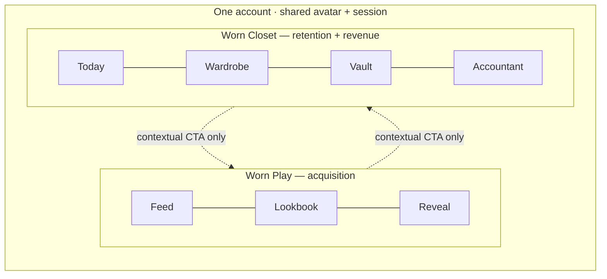
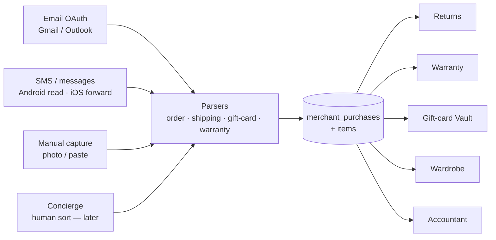

# WORN Universe — Architecture & Sequencing

> Extends `IMPLEMENTATION_PLAN.md` (Phase I MVP) and `worn-spec.html`.
> Scope: the 8-module expansion from *fantasy try-on* into an **operating system for the user's real closet and clothing money**. Two parts: **(A)** system architecture — the platform spine + a per-module build spec grounded in the current schema; **(B)** prioritization + a phased roadmap.
> Companion visual: "Worn Universe — Build Sequence" (Artifact) renders Part B.

---

## 0. Principles locked from the tension review

These four decisions from the product review constrain everything below.

| # | Decision | Architectural consequence |
|---|---|---|
| 1 | **Two emotional modes stay separated.** Fantasy (dopamine) and utility (money/chores) never share a screen. Cross-links only via a contextual CTA where a specific screen needs it. | Two Expo Router surfaces under one account — `(tabs)` = **Worn Play**, new `(closet)` = **Worn Closet**. Shared session/avatar stores; separate feature stores and tab bars. (§1) |
| 2 | **Ingestion is a platform, not a feature.** Sources: email + SMS/messages (iOS + Android), manual capture, and — later — a **human concierge** who also sorts wardrobes and lists items to **donate / sell / barter**. | A shared **Ingestion Service** (`worker-ingest`) that normalizes everything into one `merchant_purchases` graph, plus a **Disposition marketplace**. Built once; four modules consume it. (§2.1, §2.4) |
| 3 | **Regional, not India-only.** The blouse vault generalizes: customization isn't limited to neckline/pattern, and options render per region. | `BlouseBank` → **Fit & Customization Vault** with region-scoped `customization_templates`. India (saree-blouse + kurti) is the launch pack, not the ceiling. (§3, WV-06) |
| 4 | **The trust bar just rose.** Holding receipts, card balances, email/SMS scope and a real financial ledger is a higher bar than fantasy renders. | A first-class **Trust/Vault layer**: `consent_grants` (formalizing today's `users.consentFlags`), encryption-at-rest, scoped/revocable consent, export + hard-delete, audit log. Gates every ingestion + money module. (§2.2) |

---

## 1. The two-surface information architecture

One account, two apps-in-an-app. The Play surface is the acquisition engine (already built); the Closet surface is retention + revenue.

```
apps/mobile/app/
├─ _layout.tsx                 # root stack + a Play⇄Closet switcher (shared session/avatar)
├─ (tabs)/                     # ─── WORN PLAY (exists) ─── fantasy loop
│   ├─ feed.tsx  lookbook.tsx  profile.tsx
├─ (closet)/                   # ─── WORN CLOSET (new) ─── utility loop
│   ├─ _layout.tsx             # its own tab bar
│   ├─ today.tsx               # Morning Outfit (WV-04)
│   ├─ wardrobe.tsx            # Digital Wardrobe + Waste (WV-04/05)
│   ├─ vault.tsx               # Money: gift cards, returns, warranties (WV-01/02/03)
│   └─ accountant.tsx          # P&L + budgets (WV-08)
└─ listing/[id]  order/[id]  reveal/[orderId]  …   # Play detail stacks (exist)
```

**Bridge rule:** no blended screens; a cross-surface jump is always an explicit CTA, and only where the screen earns it. Sanctioned bridges:

- Play checkout success → *"Track this real purchase in your Closet"* (seeds `merchant_purchases`).
- Waste Tracker dead item → *"See it restyled"* → Play try-on (the one place fantasy serves utility).
- Closet Wardrobe → *"Find the real thing"* → Play affiliate CTA (`cashback_events`).



---

## 2. The platform spine (build once — everything sits on it)

Four shared services do the heavy lifting; the eight modules are relatively thin on top.

### 2.1 Ingestion Service — `worker-ingest`

The real engineering bet. One pipe, many sources, one output graph.



- **Email:** read-only OAuth (Gmail/Outlook). Highest-coverage source; start here.
- **SMS/messages:** Android can read order/shipping/gift-card texts (SMS Retriever / user-granted read); **iOS blocks SMS read** — use share-sheet forwarding + a forwarding address. Design the parser source-agnostic so the iOS gap is a UX detail, not an architecture fork.
- **Manual + Concierge:** same `merchant_purchases` write path; concierge is just an authenticated operator writing on the user's behalf (later).
- New tables: `ingestion_sources`, `ingestion_documents`, `merchant_purchases`, `merchant_purchase_items` (see §4).
- Reuses: the **BullMQ delayed-job pattern already proven in `worker-orders`** for scheduled re-syncs; R2 for raw document storage; `users.consentFlags` → `consent_grants`.

### 2.2 Trust / Vault layer

- `consent_grants` — append-only, per-scope (email, sms, financial), revocable, audited. Supersedes the boolean `users.consentFlags` (migrate it in).
- Encryption-at-rest for documents/balances; signed-URL-only access (as avatars already do); on-device-first parsing where feasible.
- `DELETE /vault` hard-delete + `GET /vault/export` (DPDP/GDPR) — extend the existing `DELETE /avatar` cascade discipline to the whole graph.
- Every ingestion/money route checks a live consent grant before reading.

### 2.3 Money Ledger v2

Generalize the proven `coin_ledger` primitive (append-only, signed `delta`, `balanceAfter`, `refType`/`refId`) to real money and store credit.

- `money_accounts` (kind: `CASH | STORE_CREDIT | GIFT_CARD`, merchant, currency, `balanceCacheMinor`, `expiresAt`).
- `money_ledger` — identical shape to `coin_ledger`, in **minor units** (paise/cents), one row per movement, serializable-tx writes with a row lock (same rule as coin spends).
- Powers the Gift-card Vault (WV-02) and rolls up into the Accountant (WV-08).

### 2.4 Disposition marketplace (sell / donate / barter)

- `disposition_listings` (wardrobe item → mode `SELL | DONATE | BARTER`, price, status). Reuses `sellers` + `listings`/affiliate rails.
- Fed by the Waste Tracker (dead items) and the Concierge (bulk sort-out).

---

## 3. Module build spec

Effort: **S** ≈ days on existing infra · **M** ≈ 1–2 wks · **L** ≈ marketplace/coverage-bound. "Reuses" names real current tables/services.

### WV-01 · Return Concierge  · Orbit: Recover · Geo: Global · Effort: **L** (ingestion-bound)
- **Does:** every return window tracked, drafted, chased to refund.
- **Reuses:** the `orders` **state-machine + `stateEta` + BullMQ ladder** (a return is a tracked, timed process — same engine); `push_events`; `merchant_purchases`.
- **New:** `return_requests` (purchase/item ref, `windowDeadline`, `state`, `refundMinor`, method, tracking), `return_events` (audit).
- **API:** `GET /returns` · `POST /returns/:id/initiate` · `POST /returns/:id/confirm` · `GET /returns/:id`.
- **Jobs:** deadline reminders as delayed jobs keyed to `windowDeadline`; refund reconciliation vs `money_ledger`.

### WV-02 · Gift Card & Store Credit Vault · Recover · Global · Effort: **S**
- **Does:** every card, credit and refund-to-credit in one wallet, spent before expiry.
- **Reuses:** **Money Ledger v2** (which is the `coin_ledger` shape); `push_events` for expiry; Vault.
- **New:** `money_accounts` rows (kind `GIFT_CARD`/`STORE_CREDIT`) + `money_ledger`.
- **API:** `GET /credits` · `POST /credits` (add) · `GET /credits/:id/transactions` · `POST /credits/:id/spend`.

### WV-03 · Warranty & Receipt Vault · Recover · Global · Effort: **M**
- **Does:** snap a receipt; Worn files the warranty and one-taps the claim before it lapses.
- **Reuses:** **R2 upload pipeline** (as avatar uploads); Ingestion; `push_events`; OCR (new dependency).
- **New:** `receipts` (image key, merchant, `purchasedAt`, `totalMinor`, `ocrJson`), `warranties` (receipt/item ref, `coverageUntil`, provider, claim contact, `state`).
- **API:** `POST /receipts` (multipart) · `GET /receipts` · `GET /warranties` · `POST /warranties/:id/claim`.
- **Feeds:** item prices — the spine that makes cost-per-wear (WV-05) and the Accountant (WV-08) real.

### WV-04 · Digital Wardrobe + Morning Outfit Generator · Run the closet · Global · Effort: **M–L**
- **Does:** your real closet digitized; an outfit chosen each morning for weather, calendar and what's clean.
- **Reuses (the moat's second payoff):** **avatar + render pipeline** — point FASHN try-on at *owned* garments, not just `listings`; `tryon_previews` cache pattern; `users.styleProfile` for ranking; `push_events` (morning nudge).
- **New:** `wardrobe_items` (source, category, colors, brand, `costMinor`, image keys, `garmentImageKey`, `purchaseItemId?`), `outfits` (item ids, occasion, weather ctx, generated), `wear_log` (ref item/outfit, `wornOn`).
- **API:** `GET/POST /wardrobe` · `POST /wardrobe/:id/tryon` · `GET /outfits/today` · `POST /wear`.
- **Jobs:** nightly outfit generation (weather + calendar + clean-state + taste) → morning push.
- **Feeds:** the **`wear_log` is the single highest-value new signal** — powers WV-05, WV-08 and taste.

### WV-05 · Style Waste Tracker · Run the closet · Global · Effort: **S** (rides WV-03/04 data)
- **Does:** cost-per-wear, dead inventory, and what to sell/donate/barter.
- **Reuses:** `wear_log` (WV-04), prices (WV-03 `receipts` / `merchant_purchases`), `wardrobe_items`.
- **New:** materialized `item_metrics` (`wearCount`, `lastWornAt`, `costPerWearMinor`, status `ACTIVE|DORMANT|DEAD`).
- **API:** `GET /waste/summary` · `GET /waste/dead` · `POST /waste/:item/dispose` → Disposition marketplace.

### WV-06 · Fit & Customization Vault (was BlouseBank) · Run the closet · Global, India-first · Effort: **L**
- **Does:** every measurement, design and fabric saved; restitch/reorder a customized garment in one tap. Region-aware options.
- **Reuses:** **`avatars.bodyMeta`** (measurements); R2 (design/fabric photos); render preview; **`sellers`** rails (tailor network); the `orders` **state-machine** for tailoring orders.
- **New:** `measurement_profiles` (region, points jsonb, unit), `customization_templates` (region, `garmentType` `BLOUSE|KURTI|SUIT|…`, options schema jsonb — neckline/pattern/sleeve/hem…), `tailoring_orders` (template, selections, fabric ref, tailor, measurement snapshot, `state`). Extend `sellers` with a `sellerType`.
- **API:** `GET/POST /fit/measurements` · `GET /fit/templates?region=` · `POST /fit/orders` · `GET /fit/orders/:id`.
- **Launch pack:** India — saree-blouse + kurti neckline/pattern/sleeve templates. Region packs extend the same schema.

### WV-07 · Gift Intelligence Engine · Point taste outward · Global (+IN festivals) · Effort: **L**
- **Does:** know exactly what to buy anyone — their taste, sizes, wishlist and every occasion.
- **Reuses:** `users.styleProfile` + avatar sizes; the lookbook social graph (Phase II); **`cashback_events` + `listings.affiliateUrl`** commerce rails; `push_events` (occasions).
- **New:** `recipients` (relationship, region), `recipient_profiles` (sizes, taste tags, wishlist refs, `importantDates` jsonb), `gift_plans` / `gift_orders`.
- **API:** `GET/POST /recipients` · `GET /recipients/:id/ideas` · `POST /gifts` (affiliate order) · occasion reminders.
- **Feeds:** a **recipients graph** — turns a solo app into a taste network; the universe's clearest real-GMV engine.

### WV-08 · Wardrobe Accountant · Settlement layer · Global · Effort: **M** (roll-up)
- **Does:** the P&L of your closet — spend, cost-per-wear, ROI, budgets, by category.
- **Reuses:** **Money Ledger v2**; feeds from `merchant_purchases`, `receipts`, `return_requests`, `money_accounts`, `item_metrics`.
- **New:** `budgets` (category, period, `limitMinor`), materialized `spend_rollups`.
- **API:** `GET /accountant/summary` · `GET /accountant/ledger` · `GET/POST /budgets`.
- **Hook:** budgets can gate the Play loop too (spend-awareness nudge at checkout) — the one place the ledger touches fantasy.

---

## 4. Data model additions (grouped)

All tables carry `id uuid pk`, `created_at`, `updated_at` (via the existing `columns.ts` helpers) and FK to `users` where user-scoped.

- **Spine:** `ingestion_sources`, `ingestion_documents`, `merchant_purchases`, `merchant_purchase_items`, `consent_grants`, `money_accounts`, `money_ledger`, `disposition_listings`.
- **Modules:** `return_requests`, `return_events`, `receipts`, `warranties`, `wardrobe_items`, `outfits`, `wear_log`, `item_metrics`, `measurement_profiles`, `customization_templates`, `tailoring_orders`, `recipients`, `recipient_profiles`, `gift_orders`, `budgets`, `spend_rollups`.
- **New enums:** `ingestion_source_kind`, `document_kind`, `money_account_kind`, `money_ledger_type`, `return_state`, `warranty_state`, `wear_ref_type`, `garment_type`, `disposition_mode`.
- **Alterations:** `sellers.sellerType`; migrate `users.consentFlags` → `consent_grants`.

## 5. API + services additions

- **Route modules** (mirror the current one-plugin-per-domain pattern in `apps/api/src/routes/`, register in `routes/index.ts`): `ingestion.ts`, `vault.ts`, `returns.ts`, `credits.ts`, `receipts.ts`, `warranties.ts`, `wardrobe.ts`, `outfits.ts`, `waste.ts`, `fit.ts`, `gifts.ts`, `accountant.ts`, `disposition.ts` + provider webhooks in `webhooks.ts`.
- **Workers:** add `services/worker-ingest` (email/SMS sync + parse). Deadline/nudge jobs (return windows, warranty + gift-card expiry, morning outfit, gift occasions) reuse the **proven delayed-job scheduler in `worker-orders`** — add a `worker-nudge` only if volume warrants.
- **Shared:** new zod DTOs + economy/config constants in `packages/shared`; Drizzle tables + migrations in `packages/db` (same structure as today).

---

# Part B — Prioritization & sequencing

## 6. Scorecard

Scored **L/M/H**. *Build* is effort (lower is faster to ship); the rest are higher-is-better.

| Module | Pull | Build (effort) | Reuse | Flywheel | Revenue |
|---|:--:|:--:|:--:|:--:|:--:|
| WV-02 Gift-Card Vault | H | **S** | H | M | M |
| WV-04 Wardrobe + Outfits | H | M–L | H | **H** | M |
| WV-03 Warranty/Receipt Vault | M–H | M | M | **H** | M |
| WV-05 Waste Tracker | M–H | **S** | H | M | M |
| WV-08 Wardrobe Accountant | M | M | H | M | **H** |
| WV-07 Gift Engine | H | L | M | M | **H** |
| WV-06 Fit/Customization Vault | H | L | M | M | **H** |
| WV-01 Return Concierge | H | L | H | M | M |

**Reading:** the cheap, high-reuse wins (WV-02, WV-05) build trust and seed the graph; the flywheel anchors (WV-03 prices, WV-04 wear-log) unlock everyone else; the revenue anchors (WV-07/06/08) are heavier and are best sequenced after the data + trust exist.

## 7. Phased roadmap

- **P0 — Platform spine (build once, largely parallel).** Ingestion v1 (email/Gmail first; Android SMS), Trust/Vault (consent_grants + export/delete), Money Ledger v2 (generalize `coin_ledger`), two-surface IA shell (`(closet)` group + switcher). *Nothing user-facing ships without this; it is the real bet.*
- **P1 — Found-money wedges.** **WV-02 Gift-Card Vault** → **WV-03 Warranty & Receipt Vault**. Cheap, delightful, viral; lowest trust risk; seeds `merchant_purchases` + prices.
- **P2 — Retention engine.** **WV-04 Wardrobe + Morning Outfits** (the render moat's second payoff) → **WV-05 Waste Tracker** (rides the new wear-log + prices).
- **P3 — Legibility + recovery.** **WV-08 Accountant** (rolls up P1/P2 data) + **WV-01 Return Concierge** (needs mature ingestion + merchant coverage).
- **P4 — Commerce, network, regional depth, human layer.** **WV-07 Gift Engine** (GMV) + **WV-06 Fit/Customization Vault** (India blouse/kurti launch → region packs) + **Disposition marketplace** (sell/donate/barter) + **Concierge service** (human ingestion & sort-out).

**Why this order:** spine once → cheapest trust-building found-money wins that also build the purchase graph → make retention the render moat's second payoff → make the money legible and recover it → then the heavy marketplaces, network and human ops, once the data graph and trust are proven.

## 8. Open questions (resolve before the phase they gate)

- **iOS SMS gap** — is forwarding-address UX acceptable, or is email-only enough for P1? (gates P0 ingestion scope)
- **Merchant coverage** — how many merchants must parse cleanly before Return Concierge feels magic vs flaky? (gates P3)
- **Money Ledger truth** — is Worn the source of truth for balances, or a mirror of merchant state? Affects reconciliation + liability. (gates P1)
- **Concierge unit economics** — human sort-out cost vs resale/tailoring take-rate. (gates P4)
- **Likeness/data licensing** — carrying real receipts + email scope raises the bar set in `IMPLEMENTATION_PLAN.md §12`; extend it before P1 ships.
