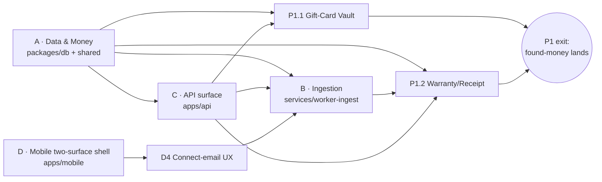

# WORN Universe — Dev Plan (P0 + P1)

> Executable plan derived from `UNIVERSE_ARCHITECTURE.md`. Task-level for **P0 (platform spine)** and **P1 (found-money wedges)** — what the team builds next. P2–P4 stay at the milestone level in the architecture doc; they're planned in detail once P0/P1 data exists (planning them now would be speculative).
> Voice matches `IMPLEMENTATION_PLAN.md`: decisive defaults, task tables, acceptance criteria, spikes pulled forward.

---

## 0. Assumptions & guardrails

- **Stack is already in place** — pnpm+Turbo monorepo, Fastify+Drizzle API (route-module-per-domain in `apps/api/src/routes/`), BullMQ workers (`services/worker-*`), Expo Router app (`apps/mobile/app/` with route groups), Postgres+Redis via `infra/docker-compose.yml`, vitest. New work **extends** these patterns; no new frameworks.
- **Team baseline:** ~2–3 engineers. Estimates are rough engineer-days (**pre-spike**); the four P0 workstreams parallelize, so with 4–5 eng the calendar compresses (§6).
- **The bet P1 validates:** does the *utility* loop's core promise — **"found money"** — land, and does ingestion parse real inboxes well enough to feel magic? Everything heavier waits on that.
- **Do-first cleanups (½ day, unblock prod):** reconcile the env drift already flagged — code reads `JWT_SECRET` / `PORT` / `HOST` ([apps/api/src/index.ts:43](apps/api/src/index.ts:43), [:72](apps/api/src/index.ts:72)) but `.env` defines `JWT_ACCESS_SECRET`/`JWT_REFRESH_SECRET` / `API_PORT` / `API_HOST`; and fix the `launch.json` `design-system` path (`design-system` → `docs/design-system`).

## 1. Workstream map & dependencies

Four P0 workstreams (A–D) pour the spine; P1 sits on top. A is the root dependency; D (mobile shell) has no backend dependency and starts immediately in parallel.

**Critical path = ingestion parser accuracy** (§5 spike). P1.1 (Gift-Card) deliberately depends only on A, so a user-facing win can ship *before* ingestion is mature, via manual entry.

---

## 2. P0 · Workstream A — Data & Money foundation
`packages/db/src/schema/*`, `packages/shared/*`. Every table uses the existing `id()`/`timestamps` helpers from `columns.ts`.

| Task | Deliverable | Deps | Est |
|---|---|---|:--:|
| A1 Consent schema | `consent_grants` (userId, `scope` enum `EMAIL\|SMS\|FINANCIAL\|LIKENESS`, grantedAt, revokedAt, source, meta) + `consent_scope` enum; dual-read with existing `users.consentFlags` | — | 1.5d |
| A2 Money Ledger v2 | `money_accounts` (kind `CASH\|STORE_CREDIT\|GIFT_CARD`, merchant, currency, `balanceCacheMinor`, expiresAt, status) + `money_ledger` (same shape as `coin_ledger`, minor units) + enums; extract a shared **`postLedgerEntry`** write helper (serializable tx + row lock) reused by coins and money | — | 3d |
| A3 Purchase graph | `merchant_purchases` (source enum, merchant, orderRef, purchasedAt, currency, `totalMinor`, status, rawDocId) + `merchant_purchase_items` (title, category, `priceMinor`, imageKey, qty) | — | 2d |
| A4 Ingestion tables | `ingestion_sources` (kind, provider, consentGrantId, status, cursor, lastSyncAt) + `ingestion_documents` (kind, rawKey→R2, parsedJson, matchedPurchaseId, status) | A1 | 1.5d |
| A5 Shared contracts | zod DTOs for all above in `packages/shared`; money helpers (minor-unit math, currency); consent-scope constants | A1–A4 | 1.5d |

**Acceptance:** migrations run clean up **and** down; Drizzle types exported from `@worn/db`; unit tests on `postLedgerEntry` cover double-spend guard + `balanceAfter` correctness (mirror the existing coin-ledger tests). No feature reads a balance except through the helper.

## 3. P0 · Workstream B — Ingestion service
New `services/worker-ingest` — scaffold from `services/worker-orders` (BullMQ consumer: `index.ts` + consumer + tests).

| Task | Deliverable | Deps | Est |
|---|---|---|:--:|
| B1 Scaffold | Package + BullMQ consumer wiring + queue names in `packages/shared` | A | 1d |
| B2 Email connector | Gmail read-only OAuth, encrypted token store, incremental sync (historyId cursor), candidate-message filter; behind an `EmailConnector` interface (Outlook later) | A4, C2 | 4d |
| B3 Parser framework | Pluggable per-merchant parsers → `merchant_purchases`/items + `ingestion_documents`; generic heuristic parser + **top 5 merchants** (India + global); emit coverage/miss metric | B2 | 5d |
| B4 SMS ingest (Android) | Server-side parse endpoint the app posts SMS to; iOS uses forwarding-address → email connector (no separate iOS SMS path) | C2 | 2d |
| B5 Re-sync scheduler | Periodic per-source sync via the BullMQ **delayed-job pattern already in worker-orders** | B2 | 1d |

**Acceptance:** against a fixture inbox, the worker writes correct `merchant_purchases` rows; a **consent grant is checked before any read**; coverage metric is emitted per run. **Gate at B3** — see §5.

## 4. P0 · Workstream C — API surface
`apps/api/src/routes/` — add modules, register in `routes/index.ts` (same one-plugin-per-domain pattern).

| Task | Deliverable | Deps | Est |
|---|---|---|:--:|
| C1 `vault.ts` | `POST /vault/consent`, `DELETE /vault/consent/:scope`, `GET /vault/export`, `DELETE /vault` (hard-delete cascade — extend the existing `DELETE /avatar` discipline) | A1 | 2d |
| C2 `ingestion.ts` + webhooks | `POST /ingestion/sources` (returns OAuth URL), `GET /ingestion/sources`, `POST /ingestion/sms`; email push webhook in `webhooks.ts` | A4 | 2d |
| C3 `credits.ts` (read) | `GET /credits`, `GET /credits/:id/transactions` — consumed by P1.1 | A2 | 1d |
| C4 Consent guard | A `preHandler` that verifies a live grant before any ingestion/money route; rate limits; shared zod schemas | A1 | 1d |

**Acceptance:** routes typed + zod-validated; auth **and** consent guards covered by inject tests (like `routes.test.ts`); tags/OpenAPI consistent with existing routes.

## 5. P0 · Workstream D — Mobile two-surface shell
`apps/mobile/app/` — add the Closet surface beside the existing Play `(tabs)`.

| Task | Deliverable | Deps | Est |
|---|---|---|:--:|
| D1 `(closet)` group | New route group + `_layout.tsx` tab bar with placeholders: today / wardrobe / vault / accountant | — | 2d |
| D2 Surface switcher | Play⇄Closet control in root `_layout.tsx`; persist last surface in the `session` store | D1 | 1d |
| D3 State split | Keep `session`/avatar shared (Zustand); add `closet` store + a TanStack Query hooks namespace | D1 | 1d |
| D4 Connect-email UX | OAuth webview flow + transparency/consent screens (the gate for ingestion) | D1, C2 | 2.5d |

**Acceptance:** both surfaces navigable; switcher persists; connect-email reaches the OAuth screen; **all existing Play tests stay green** (no regression).

### Cross-cutting P0
Encryption-at-rest for OAuth tokens + documents (KMS/lib), signed-URL access (reuse the avatar pattern), an audit-log row on every consent change + financial read. Extend Turbo pipelines to the new worker package + a **migration check** in CI. Ingestion cost/coverage dashboards; Sentry already present.

---

## 6. Calendar (small team; 6 weeks, mirrors Phase I cadence)

| Week | Focus | Ships |
|---|---|---|
| 1 | A1–A3 schema + migrations · D1–D2 shell · **env cleanups** · **spike: parser accuracy** on real receipts (§5) | Migrations green; Closet shell navigable |
| 2 | A2 `postLedgerEntry` + tests · C1 vault · B1–B2 email OAuth · D4 connect-email UX · **gate: parser accuracy acceptable?** | Consent + connect-email end-to-end |
| 3 | B3 parser framework + top-5 merchants · C2 ingestion routes · A4 tables · encryption/audit | Real inbox → `merchant_purchases` |
| 4 | **P1.1 Gift-Card Vault** end-to-end | Internal build: real gift-card balances |
| 5 | **P1.2 Warranty/Receipt Vault** + OCR · expiry nudges | Receipts parsed; warranty reminders fire |
| 6 | Hardening: export/delete flows · coverage + "found-money" analytics · EAS → TestFlight/Play internal · transparency copy | **Beta to ~20–50 users** |

**Scale note:** with 4–5 engineers, A/B/C/D run concurrently and this compresses to ~4 weeks — but the **parser-accuracy gate (wk 1–2) stays on the critical path regardless of headcount.**

---

## 7. P1 · Found-money wedges (task-level)

### P1.1 — Gift-Card & Store-Credit Vault · Effort **S** · rides A2
| Task | Deliverable |
|---|---|
| Schema | Uses `money_accounts` (GIFT_CARD/STORE_CREDIT) + `money_ledger` — no new tables |
| API `credits.ts` | `POST /credits` (add), `GET /credits`, `GET /credits/:id/transactions`, `POST /credits/:id/spend` — idempotent |
| Jobs | Expiry reminders via BullMQ delayed jobs → `push_events` |
| Mobile | Vault → Gift Cards: add (manual first; ingestion auto-fill later), balances + expiry badges, mark-spent; surface total "found money" |

**Acceptance:** add/spend round-trips through `money_ledger`; concurrent spend is race-safe (row-lock test); expiry push fires. **Fastest user-facing ship — needs no ingestion.**

### P1.2 — Warranty & Receipt Vault · Effort **M** · rides A3/A4 + R2 + OCR
| Task | Deliverable |
|---|---|
| Schema | `receipts` (imageKey, merchant, purchasedAt, `totalMinor`, ocrJson, purchaseId?) · `warranties` (receipt/item ref, coverageUntil, provider, claimContact, `state` enum) |
| OCR | Integrate an OCR provider (**spike: hosted vs on-device**, cost + quality) → prefill receipt fields |
| API | `POST /receipts` (multipart — reuse the avatar upload pipeline), `GET /receipts`, `GET /warranties`, `POST /warranties/:id/claim` |
| Jobs | Warranty-expiry reminders (delayed) → push |
| Mobile | Vault → Receipts & Warranties: snap → review parsed fields → save; warranty list with expiry; one-tap claim |

**Acceptance:** receipt image → parsed `receipts` row; **prices written into `merchant_purchases`** (this is what later unlocks Waste Tracker + Accountant); warranty reminder fires.

### P1 exit criteria
A beta user connects email (or adds a card manually), sees **real** gift-card balances and ≥1 tracked warranty/receipt, and receives an expiry nudge. Ingestion parser coverage is **measured on real inboxes**. Trust flows (consent, export, hard-delete) work end-to-end. → the utility loop's "found money" promise is validated before any heavier module.

---

## 8. Risks & spikes (pull forward)

| Risk | Spike / decision | When |
|---|---|---|
| **Parser accuracy** (make-or-break) | Match rate on a seed set of real receipts before investing in breadth | Wk 1, gate Wk 2 |
| **Money-ledger truth** | Is Worn source-of-truth or a mirror of merchant balances? (reconciliation + liability) | Before A2 lands |
| **iOS SMS gap** | Is forwarding-address UX acceptable, or email-only for P1? | Before B4 |
| **OCR quality/cost** | Hosted vs on-device provider | Before P1.2 |
| **Trust/security review** | Real financial data raises the bar in `IMPLEMENTATION_PLAN.md §12` — review before P1 ships | Before Wk 6 |

## 9. Definition of done (every milestone)
Migrations up/down clean · Drizzle types · vitest unit + inject/integration tests · consent-gated · rate-limited · Sentry wired · analytics events emitted · docs updated · the new surface behind a feature flag.

## 10. Immediate next actions
1. Land the **do-first cleanups** (§0) — ½ day, unblocks prod config.
2. Start **A1–A3** (schema + migrations) and **D1–D2** (shell) in parallel — neither blocks the other.
3. Kick the **parser-accuracy spike** on a real seed inbox now — it gates everything downstream.

> Say the word and I'll execute step 2's first slice: the `consent_grants` + Money-Ledger-v2 migrations and the `(closet)` route-group shell.
